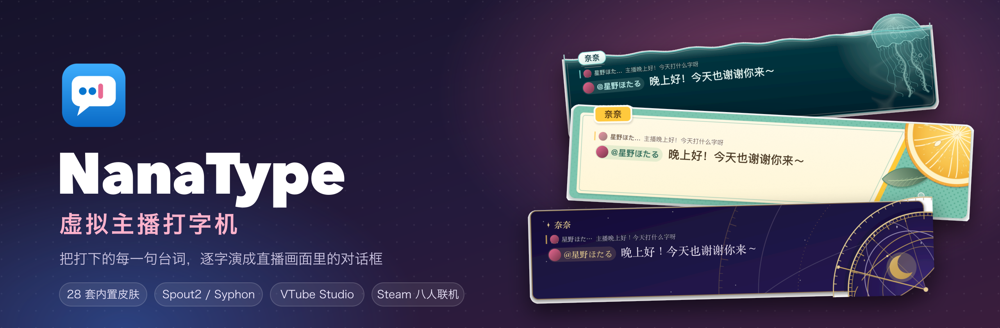
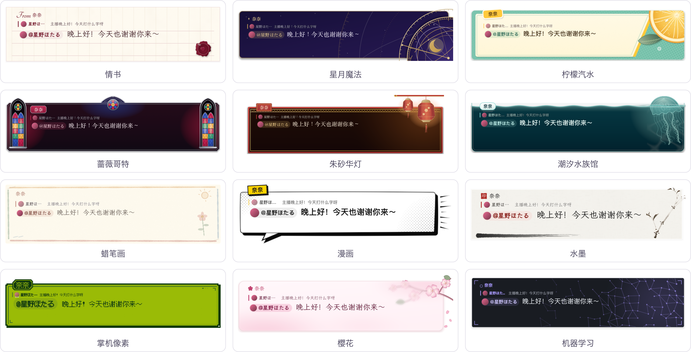
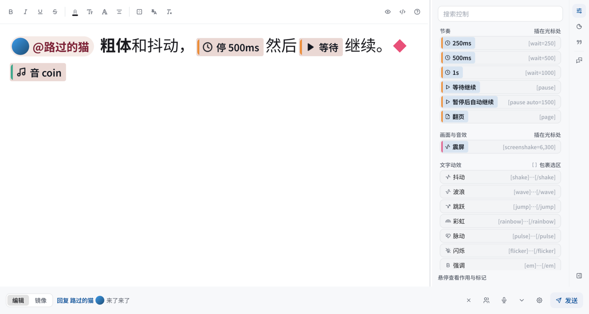

<p align="center">
  
</p>

<h3 align="center">Every line you type, played out letter by letter as a visual-novel / RPG dialogue box on stream</h3>

<p align="center">
  <a href="https://github.com/sena-nana/NanaType/releases"></a>
  <a href="https://github.com/sena-nana/NanaType/actions/workflows/ci.yml"></a>
  
  
  <a href="LICENSE-MIT"></a>
</p>

<p align="center">
  <a href="https://github.com/sena-nana/NanaType/releases"><b>Download</b></a> ·
  <a href="docs/en/README.md"><b>Documentation</b></a> ·
  <a href="docs/en/markup.md"><b>Dialogue markup</b></a> ·
  <a href="docs/en/skins.md"><b>Making skins</b></a> ·
  <a href="docs/en/building.md"><b>Building from source</b></a>
</p>

<p align="center">
  <a href="README.md">简体中文</a> · <b>English</b> · <a href="README.ja.md">日本語</a><br>
  <sub>The app UI is available in Simplified Chinese, English and Japanese</sub>
</p>

---

NanaType is a streaming typewriter built for VTubers. You type in the input box, and the display box reveals your line at a typewriter pace, complete with pauses, screen shake, portrait variants and per-character effects. A history window keeps everything you've said, styled like a live chat. Frames go straight to OBS over Spout2 / Syphon with no CPU readback, and output keeps running even while the windows are hidden.

<p align="center">
  
  <br>
  <sub>12 of the 28 built-in skins, all real GPU renders</sub>
</p>

## ✨ Features

<table>
  <tr>
    <td width="50%" valign="top">
      <h4>⌨️ WYSIWYG input box</h4>
      Edit right inside the skin preview, with line breaks exactly as they'll appear on stream. Bold, colour, outline, ruby, motion effects and timing are all supported, and you can switch to the raw markup at any time. The side panel holds commands, stickers and saved phrases.
    </td>
    <td width="50%" valign="top">
      <h4>🎬 Typewriter display box</h4>
      A transparent overlay reveals each line letter by letter, with pauses, page turns, screen shake, sound effects and portrait variants. Choose "edit, then send", or have the display mirror what you're typing in real time.
    </td>
  </tr>
  <tr>
    <td valign="top">
      <h4>🎨 28 built-in skins</h4>
      From Love Letter, Crayon and Parchment to Terminal, Pocket Pixel and the Echo-Live styles. Skins are <code>.ntpkg</code> packages in a single unified format: they can inherit from each other, hot-reload, and use sandboxed WGSL effects and sandboxed Lua / Wasm plugins.
    </td>
    <td valign="top">
      <h4>📺 Zero-copy OBS output</h4>
      Spout2 on Windows and Syphon on macOS share the GPU texture directly. The display box, online partners and history can each be sent as a separate output, or you can capture the transparent windows instead.
    </td>
  </tr>
  <tr>
    <td valign="top">
      <h4>🎙️ Voice input</h4>
      Uses the system recogniser first, with an optional small multilingual offline model. Sends automatically after you pause, and steps aside while you edit.
    </td>
    <td valign="top">
      <h4>🤝 Steam online play</h4>
      Up to 8 people per room. Partners' lines show up live in everyone's display box, with one shared history. Connects directly when it can, and through Steam relays when it can't.
    </td>
  </tr>
  <tr>
    <td valign="top">
      <h4>🔗 Streaming tool integration</h4>
      VTube Studio expressions, hotkeys, parameters and lip sync, triggered by markup at the exact typing position. OSC and a local WebSocket broadcast are also available.
    </td>
    <td valign="top">
      <h4>💬 Live chat</h4>
      Read and send Twitch chat. You can also bring in <a href="https://github.com/xfgryujk/blivechat">blivechat</a>, connect straight to the <a href="https://huixinghao.cn/">Comet (彗星号)</a> client, or connect a <a href="https://github.com/laplace-live/event-bridge">LAPLACE Event Bridge</a> (with LAPLACE joining by auth code only), which relay Bilibili, Douyin and Kuaishou comments.
    </td>
  </tr>
  <tr>
    <td valign="top">
      <h4>😺 Stickers</h4>
      Import a local folder, Echo-Live emotes or Telegram sticker packs. Animated GIF / WebP / TGS / WebM stickers play both in the display box and in the OBS output.
    </td>
    <td valign="top">
      <h4>🧰 Package editor</h4>
      The standalone <a href="docs/en/package-editor.md">NanaType Editor</a> is for building, signing and debugging skin packages and plugins in isolation.
    </td>
  </tr>
</table>

<p align="center">
  
  <br>
  <sub>The input box: pauses, continues, sound effects and other markup appear as inline tags, wrapped exactly like the display box</sub>
</p>

## 🚀 Quick start

1. Download the Windows installer / portable build or the macOS `.dmg` from [Releases](https://github.com/sena-nana/NanaType/releases).
2. After launch, the input box appears near the bottom of the screen; the display box and history are transparent overlays.
3. Type and press **Enter** to send (**Shift+Enter** for a new line). The display box starts playing your line letter by letter.
4. In OBS, add a *Spout2 Capture* (Windows) or *Syphon Client* (macOS) source, pick `NanaType Display`, and set the composite mode to *Premultiplied Alpha*.

### Common shortcuts

| Shortcut | Action |
| --- | --- |
| <kbd>F8</kbd> | Bring up the input box |
| <kbd>F9</kbd> | Continue: get past a pause / skip the current section |
| <kbd>Ctrl</kbd>+<kbd>↑</kbd> / <kbd>↓</kbd> | Recall lines you've already sent |
| <kbd>Ctrl</kbd>+<kbd>B</kbd> / <kbd>I</kbd> / <kbd>U</kbd> | Bold / italic / underline |
| <kbd>Esc</kbd> | Hide the input box |

For Twitch, live chat, online play, multiple OBS outputs, stickers and more, see the **[user guide](docs/en/usage.md)**.

## ✍️ Dialogue markup

Every effect you apply from the toolbar is stored as BBCode-style markup, shared by source mode, quick phrases and templates:

```text
[@auto=1500]大家好！[wait=400][b][color=#e86a92]今天[/color][/b]也来[wave]打字[/wave]啦～
[pause][shake amp=2]哇！[/shake][se=coin][expr=smile]
[ruby=かんじ]漢字[/ruby][sticker=cats/hello h=1.6]
```

See [Dialogue markup](docs/en/markup.md) for the full syntax.

## 📚 Documentation

| | |
| --- | --- |
| **Users** | [User guide](docs/en/usage.md) · [Voice input](docs/en/voice-input.md) · [Twitch](docs/en/twitch.md) · [Comet](docs/en/comet.md) · [LAPLACE](docs/en/laplace.md) · [OBS / Spout output](docs/en/obs-spout.md) · [Checking for updates](docs/en/updates.md) · [Steam edition](docs/en/steam.md) |
| **Creators** | [Dialogue markup](docs/en/markup.md) · [Skin format](docs/en/skins.md) · [Plugins and package API](docs/en/plugins.md) · [Package editor](docs/en/package-editor.md) · [Fonts](docs/en/fonts.md) |
| **Developers** | [Building from source](docs/en/building.md) · [Rendering pipeline](docs/rendering-pipeline.md) (Chinese) · [Logging](docs/en/logging.md) |

## 🛠️ Building from source

Requires Rust 1.98+. Dependencies are fetched automatically on the first build.

```bash
cargo run -p nanatype          # NanaType
cargo run -p nanatype-editor   # NanaType Editor
cargo test --workspace --exclude nanatype
```

Platform dependencies, packaging, the Steam edition and development environment variables are covered in [Building from source](docs/en/building.md).

## 💝 Acknowledgements

- The four built-in **Echo-Live Vanilla, Glass, Bubble and Void** skins are based on designs from [sheep-realms/Echo-Live](https://github.com/sheep-realms/Echo-Live), by Sheep-realms and the project's contributors; NanaType reimplements and adapts these styles in its own skin format. For the original project's licensing, see the [Echo-Live license and statement](https://github.com/sheep-realms/Echo-Live/blob/master/copyright.md). The app also links to the original repository under **Settings › About**.
- The sticker presets come from [Echo-Live](https://github.com/sheep-realms/Echo-Live) and the [Sheep-realms EmoteLab extension](https://github.com/sheep-realms/Echo-Live-Sheep-realms-EmoteLab-Extension).
- Twitch support is implemented independently from the official developer documentation; blivechat and LAPLACE Event Bridge support use their public protocols for receiving externally forwarded messages.

## 📄 License

The original code in this repository is licensed under [MIT](LICENSE-MIT). Third-party dependencies, fonts, illustrations and other materials are distributed under their own licenses; see [License scope](LICENSE) and [Third-party notices](THIRD_PARTY_NOTICES.md).
