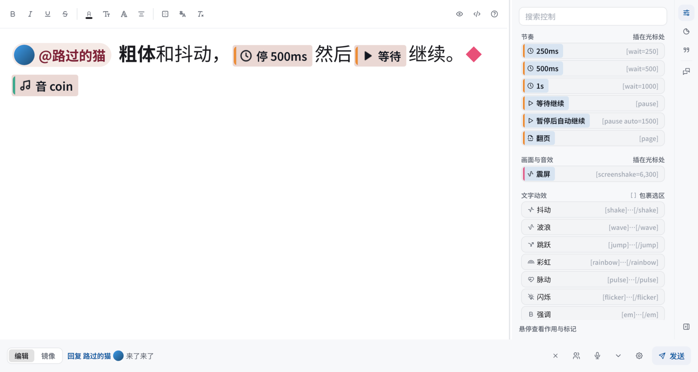

<p align="center">
  
</p>

<h3 align="center">打ち込んだセリフを一文字ずつ、配信画面の ADV / RPG 風ダイアログに</h3>

<p align="center">
  <a href="https://github.com/sena-nana/NanaType/releases"></a>
  <a href="https://github.com/sena-nana/NanaType/actions/workflows/ci.yml"></a>
  
  
  <a href="LICENSE-MIT"></a>
</p>

<p align="center">
  <a href="https://github.com/sena-nana/NanaType/releases"><b>ダウンロード</b></a> ·
  <a href="docs/ja/usage.md"><b>使い方ガイド</b></a> ·
  <a href="docs/ja/markup.md"><b>セリフのマークアップ</b></a> ·
  <a href="docs/ja/skins.md"><b>スキンの作り方</b></a> ·
  <a href="docs/ja/building.md"><b>ソースからビルド</b></a>
</p>

<p align="center">
  <a href="README.md">简体中文</a> · <a href="README.en.md">English</a> · <b>日本語</b><br>
  <sub>アプリの UI は簡体字中国語・英語・日本語に対応しています</sub>
</p>

---

NanaType は VTuber のための配信用タイプライターです。入力ボックスに文字を打つと、表示ボックスがタイプライターのリズムでセリフを一文字ずつ表示します。間（ま）、画面の揺れ、立ち絵の差分、文字ごとのエフェクトにも対応。履歴ウィンドウは配信チャット風に、これまでのセリフを残します。映像は Spout2 / Syphon で OBS に直接送られ、CPU への読み戻しは不要。ウィンドウを隠していても出力は続きます。

<p align="center">
  
  <br>
  <sub>28 種の内蔵スキンのうち 12 種。すべて実際の GPU レンダリングです</sub>
</p>

## ✨ 機能

<table>
  <tr>
    <td width="50%" valign="top">
      <h4>⌨️ WYSIWYG の入力ボックス</h4>
      スキンのプレビュー上で直接編集でき、改行位置も配信画面とまったく同じです。太字・色・縁取り・ルビ・動きのエフェクト・タイミングに対応し、マークアップのソース表示にも切り替えられます。右側のパネルにはコマンド、スタンプ、定型文がまとまっています。
    </td>
    <td width="50%" valign="top">
      <h4>🎬 タイプライター表示ボックス</h4>
      透明なオーバーレイウィンドウがセリフを一文字ずつ表示。間、ページ送り、画面の揺れ、効果音、立ち絵の差分に対応します。「編集してから送信」のほか、入力中の文字を表示ボックスにリアルタイムで映すこともできます。
    </td>
  </tr>
  <tr>
    <td valign="top">
      <h4>🎨 28 種の内蔵スキン</h4>
      ラブレター、クレヨン、羊皮紙から、ターミナル、ポケットピクセル、Echo-Live 風まで。スキンは統一形式の <code>.ntpkg</code> パッケージで、継承やホットリロードに対応し、制限付きの WGSL エフェクトやサンドボックス化された Lua / Wasm プラグインも使えます。
    </td>
    <td valign="top">
      <h4>📺 ゼロコピーで OBS へ</h4>
      Windows では Spout2、macOS では Syphon で GPU テクスチャを共有します。表示ボックス、オンラインの相手、履歴はそれぞれ別々に出力でき、透明ウィンドウをキャプチャする方法も選べます。
    </td>
  </tr>
  <tr>
    <td valign="top">
      <h4>🎙️ 音声入力</h4>
      システムの音声認識を優先し、小さな多言語オフラインモデルをダウンロードして使うこともできます。話し終えて間が空くと自動で送信し、編集中は自動で一時停止します。
    </td>
    <td valign="top">
      <h4>🤝 Steam オンライン</h4>
      1 ルーム最大 8 人。相手のセリフがそれぞれの表示ボックスにリアルタイムで現れ、履歴も共有されます。直接つながれるときは直接、無理なときは Steam のリレーを経由します。
    </td>
  </tr>
  <tr>
    <td valign="top">
      <h4>🔗 配信ツール連携</h4>
      VTube Studio の表情・ホットキー・パラメーター・リップシンクに対応し、マークアップで入力位置に合わせて発動できます。OSC とローカル WebSocket での配信も可能です。
    </td>
    <td valign="top">
      <h4>💬 コメント連携</h4>
      Twitch チャットの受信と送信に対応。blivechat プロトコル経由で <a href="https://github.com/xfgryujk/blivechat">blivechat</a> や <a href="https://huixinghao.cn/">彗星号</a>、または <a href="https://github.com/laplace-live/event-bridge">LAPLACE Event Bridge</a> を接続すれば、bilibili・抖音（Douyin）・快手（Kuaishou）のコメントも取り込めます。
    </td>
  </tr>
  <tr>
    <td valign="top">
      <h4>😺 スタンプ</h4>
      ローカルフォルダー、Echo-Live の表情、Telegram のスタンプパックを読み込めます。GIF / WebP / TGS / WebM のアニメーションは、表示ボックスでも OBS 出力でも再生されます。
    </td>
    <td valign="top">
      <h4>🧰 パッケージエディター</h4>
      独立したアプリ <a href="docs/ja/package-editor.md">NanaType Editor</a> で、スキンパッケージやプラグインの作成・署名・隔離デバッグができます。
    </td>
  </tr>
</table>

<p align="center">
  
  <br>
  <sub>入力ボックス：間、続行、効果音などのマークアップはインラインのタグで表示され、改行位置は表示ボックスと一致します</sub>
</p>

## 🚀 クイックスタート

1. [Releases](https://github.com/sena-nana/NanaType/releases) から Windows のインストーラー / ポータブル版、または macOS の `.dmg` をダウンロードします。
2. 起動すると入力ボックスが画面下部に現れます。表示ボックスと履歴は透明なオーバーレイです。
3. 文字を打って **Enter** で送信（**Shift+Enter** で改行）。表示ボックスで一文字ずつ再生が始まります。
4. OBS で *Spout2 Capture*（Windows）または *Syphon Client*（macOS）を追加し、`NanaType Display` を選んで、合成モードを *Premultiplied Alpha* にします。

| ショートカット | 動作 |
| --- | --- |
| <kbd>F8</kbd> | 入力ボックスを呼び出す |
| <kbd>F9</kbd> | 続行：間を飛ばす / 現在の段落をスキップ |
| <kbd>Ctrl</kbd>+<kbd>↑</kbd> / <kbd>↓</kbd> | 送信済みのセリフを呼び戻す |
| <kbd>Ctrl</kbd>+<kbd>B</kbd> / <kbd>I</kbd> / <kbd>U</kbd> | 太字 / 斜体 / 下線 |
| <kbd>Esc</kbd> | 入力ボックスを隠す |

Twitch、コメント連携、オンライン、OBS の複数出力、スタンプなどの詳しい使い方は **[使い方ガイド](docs/ja/usage.md)** をご覧ください。

## ✍️ セリフのマークアップ

ツールバーで付けた効果はすべて BBCode 風のマークアップとして保存され、ソース表示・定型文・テンプレートで共通に使えます。

```text
[@auto=1500]大家好！[wait=400][b][color=#e86a92]今天[/color][/b]也来[wave]打字[/wave]啦～
[pause][shake amp=2]哇！[/shake][se=coin][expr=smile]
[ruby=かんじ]漢字[/ruby][sticker=cats/hello h=1.6]
```

文法の全体は [セリフのマークアップ](docs/ja/markup.md) を参照してください。

## 📚 ドキュメント

| | |
| --- | --- |
| **ユーザー** | [使い方ガイド](docs/ja/usage.md) · [音声入力](docs/ja/voice-input.md) · [Twitch](docs/ja/twitch.md) · [彗星号](docs/ja/comet.md) · [OBS / Spout 出力](docs/ja/obs-spout.md) · [アップデートの確認](docs/ja/updates.md) · [Steam 版](docs/ja/steam.md) |
| **クリエイター** | [セリフのマークアップ](docs/ja/markup.md) · [スキン形式](docs/ja/skins.md) · [プラグインとパッケージ API](docs/ja/plugins.md) · [パッケージエディター](docs/ja/package-editor.md) · [フォント](docs/ja/fonts.md) |
| **開発者** | [ソースからビルド](docs/ja/building.md) · [レンダリングパイプライン](docs/rendering-pipeline.md)（中国語） · [ログ](docs/ja/logging.md) |

## 🛠️ ソースからビルド

Rust 1.98 以降が必要です。依存関係は初回ビルド時に自動で取得されます。

```bash
cargo run -p nanatype          # NanaType
cargo run -p nanatype-editor   # NanaType Editor
cargo test --workspace --exclude nanatype
```

プラットフォームごとの依存関係、パッケージング、Steam 版、開発用の環境変数は [ソースからビルド](docs/ja/building.md) にまとめています。

<details>
<summary><b>プロジェクト構成</b></summary>

| crate | 内容 |
| --- | --- |
| `crates/model` | セリフのドキュメントモデル：テキスト、ルビ、スタンプ、マーカー |
| `crates/markup` | マークアップの解析とシリアライズ、テンプレート |
| `crates/playback` | 表示タイムライン、プレイヤーの状態機械、リアルタイムミラーの差分、キュー |
| `crates/theme` | スキンパッケージ：マニフェスト、継承、検証、インストールとエクスポート |
| `crates/i18n` | Fluent の文言（zh-CN / en-US / ja-JP） |
| `crates/settings` | 設定の構造、バージョン移行、アトミックな書き込み、ウィンドウ位置 |
| `crates/audio` | デコード、ミキシング、サンプル単位のスケジューリング |
| `crates/bridge` | VTube Studio、OSC、WebSocket |
| `crates/twitch` | Twitch IRC の匿名受信、デバイスコードによるログインと Helix での送信 |
| `crates/blive` | blivechat と LAPLACE Event Bridge のクライアント（プロトコル解析、接続と再接続）と彗星号の中継 |
| `integrations/comet` | 彗星号のクリエイティブワークショップ用プラグインページ：彗星号のイベントを blivechat のメッセージに変換 |
| `crates/core` | セッションのロジック：下書き、送信、続行、キュー、履歴、巻き戻し |
| `crates/p2p` | Steam オンライン（最大 8 人）、セッションの順序付け、再接続と画像の転送 |
| `crates/update` | アップデートの確認：署名付きリリースマニフェスト、ファイルプロキシ、検証付きダウンロード |
| `crates/frame` | 2 つのアプリが共有するフレームワーク：スキン描画、UI コンポーネント、スキンプレビュー、プラグインホスト、メディアサービスとパス |
| `app` | NanaType：NanaUI ホスト、ウィンドウ、ビュー、ホットキー、トレイ、Spout |
| `editor` | NanaType Editor：パッケージエディター、署名と隔離デバッグ |

ロジックだけの crate は UI フレームワークに依存せず、単体でテストできます。

</details>

## 💝 謝辞

- 内蔵の **Echo-Live オリジナル、ガラス、バブル、ヴォイド** の 4 スキンは、[sheep-realms/Echo-Live](https://github.com/sheep-realms/Echo-Live)（Sheep-realms とプロジェクトの貢献者による作品）のデザインを参考にしています。NanaType は独自のスキン形式でこれらのスタイルを実装・調整しています。元プロジェクトのライセンスについては [Echo-Live のライセンスと声明](https://github.com/sheep-realms/Echo-Live/blob/master/copyright.md) をご覧ください。アプリの **設定 › 情報** にも元リポジトリへのリンクがあります。
- スタンプのプリセットは [Echo-Live](https://github.com/sheep-realms/Echo-Live) と [Sheep-realms EmoteLab 拡張](https://github.com/sheep-realms/Echo-Live-Sheep-realms-EmoteLab-Extension) に由来します。
- Twitch 連携は公式の開発者ドキュメントに基づいて独自に実装しています。blivechat と LAPLACE Event Bridge は外部から転送されたメッセージを受け取るための公開プロトコルを使っています。

## 📄 ライセンス

このリポジトリのオリジナルコードは [MIT](LICENSE-MIT) ライセンスです。サードパーティの依存関係、フォント、イラスト、その他の素材はそれぞれのライセンスで配布されています。詳しくは [ライセンスの範囲](LICENSE) と [サードパーティに関する表示](THIRD_PARTY_NOTICES.md) をご覧ください。
