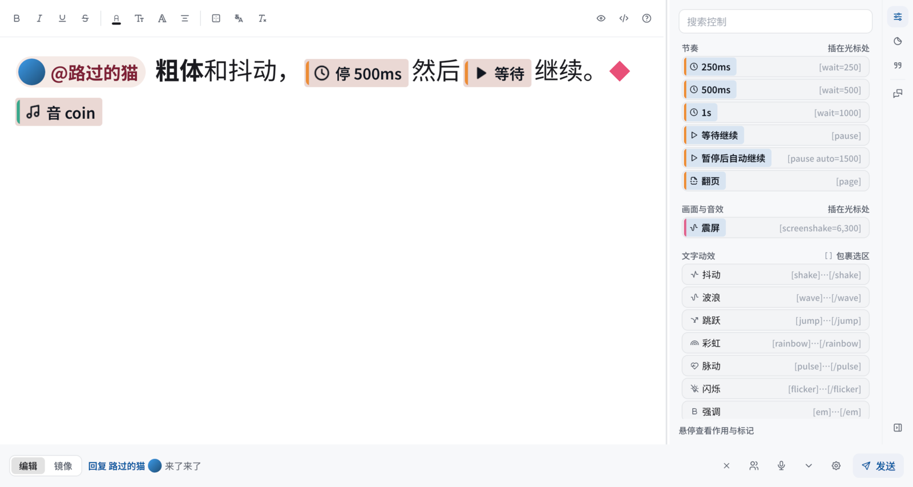

<p align="center">
  
</p>

<h3 align="center">把打下的每一句台词，逐字演成直播画面里的 AVG / RPG 对话框</h3>

<p align="center">
  <a href="https://github.com/sena-nana/NanaType/releases"></a>
  <a href="https://github.com/sena-nana/NanaType/actions/workflows/ci.yml"></a>
  
  
  <a href="LICENSE-MIT"></a>
</p>

<p align="center">
  <a href="https://github.com/sena-nana/NanaType/releases"><b>下载</b></a> ·
  <a href="docs/usage.md"><b>使用指南</b></a> ·
  <a href="docs/markup.md"><b>台词标记</b></a> ·
  <a href="docs/skins.md"><b>制作皮肤</b></a> ·
  <a href="docs/building.md"><b>从源码构建</b></a>
</p>

<p align="center">
  <b>简体中文</b> · <a href="README.en.md">English</a> · <a href="README.ja.md">日本語</a><br>
  <sub>界面支持简体中文 / English / 日本語</sub>
</p>

---

NanaType 是为虚拟主播做的直播打字机。你在输入框里打字，展示框按打字机节奏逐字揭示台词，带上停顿、震屏、立绘差分和逐字特效；历史窗口以直播聊天的样式保留说过的话。画面经 Spout2 / Syphon 直接送进 OBS，不读回 CPU，窗口隐藏时也照常输出。

<p align="center">
  
  <br>
  <sub>28 套内置皮肤中的 12 套，均为实际 GPU 渲染</sub>
</p>

## ✨ 功能

<table>
  <tr>
    <td width="50%" valign="top">
      <h4>⌨️ 所见即所得的输入框</h4>
      在皮肤预览里直接编辑，换行与直播画面完全一致。支持加粗、上色、描边、注音、动效和节奏，也能切到标记源码；右侧栏放命令、表情包和常用短语。
    </td>
    <td width="50%" valign="top">
      <h4>🎬 打字机展示框</h4>
      透明叠加窗口逐字揭示台词，支持停顿、翻页、震屏、音效和立绘差分。可选「编辑后发送」，或让展示框实时镜像你正在打的字。
    </td>
  </tr>
  <tr>
    <td valign="top">
      <h4>🎨 28 套内置皮肤</h4>
      从情书、蜡笔画、羊皮纸到终端、掌机像素和 Echo-Live 样式。皮肤是统一格式的 <code>.ntpkg</code> 包，可继承、热重载，支持受限 WGSL 动效与沙箱化的 Lua / Wasm 插件。
    </td>
    <td valign="top">
      <h4>📺 零拷贝接入 OBS</h4>
      Windows 用 Spout2，macOS 用 Syphon，共享 GPU 纹理。展示框、联机伙伴和历史记录可分别输出，也可以用透明窗口捕获。
    </td>
  </tr>
  <tr>
    <td valign="top">
      <h4>🎙️ 语音输入</h4>
      系统识别优先，也可下载小型多语言离线模型；停顿后自动发送，编辑时自动让出。
    </td>
    <td valign="top">
      <h4>🤝 Steam 联机</h4>
      最多 8 人同房间，伙伴的台词实时出现在各自的展示框里，共享一份历史；能直连则直连，否则经 Steam 中继。
    </td>
  </tr>
  <tr>
    <td valign="top">
      <h4>🔗 主播工具联动</h4>
      VTube Studio 表情、热键、参数与口型同步，标记按打字位置触发；另有 OSC 与本地 WebSocket 广播。
    </td>
    <td valign="top">
      <h4>💬 弹幕与聊天</h4>
      Twitch 聊天收发；通过 blivechat 协议接入 <a href="https://github.com/xfgryujk/blivechat">blivechat</a> 或 <a href="https://huixinghao.cn/">彗星号</a>，或连接 <a href="https://github.com/laplace-live/event-bridge">LAPLACE Event Bridge</a>，B 站、抖音、快手弹幕都能转进来。
    </td>
  </tr>
  <tr>
    <td valign="top">
      <h4>😺 表情包与贴纸</h4>
      导入本地文件夹、Echo-Live 表情或 Telegram 贴纸包，GIF / WebP / TGS / WebM 动图在展示框和 OBS 输出中都会播放。
    </td>
    <td valign="top">
      <h4>🧰 包编辑器</h4>
      独立的 <a href="docs/package-editor.md">NanaType Editor</a> 用来制作、签名和隔离调试皮肤包与插件。
    </td>
  </tr>
</table>

<p align="center">
  
  <br>
  <sub>输入框：停顿、继续、音效等标记显示为内联标签，与展示框换行一致</sub>
</p>

## 🚀 快速开始

1. 从 [Releases](https://github.com/sena-nana/NanaType/releases) 下载 Windows 安装包 / 便携包，或 macOS 的 `.dmg`。
2. 启动后输入框出现在屏幕下方，展示框与历史记录是透明叠加层。
3. 打字，按 **Enter** 发送（**Shift+Enter** 换行）。展示框开始逐字播放。
4. 在 OBS 里添加 *Spout2 Capture*（Windows）或 *Syphon Client*（macOS），选择 `NanaType Display`，合成模式选 *Premultiplied Alpha*。

| 快捷键 | 作用 |
| --- | --- |
| <kbd>F8</kbd> | 唤出输入框 |
| <kbd>F9</kbd> | 继续：越过停顿 / 跳过当前段 |
| <kbd>Ctrl</kbd>+<kbd>↑</kbd> / <kbd>↓</kbd> | 调回发过的台词 |
| <kbd>Ctrl</kbd>+<kbd>B</kbd> / <kbd>I</kbd> / <kbd>U</kbd> | 加粗 / 斜体 / 下划线 |
| <kbd>Esc</kbd> | 隐藏输入框 |

Twitch、弹幕、联机、OBS 多路输出、表情包等的详细用法见 **[使用指南](docs/usage.md)**。

## ✍️ 台词标记

工具栏做的每一处效果都保存为 BBCode 风格的标记，源码模式、快捷短语和模板通用：

```text
[@auto=1500]大家好！[wait=400][b][color=#e86a92]今天[/color][/b]也来[wave]打字[/wave]啦～
[pause][shake amp=2]哇！[/shake][se=coin][expr=smile]
[ruby=かんじ]漢字[/ruby][sticker=cats/hello h=1.6]
```

完整语法见 [台词标记](docs/markup.md)。

## 📚 文档

| | |
| --- | --- |
| **用户** | [使用指南](docs/usage.md) · [语音输入](docs/voice-input.md) · [Twitch](docs/twitch.md) · [彗星号](docs/comet.md) · [OBS / Spout 输出](docs/obs-spout.md) · [检查更新](docs/updates.md) · [Steam 版](docs/steam.md) |
| **创作者** | [台词标记](docs/markup.md) · [皮肤格式](docs/skins.md) · [插件与包接口](docs/plugins.md) · [包编辑器](docs/package-editor.md) · [字体](docs/fonts.md) |
| **开发者** | [从源码构建](docs/building.md) · [渲染管线](docs/rendering-pipeline.md) · [日志](docs/logging.md) |

## 🛠️ 从源码构建

需要 Rust 1.98+。依赖会在首次构建时自动拉取。

```bash
cargo run -p nanatype          # NanaType
cargo run -p nanatype-editor   # NanaType Editor
cargo test --workspace --exclude nanatype
```

平台依赖、打包、Steam 版和开发用环境变量见 [从源码构建](docs/building.md)。

<details>
<summary><b>项目结构</b></summary>

| crate | 内容 |
| --- | --- |
| `crates/model` | 台词文档模型：文字段、注音、贴纸、标记 |
| `crates/markup` | 标记语言的解析与序列化、模板 |
| `crates/playback` | 揭示时间线、播放器状态机、实时镜像差分、队列 |
| `crates/theme` | 皮肤包：清单、继承、校验、安装与导出 |
| `crates/i18n` | Fluent 文案（zh-CN / en-US / ja-JP） |
| `crates/settings` | 设置结构、版本迁移、原子写入、窗口位置 |
| `crates/audio` | 解码、混音与按采样时刻调度 |
| `crates/bridge` | VTube Studio、OSC、WebSocket |
| `crates/twitch` | Twitch IRC 匿名接收、设备码登录与 Helix 发送 |
| `crates/blive` | blivechat 与 LAPLACE Event Bridge 客户端（协议解析、连接与重连）和彗星号中转 |
| `integrations/comet` | 彗星号创意工坊插件页面：把彗星号事件转换成 blivechat 消息 |
| `crates/core` | 会话逻辑：草稿、发送、继续、队列、历史、回溯 |
| `crates/p2p` | Steam 联机（最多 8 人）、会话排序、重连与图片转发 |
| `crates/update` | 检查更新：签名的 Release 清单、文件代理、校验下载 |
| `crates/frame` | 两个程序共用的框架：皮肤渲染、界面组件、皮肤预览、插件宿主、媒体服务与路径 |
| `app` | NanaType：NanaUI 宿主、窗口、视图、热键、托盘、Spout |
| `editor` | NanaType Editor：包编辑器、签名与隔离调试 |

纯逻辑 crate 不依赖界面框架，可单独测试。

</details>

## 💝 致谢

- 内置的 **Echo-Live 原版、玻璃、气泡、虚空** 四套皮肤，设计参考自 [sheep-realms/Echo-Live](https://github.com/sheep-realms/Echo-Live)，原作者为 Sheep-realms 及该项目贡献者；NanaType 使用本地皮肤格式实现和适配这些样式。原项目的授权说明见 [Echo-Live 授权协议与声明](https://github.com/sheep-realms/Echo-Live/blob/master/copyright.md)。软件「设置 › 关于 › 设计来源」也提供原始仓库链接。
- 表情包预设来自 [Echo-Live](https://github.com/sheep-realms/Echo-Live) 和 [绵羊动态表情包扩展](https://github.com/sheep-realms/Echo-Live-Sheep-realms-EmoteLab-Extension)。
- Twitch 按官方开发者文档自行实现；blivechat 与 LAPLACE Event Bridge 使用其公开协议接收外部转发消息。

## 📄 许可

本仓库原创代码采用 [MIT](LICENSE-MIT)；第三方依赖、字体、插画及其他材料按各自许可分发，详见 [许可范围](LICENSE) 与 [第三方声明](THIRD_PARTY_NOTICES.md)。
