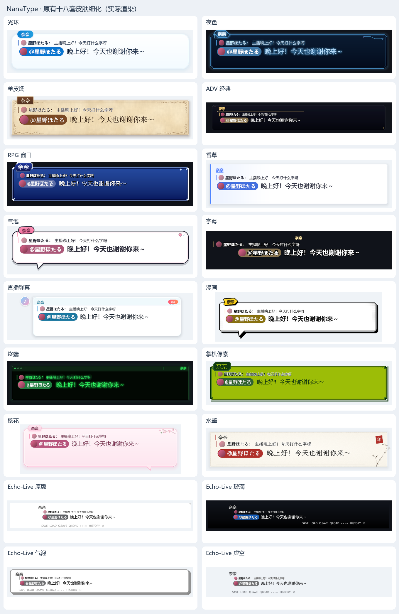

# 原有十八套皮肤：设计与实现记录

> **读者定位**：这是一份面向创作者和贡献者的设计记录，不是日常使用指南。想制作普通皮肤，请先看[皮肤格式](skins.md)；想了解整体视觉方向，请看[皮肤艺术方向](skin-art-direction.md)。

## 本页内容

- [设计原则](#设计原则)
- [十八套皮肤的设计摘要](#十八套皮肤的设计摘要)
- [实现边界](#实现边界)
- [资源与许可](#资源与许可)
- [重建流程](#重建流程)
- [验证清单](#验证清单)

## 设计原则

每套皮肤先回答“为什么需要这个图形”，再决定是否加入动效。统一保留框体比例、正文留白、姓名位置、尾巴、字体、历史布局和 Echo 菜单；删除没有语义的框沿游光、页脚呼吸和装饰性扫描。

- 十一套保持静态，让材质、留白和版式承担阅读节奏。
- 七套只让具体物件或状态动起来，不对整个框体做扫描或呼吸。
- 动效关闭、启用“减少动态效果”或查看历史记录时，动态款仍显示完整静态设计。

## 十八套皮肤的设计摘要

| 主题 | 平面设计重点 | 动态决定 |
| --- | --- | --- |
| 光环 | 蓝白圆润卡片、轻阴影、天蓝胶囊姓名；移除轨道、支架和机械装饰 | 静态；圆角、留白和胶囊比例提供轻快感 |
| 夜色 | 深蓝切角设备外壳、嵌入式铭牌；右上角折线包含输入、转折和输出节点 | 数据点沿电路移动，抵达后停顿；框体不扫描 |
| 羊皮纸 | 暖黄纸浆、纤维、杂质和边缘旧化；不对称叶片压印边饰与深棕皮签名牌 | 静态；材质由多个空间尺度构成 |
| ADV | 宽幅电影幕板、固定金色姓名基线、菱形端点和分层留白 | 静态；继续标记负责节奏 |
| RPG | 蓝色搪瓷、像素倒角、白包边和游戏窗口式名牌 | 等待翻页时，右上水晶按两像素网格切换 |
| 香草 | 白色正文面、蓝色左书脊、内嵌姓名和水平页脚标记 | 静态；保持平直轮廓 |
| 气泡 | 黑色连续描边与尾巴、粉色姓名贴纸、爱心贴花 | 爱心随描边轻微倾斜、挤压和回弹，不缩放整个气泡 |
| 字幕 | 白色描边正文、暖金姓名和透明留白 | 静态 |
| 直播弹幕 | 圆头像、纯文字姓名、浅青消息栏和 LIVE 标签；历史列表不使用姓名框 | 打字时 LIVE 下方三点依次弹跳 |
| 漫画 | 黑色硬边、黄色纸条姓名、角落渐疏网点和放射线 | 静态；网点表达印刷感 |
| 终端 | 绿色标题栏、三颗设备灯、等宽姓名和命令忙碌符号 | 忙碌符号逐格切换；等待时显示空心停止方格 |
| 掌机像素 | 四阶绿 LCD、台阶边框、方铆点和设备状态单元 | 深浅墨色逐格切换，不做平滑呼吸 |
| 樱花 | 粉白纸边、浅粉名牌和连续花枝；花蕊与叶片属于枝条 | 花枝绕接点轻摆，远端摆幅更大 |
| 水墨 | 纸纤维、干笔细边、朱色姓名竖线和郑燮墨竹 | 静态；留白是构图主体 |
| Echo-Live 原版 | 白底灰顶线、凸出姓名、角标和菜单比例 | 静态，保持原版平面界面感 |
| Echo-Live 玻璃 | 黑色渐变、描边白字和右侧菜单组成透明叠加层 | 静态，移除悬浮反光短线 |
| Echo-Live 气泡 | 灰色粗圆框、白色内压线、硬投影与菜单 | 静态；依靠边框重量表达层次 |
| Echo-Live 虚空 | 透明背景、黑字和灰色菜单，以墨色等级表达层次 | 静态；不为留白添加图案 |



[查看羊皮纸边框与名牌接缝放大图](parchment-border-preview.png)

## 实现边界

- 七套动态款各使用一个受限 WGSL 效果，不开放自定义数值参数；效果分别采用平滑轨迹、分段路径、离散状态、形变或连接点旋转。
- 直播弹幕和 RPG 读取打字进度或等待状态；不按字符叠加闪光，也不共用扫边运动。
- 十五套完整框面使用同源 `still.png`。其中八套静态图由 WGSL 离线绘制，应用、导出包和运行时都不需要编译这些程序。
- `frame.layout_inset = false` 固定九宫格边角和标题栏尺寸。羊皮纸左右各保留 152 像素，避免卷叶随窗口拉伸；旧格式默认仍为 `true`。
- 显式设置个性化框色会移除完整框图，改用所选颜色和原生几何。Echo-Live 玻璃继续使用原生透明渐变。

## 资源与许可

- 羊皮纸卷叶、樱花花枝为原创 CC0 SVG；羊皮纸纹理只用于离线烘焙，运行时使用完整静态框图。
- 樱花动效使用透明 PNG，其余程序图形不依赖外部纹理。
- 水墨保留 `ink/ART-LICENSE.txt` 与原有郑燮墨竹，不变形馆藏图片。
- Echo 四款继续注明 [Echo-Live](https://github.com/sheep-realms/Echo-Live) 来源。

## 重建流程

各主题清单与 `parchment`、`sakura` 的 `ornament.svg` 是后续编辑的源文件。修改 SVG 或 WGSL 后，在仓库根目录执行：

```powershell
node scripts/assets/render-skin-ornaments.cjs parchment sakura
cargo build -p nanatype --example skin_artwork
& target/debug/examples/skin_artwork.exe crates/theme/builtin halo night parchment adv rpg vanilla bubble livechat comic terminal pixel sakura ink echo_vanilla echo_bubble
cargo build -p nanatype --example snapshots --example gpu_perf --bin nanatype
```

将烘焙图重新嵌入渲染样例和应用。一次性生成脚本的历史位置是 `scripts/refine-classic-skins.py`。

## 验证清单

- [七套原速动效](skins-classic-motion.webp)与[局部放大预览](skins-classic-motion-details.webp)来自真实 GPU 输出；检查打字/等待状态、正文与引用区、透明轮廓和完整周期首尾。
- 静态款应不携带运行时 WGSL，也不请求自定义效果帧；缩放和长正文应保持框角、标题栏与尾巴稳定。
- 2026-10-17 的基准（RTX 5060、Vulkan、960×540）显示：动态款静态 GPU P95 为 0.10–0.13 ms，启用动效后为 0.12–0.13 ms；每帧增加一次绘制和 176 字节固定 uniform；缓存峰值为 2.49 MiB。七套动效均逐像素检查 16 秒周期的 64 帧。该测量不含 OBS 接收端。
