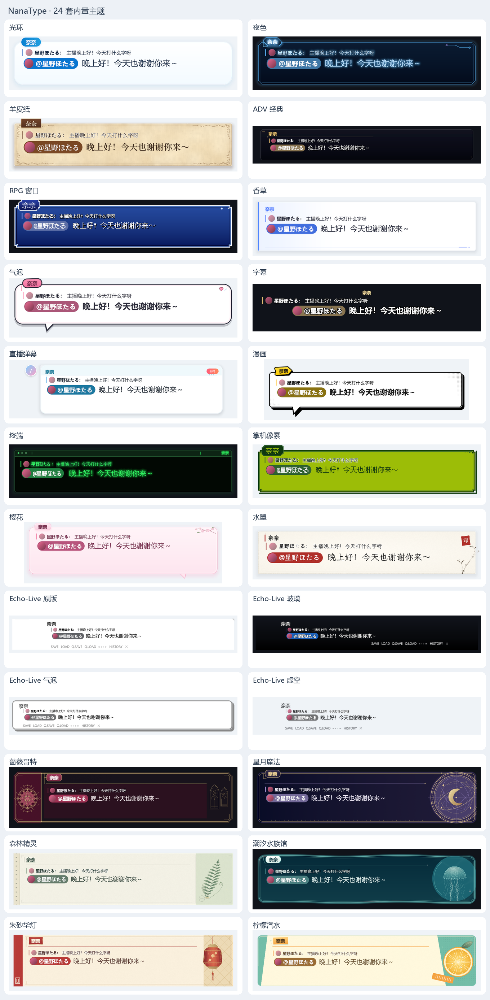
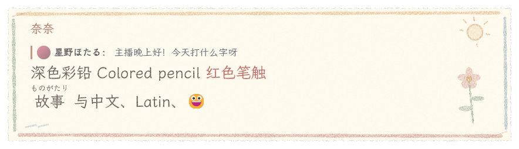

[简体中文](../skins.md) · [English](skins.md) · [日本語](../ja/skins.md)

# Skin format

A skin is one capability in the unified package system. Every directory package declares its identity, version, capabilities and dependencies in `package.toml`, describes its styling in `skin.toml`, and carries its images, shaders, fonts, sounds and license files. The compressed distribution format is `.ntpkg`; the old `.ntskin` format is no longer supported. **Settings › Plugins & packages** manages every package; the Skins page lists only packages that provide the skin capability.

The framework defaults are transparent and frameless, with the system font, black body text and no motion — they carry no particular skin design. All 28 built-in skins declare their own look; Halo is just an ordinary package that the app selects by default. To inherit from another skin with `base` in the package manifest, you must also declare an exact-version dependency on it. Tables merge layer by layer, arrays are replaced whole, and `decor = []` clears decorations. Package identity, name and tags are never inherited from the parent.

## Package identity and shared resources

```toml
# package.toml
format = 1
schema = 3
id = "my.sakura"
version = "1.0.0"
capabilities = ["skin"]          # any combination of skin, resources, lua
name = { zh-CN = "樱", en-US = "Sakura" }
author = "你的名字"
license = "CC-BY-4.0"
base = "nanatype.halo"           # optional; inherits configuration only

[dependencies]
"nanatype.halo" = "2.1.0"
"my.shared" = "1.0.0"
```

`package.toml` is parsed strictly: unknown keys stop the package from loading. Declared capabilities must match the contents — `skin` needs a `skin.toml`, the `lua` entry file must exist, and `resources` must carry resource files. `skin.toml` holds styling only. Files inside a package use relative paths; cross-package references look like `pkg:my.shared/images/paper.png`. Common fonts are still referenced as `builtin:fonts/LXGWWenKai-Regular.ttf`. Only the declared dependency closure is visible; missing dependencies, version mismatches, conflicts, cycles and paths that escape the package all stop it from loading. Inherited relative resources keep the namespace of the parent package they came from, so a child's file with the same name cannot shadow them.

Exports carry the full set of dependencies and license files, with dependencies stored under `dependencies/<package ID>/`; within one dependency closure each ID is pinned to a single exact version. Referencing another package's resources never runs that package's scripts. See [Plugin interface](plugins.md) for details.

The general UI uses NanaUI's own neutral palette; pick Follow system, Light or Dark under **Settings › General › Appearance**. Only the display box (including the partner's display box), the history window and the input editing area follow the skin; thumbnails, samples and swatches in the skin picker keep the skin's look too. The input window's toolbar, status bar and chat panel all use the general palette. `chrome` supplies the content accent, inline tag background and text contrast color; it does not change the app's interface.

## Built-in skins

Each entry below is a separate skin package living in `crates/theme/builtin/<ID without the nanatype. prefix>/`; its manifest, styling and assets ship with the package.

In **Settings › Skins › Preview**, switch between the display box and the history to adjust the body font (dropdown), font size (number box), line height (slider), text color (color picker) and window size, and edit the test text. Changes show in the preview first; only **Save** writes them to that skin's personal configuration, and saving a different skin does not switch the skin in use. The controls start at the skin's defaults; setting a value back to the default makes it follow the skin again, and leaving width or height empty means "use the skin's default". **Reset to skin defaults** and **Discard changes** are icon buttons with tooltips; resetting also needs a save to take effect, and closing Settings throws away unsaved drafts. Personal configuration never modifies the skin's own files.

Once the display box and history window are unlocked, you can drag any edge or corner to resize them independently; text keeps its size and rewraps. Windows can be 160–8192 × 96–8192 logical pixels, font size 8–200 px and line height 1–3×. A very short history window folds away its title and tightens vertical padding to leave room for messages. The partner display box shares the body text settings but remembers its own size.

| id | Name | Tags | Highlights |
|---|---|---|---|
| `nanatype.machine_learning` | Machine Learning | minimal, game | Graphite ground, cool white text and a faint violet node network; characters compute rapidly before locking in, and whole lines dissolve as random glyph noise |
| `nanatype.crayon` | Crayon | cute, elegant | Off-white drawing paper, soft crayon colors and little flower doodles, dark colored-pencil text; static GPU material |
| `nanatype.halo` | Halo | classic, minimal | The default. A pared-back, rounded blue-and-white card with a light shadow and a sky-blue capsule nameplate; no top-right animation |
| `nanatype.sonnet` | Sonnet | elegant, minimal | Transparent verse subtitles in WenKai for Chinese and a script face for Latin; each glyph glints gold with spark filaments, and the whole line turns to light dust together |
| `nanatype.love_letter` | Love Letter | cute, elegant | Ivory laid stationery with ruled lines and chain marks, a burgundy wax seal and a script "From" signature; WenKai strokes are written in stroke order, staggered, and the line melts away together; see the [Love Letter notes](../love-letter.md) |
| `nanatype.night` | Night | classic | A neon tube sign: aubergine-black ground, magenta tubes and clips, the name a lit-up stretch of tubing; the tubes flicker twice on a new line |
| `nanatype.parchment` | Parchment | classic, elegant | Vellum, a double pressed rule, acanthus scrolls in the corners, a leather name tab with an inlaid gold line, serif type |
| `nanatype.adv` | ADV Classic | game | A 1280-wide cinema letterbox: transparent at the top fading to deep black, a thin white rule, the name in white serif with a short underline |
| `nanatype.rpg` | RPG Window | game, retro | A royal-blue enamel window with a triple bevel, a separate little nameplate window and pixel type; a crystal bounces while waiting |
| `nanatype.vanilla` | Vanilla | streaming, minimal | Swiss editorial layout: warm white square-cornered paper, a dark vanilla-pod rule, a column-style name and registration crosses |
| `nanatype.bubble` | Bubble | streaming, cute | Candy sticker: pale pink ground, a thick deep-plum outline, an offset pink shadow, a candy capsule nameplate and a bouncy heart |
| `nanatype.subtitle` | Subtitle | streaming, minimal | Frameless, centered white text with a heavy outline; the name is gold outlined text with no plate |
| `nanatype.livechat` | Live Chat | streaming | Round avatar, plain-text name, rounded comment bubble and a LIVE badge |
| `nanatype.comic` | Comic | game, cute | Black-and-white print plus process yellow: variable-weight ink lines, a pointed tail, halftone in two corners, speed lines and a tilted yellow caption box |
| `nanatype.terminal` | Terminal | retro, minimal | Amber phosphor screen, a title-bar path and busy indicator, very faint scanlines, a hollow cursor |
| `nanatype.pixel` | Pocket Pixel | game, retro | Four shades of green, a stepped frame with pixel grooves, pixel type |
| `nanatype.sakura` | Sakura | cute | Translucent pink frosted glass with no tail; a blossoming branch reaches past the top-right corner, a few petals fall outside the box, and a small blossom leads into the name |
| `nanatype.ink` | Ink Wash | elegant | Blank raw xuan paper with a single dry-brush stroke along the bottom, ink bamboo bleeding past the frame, a vermilion seal and regular-script type |
| `nanatype.echo_vanilla` | Echo-Live Vanilla | streaming, minimal | Recreates the original Echo-Live: white ground, a gray rule at the top, a top-right triangle, a name tab sticking out on the left, a menu bar at the bottom |
| `nanatype.echo_glass` | Echo-Live Glass | streaming | Recreates Echo-Live Glass: a black gradient rising from the bottom, white text with a black outline, the menu bar on the right |
| `nanatype.echo_bubble` | Echo-Live Bubble | streaming, cute | Recreates Echo-Live Bubble: a white rounded box, a thick gray border and a hard bottom-right drop shadow |
| `nanatype.echo_void` | Echo-Live Void | streaming, minimal | Recreates Echo-Live Void: fully transparent, just black text and a gray menu bar |
| `nanatype.gothic` | Rose Gothic | streaming, elegant | A cathedral facade: two pointed stained-glass windows, a rose window in the gable, pewter-silver tracery and a burgundy reading panel |
| `nanatype.celestial` | Celestial | streaming, elegant | A brass astrolabe bleeding from a center at the bottom-right corner, a crescent moon and faint star arcs passing behind the text |
| `nanatype.forest` | Forest Sprite | streaming, cute | Specimen paper on a sage-green mount, a washi-tape nameplate, a fern frond reaching over the top edge and a specimen label |
| `nanatype.tidal` | Tidal Aquarium | streaming, elegant | An undulating waterline as the top edge, a jellyfish bell rising above the surface and a pearl nameplate floating on the waterline |
| `nanatype.lantern` | Vermilion Lantern | streaming, elegant | Black lacquer in a gilded vermilion frame; two lanterns hang from the crossbeam outside the frame, their warm light reflected in the lacquer |
| `nanatype.citrus` | Citrus Soda | streaming, cute | A slant-cut soda label on mint halftone, a lemon slice bleeding off the corner and a tilted sticker nameplate |



The preview card at the top of **Settings › Skins** draws the selected skin live with sample lines (including personalization). Clicking a row previews it without switching (copy, export and other actions are in the "⋯" menu at the end of the row); tags and Light / Dark filter the list. Ink Wash keeps its openly licensed ink-bamboo artwork, the procedural prints carry matching static fallbacks, and complex branches and scrolls use original transparent textures; use **Duplicate to edit** if you want to rework them. Thumbnails use the same static decorations, tails and surface drawing as the display box, with room left for decorations and shadows that extend outside; skins without a continue indicator show no placeholder dot.

In 2026-10 the [skin redesign](../skin-redesign.md) spread the skins further apart in palette and composition: the six print skins each got their own skeleton, Terminal went amber, Night went neon, Lantern moved to a dark ground, Gothic to pewter-silver and ADV lost its gold; Halo, Live Chat, Crayon and the four Echo skins kept their original style. Every skin's @mention now uses dark text on a light ground, and the compact state no longer borrows Halo's blue. Earlier refinements are in the [classic skin design notes](../classic-skin-refinement.md). Seven skins use object or state animation: neon tube flicker, a ready crystal, a bouncy heart, typing dots, terminal glyphs, LCD cells and a blossoming branch; the rest stay static, relying on paper, line and typography. Responsive portrait and narrow layouts reuse the original print programs to rearrange textures, corner ornaments and state objects; static programs request no animation frames. With advanced effects off, the static look is kept. Full artwork leaves room for very long names; the name is ellipsized inside the nameplate while the original stays unchanged. When you explicitly personalize the box color, the chosen color and the native box drawing take priority.

The history window carries over the display box's nameplate, rules and typography: paper themes use static fibers, double rules or a vermilion seal; the six new themes each keep their burgundy binding, star tracks, binding holes, glass waterline, vermilion stamp and mint paper layers. History decorations stay static and never run the display box's animation. Name plates and placeholder avatars for both the streamer and viewers follow the same skin palette; real avatars keep their original image. Pocket Pixel and RPG Window use font sizes that are integer multiples of 12px for body text, names, times and quotes; Subtitle shows no avatars.

To regenerate the display / history comparison images for every skin, and check long nicknames, multi-line text, reply quotes and line spacing at the default width and in a 300px narrow window:

```powershell
cargo build -p nanatype --example snapshots
$env:NANATYPE_THEME_SNAPSHOTS_ONLY='1'
$env:NANATYPE_SNAPSHOT_VIEWS='display,history'
$env:NANATYPE_SNAPSHOT_TRANSPARENT='1'
& target/debug/examples/snapshots.exe target/history-style-fixed all zh-CN
```

The [real-time motion preview](../skins-motion.webp) of the six new themes shows the jellyfish swimming at a tilt, leaves bending, lanterns swaying gently, star tracks and gilded edges catching light, and bubbles rising behind the citrus slice. Text, nameplates and frames stay put; amplitudes, periods and how to inspect frame by frame are in the [design notes](../skin-art-direction.md#装饰自身的运动).

Ink Wash overlays a detail of the ink bamboo from Zheng Xie's [Bamboo and Poem](https://www.metmuseum.org/art/collection/search/52946), an open-access image from The Metropolitan Museum of Art (Public Domain). It was only cropped and had the paper background removed — no lines were redrawn or recolored; the source and processing record ship with the skin in `ink/ART-LICENSE.txt`.

### Echo-Live design source

The `echo_vanilla`, `echo_glass`, `echo_bubble` and `echo_void` skins are designed after [sheep-realms/Echo-Live](https://github.com/sheep-realms/Echo-Live), by Sheep-realms and the project's contributors. NanaType implements and adapts these styles in its own TOML skin format. The original project is GPL-3.0-or-later; see its [license and statement](https://github.com/sheep-realms/Echo-Live/blob/master/copyright.md). The CC0-1.0 declaration in the local manifests covers only NanaType's own contributions.

## Sound packs

A sound pack is a package that declares `capabilities = ["sounds"]` and has a `sounds.toml` at its root, with the same contents as a skin's `[sounds]` table:

```toml
[sounds]
open = "sounds/open.ogg"
[sounds.typing]
files = ["sounds/key-1.wav", "sounds/key-2.wav"]
volume = 0.5
[sounds.se]
coin = "sounds/coin.ogg"
```

Once you pick it under **Settings › Playback › Sound pack**: if the pack defines `typing`, it replaces the skin's typing sound and its rhythm (`every_n`, `skip_punct` and so on); if it defines `open` or `advance`, it replaces those sounds. `se` overrides or adds entries by name; the skin's other named sounds remain, so `[se=…]` markup written for the skin still plays. Referenced files must be inside the pack (or in a dependency, `pkg:<package ID>/<path>`); if any is missing, the whole pack is rejected.

If the selected sound pack is deleted, fails to load or isn't visible in the current build (for example, the GitHub build can't see Steam Workshop items), the skin's own sounds are used for now with a one-time notice, and the setting is left as it is. A sound pack can live in the same package as a skin (`capabilities = ["skin", "sounds"]`).

## General layout of the history window

`history.group_speakers` controls whether consecutive messages from the same speaker share a name row. `history.padding` is the left, top, right, bottom padding when there is no panel; `history.margin` is the top, right, bottom, left margin. `history.row_padding` is each row's horizontal padding, and `history.column_inset` is extra width reserved beside the body column. Avatar size and `history.text.size` are set by the skin and overridden by the user's personalization as usual; nothing is rewritten based on a skin ID.

New messages enter according to `history.entrance` (`slide_up`, `fade`, `slide_left`; `none` makes them just appear). Messages already on screen ease out to their new positions over the same 220ms: the list moves up as a whole when a new message pushes it, and when the oldest message leaves because of the display limit, the ones below fill the gap. The framework default is `none`; every built-in skin turns entrance on. With reduced motion, messages land in place immediately.

## Manifest

```toml
[meta]                           # these identity fields actually live at the root of package.toml; listed here as a field index
id = "my.sakura"                  # a-z 0-9 . - _, up to 64
version = "1.0.0"
min_app = "0.1.0"                 # minimum NanaType version required
base = "nanatype.halo"            # optional: the skin to inherit from
name = { zh-CN = "樱", en-US = "Sakura", ja-JP = "さくら" }
description = { zh-CN = "粉色樱花", en-US = "Pink blossoms" }   # one-line description in the picker (optional)
author = "你的名字"
license = "CC-BY-4.0"
preview = "preview.png"
tags = ["cute", "streaming"]      # picker categories: classic streaming game retro cute elegant minimal

[chrome]                          # content colors; does not affect Settings, the toolbar or other general UI
appearance = "light"              # light | dark, the skin picker's light/dark category
accent = "#e86a92"                # accent for decorations, quoted nicknames, inline tags and so on
surface = "#ffffff"               # background reference for inline markup in the editor
text = "#3a2230"                  # candidate color for the content text's contrast outline

[fonts.body]                      # dialogue font; name (nameplate) and accent (decorative text) work the same way
file = "fonts/LXGWWenKai.ttf"     # font shipped with the skin (optional)
families = ["LXGW WenKai", "Microsoft YaHei UI", "PingFang SC"]   # the first installed one wins, in order
weight = 500

[dialogue]
region = [760, 150]               # dialogue region (logical pixels)
overscan = 18                     # transparent margin all round, so jitter / outlines aren't clipped
padding = [20, 22, 20, 14]        # text padding: left top right bottom
background = "images/bg.png"      # optional
overflow = "scroll"               # long text: clip cuts off / scroll follows (default) / page waits when full, then clears
overflow_auto_ms = 1500           # in page mode, wait this long before turning a full page; omit to wait for the continue key

[dialogue.box]
# contour = "rounded"             # optional: draw continuous rounded corners and a curved tail with Painter
color = "#ffffffee"
border_color = "#f0cfdc"
border_width = 2
radius = 18
inner_border_color = "#ffe4ee"    # optional inner border
inner_border_width = 2
glow = "#e86a9260"                # optional outer glow
glow_blur = 12                    # blur radius of the outer glow
shadow = { color = "#00000030", dy = 3, blur = 8 }
frame = { image = "images/frame.png", slice = [24, 24, 24, 24], scale = 1 }   # nine-slice image, replaces the drawing above
# repeat = false                 # the nine-slice center stretches by default; true tiles it
width_fraction = 1.0              # box width as a fraction of the region
gradient = { angle = 160, stops = [[0, "#ffffff"], [1, "#ffe9f1"]] }   # gradient, drawn over color
radii = [4, 18, 18, 18]           # per-corner radii: top-left top-right bottom-right bottom-left (replaces radius)
border_widths = [0, 0, 0, 4]      # per-side widths: top right bottom left (replaces border_width)
border_style = "solid"            # solid | dashed | dotted
shadows = [                       # more shadow layers; inset = true for an inner shadow
    { color = "#e86a9240", dy = 6, blur = 18 },
    { color = "#ffffff", dy = 1, inset = true },
]
margin = [0, 0, 26, 0]            # space reserved inside the region for tails and decorations: top right bottom left

[dialogue.tail]                   # optional: speech-bubble tail, reuses the box's fill and border automatically
side = "bottom"                   # top | right | bottom | left
at = 0.15                         # where the tail's root sits along that side (0–1)
width = 34                        # root width
length = 24                       # how far it sticks out of the box
lean = -10                        # offset of the tip along the side
shadow = true                     # copy the box's hard shadow (outer shadow with blur = 0) onto the tail
# color = "#ffe6ef"               # fill, defaults to the box color

[[dialogue.decor]]                # decorations, any number (up to 16)
# image = "ink/stroke.png"        # optional: transparent image asset, fitted whole into size at its own aspect ratio
# motif = "blossom"               # optional: curved shape, replaces polygon and plain rectangle fill
anchor = "top_right"              # this point of the decoration lines up with the same-named point of the box, then offset applies
offset = [-18, -14]
size = [26, 26]                   # pixels, or a percentage of the box size such as "56%"
# inset = [5, 5, 5, 5]            # use distances from the four sides instead (may be negative), for inner rules or backings
text = "✦"                        # optional: draw a centered character (up to 8 characters)
text_color = "accent"
text_size = 22
font = "accent"                   # body | name | accent
rotate = 12                       # clockwise degrees
layer = "above"                   # above: drawn over the box; below: drawn under it
when = "always"                   # always | speaker (only shown when there's a nameplate)
                                  # | display (only drawn in the display box and skin preview, not the input window;
                                  #   for decorations that look clickable, like a fake menu bar)
# motion = { kind = "float", period_s = 6, amplitude = 1.5, phase = 0 }
# also accepts color, gradient, radius, radii, border_color, border_width,
# border_widths, border_style, shadows, opacity,
# and polygon = [[0, 0], [100, 0], [50, 100]] (clips to a polygon in percentages of the decoration size, 3–8 points)

[dialogue.text]
color = "#3a2230"
size = 28
line_height = 1.4
letter_spacing = 0                # letter spacing (pixels); history.text accepts it too
stroke = { color = "#ffffff", width = 2 }
shadow = { color = "#00000055", dx = 1, dy = 1, blur = 2 }
align = "start"                   # start | center | end

[dialogue.nameplate]
color = "#e86a92"
text_color = "#ffffff"
size = 18
radius = 10
padding = [10, 4]
anchor = "top_left"               # this point of the nameplate lines up with the same-named point of the box
offset = [16, -12]                # then offset; negative values sit on the border
frame = { image = "images/nameplate.png", slice = [8, 8, 8, 8] }
# a full frame image can set layout_inset = false to keep the nine-slice without adding layout padding; default true.
stroke = { color = "#000000", width = 3 }   # name outline
text_shadow = { color = "#e86a92", blur = 8 }
gradient = { angle = 90, stops = [[0, "#ff8fb8"], [1, "#ffb3cf"]] }
radii = [10, 10, 10, 2]
border_color = "border"
border_width = 2                  # or border_widths = [0, 0, 2, 0] for just an underline
shadows = [{ color = "#00000040", dx = 3, dy = 3 }]
rotate = -3

[dialogue.portrait]               # character art / avatar
visible = true
side = "left"
size = [180, 220]
image = "images/portrait.png"
variants = { smile = "images/portrait-smile.png", angry = "images/portrait-angry.png" }

[dialogue.continue]               # indicator shown while waiting to continue
glyph = "▼"
color = "#e86a92"
size = 16
image = "images/continue.png"     # optional: use an image instead of a character
frames = 1                        # frame count if the image is a horizontal sprite strip
fps = 8
image_size = [22, 22]
anchor = "bottom_right"
offset = [-14, -8]
motion = "bob"                    # bob | blink | pulse (scale) | none
period_s = 0.83                   # one motion cycle
bob_px = 3
# not shown when glyph = "" and there is no image

[dialogue.reveal]                 # typing rhythm
base_ms = 50                      # per Latin character
cjk_factor = 2.0                  # how many beats one CJK character counts as
space_ms = 50                     # per space
punct = { comma_ms = 120, stop_ms = 260, ellipsis_ms = 300 }
entrance = { kind = "fade", ms = 140 }   # none | fade | pop | slide_up

[history]                         # history window (live-chat style)
width = 420
height = 560
avatar = { shape = "circle", size = 40, ring_color = "#ffffff", ring_width = 2 }   # circle | square | none
# avatars also accept color (placeholder avatar fill, default an accent gradient) and radius (corner radius for square, default 18% of the side);
# the streamer and viewers share the skin's placeholder avatar colors and name style; real avatars still show the original image
name_color = "#e86a92"
name_size = 14
name_stroke = { color = "#000000", width = 2 }
name_plate = { color = "accent", text_color = "#ffffff", radius = 9, padding = [9, 2], border_color = "border", border_width = 1 }   # name backing (optional); supports contour, gradient, border_widths and shadows
bubble_color = "#ffffffee"
bubble_border = "#f0cfdc"
bubble_border_width = 1
bubble_radius = 14
bubble_radii = [4, 14, 14, 14]
bubble_gradient = { angle = 135, stops = [[0, "#fff0f5"], [1, "#ffe1ec"]] }
bubble_shadows = [{ color = "#00000020", dy = 2, blur = 8, spread = 0 }]  # spread: how far the shadow expands; inner shadows can make a double embossed line
bubble_padding = [12, 8]          # bubble padding: horizontal vertical
bubble_frame = { image = "images/bubble.png", slice = [12, 12, 12, 12] }
gap = 10                         # spacing guide: stack keeps 12–20px depending on font size; consecutive messages by the same author 8–12px; inline 8–14px
entrance = "slide_up"             # none | slide_up | fade | slide_left
layout = "stack"                  # stack: name and time above the bubble | inline: name, line and time on one row (chat-log style)
                                  # in stack, consecutive messages from the same person within 2 minutes merge: only the first shows avatar, name and time
name_width = 96                   # name column width for inline; shrinks in narrow windows to keep room for text and @ tags
name_weight = 700
time_size = 11                    # defaults to 3 smaller than the name (also used for the "streamer/viewer" role tag)
time_color = "#8aa0b4"            # color of the time and role tag
time_seconds = false              # true shows HH:MM:SS
hide_latest = false               # true: the line still showing in the display box stays out of history for now (Settings › History can override)
# panel behind the whole list (optional); also supports gradient / radii / border_widths / border_style / shadows
panel = { color = "#edeef0", border_color = "#888888", border_width = 0, radius = 0, padding = [18, 18, 18, 18], margin = [0, 0, 0, 0] }   # padding is left top right bottom, margin is top right bottom left
title = { text = "HISTORY", color = "#606266", size = 21, weight = 600, background = "#ffffff", height = 42, padding = 18 }   # title bar at the top of the panel (optional)

[[history.decor]]                 # decorations on the panel, same fields as [[dialogue.decor]] (when and motion don't apply; history decorations stay static)
anchor = "top_right"
size = [11, 11]
polygon = [[0, 0], [100, 0], [100, 100]]
color = "#00000026"
# paper themes can use motif = "paper" for fixed, sparse paper fibers; no image is loaded and no per-frame noise is generated.

[history.text]
color = "#3a2230"
size = 18

[history.chat]                    # live chat rows (appear once Settings › History › Live chat is on)
text_scale = 0.88                 # chat text size relative to history.text
bubble_opacity = 0.7              # opacity of the whole chat bubble backing (including gradient, border, shadow and nine-slice image); text stays opaque

[history.reply]                   # for lines replying to chat, a one-line quote above the bubble: avatar · nickname: original (in inline layout, above the whole row, aligned with the text column)
visible = true
size = 12                         # defaults to 62% of the body text
color = "#7a6070"                 # color of the original text, defaults to the body color, accepts color roles; the nickname uses accent
opacity = 0.8

# The quoted nickname uses fonts.name and the original text uses fonts.body; both inherit the outline and shadow of the current area's text.
# On a transparent background with no outline set, quote text gets a thin contrast outline so the stream background doesn't swallow it.
# In a transparent history, floating nicknames, times and plate-less body text without an outline get the same thin contrast outline, keeping their colors.

[dialogue.reply]                  # reply quote on the dialogue box, same fields as [history.reply]
visible = true                    # users can also turn it off in the Chat panel settings

[mention]                         # [at=…] in a line: a tag with avatar and nickname, consistent across input box, dialogue box and history
fill = "accent"                   # tag background, accepts color roles; darkened automatically if contrast with text_color is below 4.5:1
text_color = "#ffffff"            # always used as is; the line's shadow or glow isn't drawn under the tag
scale = 0.82                      # font size relative to the surrounding text
avatar = true                     # show the avatar before the nickname

[sounds]
typing = { files = ["sounds/key1.ogg", "sounds/key2.ogg"], volume = 0.6, pitch_jitter = 0.05, every_n = 1, min_interval_ms = 30, skip_punct = true }   # skip_punct: punctuation is silent
open = "sounds/open.ogg"          # a line begins
advance = "sounds/advance.ogg"    # continue is pressed
se = { coin = "se/coin.ogg", boom = "se/boom.wav" }   # [se=coin]

[effects]                         # default amplitudes for per-character effects
shake_px = 1.6
shake_hz = 14                     # shake frequency
wave_px = 3
wave_period_s = 1.2               # seconds per wave cycle
jump_px = 6
jump_period_s = 0.9               # seconds per jump cycle
rainbow_period_s = 2.4
screen_shake_px = 6
contrast_guard = 3.0              # add a 1.5px outline when colored text contrasts less than 3:1 with the box color (0 = off)
```

## Restricted WGSL effects (schema 3)

The `package.toml` at the package root declares `format = 1`, `schema = 3` and `capabilities = ["skin"]`; `skin.toml` defines effects in a `shaders` table and references them from `shader_effects` or a decoration's `shader`. Older formats are no longer supported. Exports carry dependencies and all resources, so a package loads offline on its own. Arrays are replaced whole: `shader_effects = []` clears the inherited display-box effects and `decor = []` clears decoration effects. Named effect tables merge by key; an inherited effect that is no longer referenced isn't drawn.

```toml
# package.toml
format = 1
schema = 3
id = "my.aurora"
version = "1.0.0"
capabilities = ["skin"]
base = "nanatype.halo"
[dependencies]
"nanatype.halo" = "2.1.0"

# save the following as skin.toml
[shaders.world]
source = "effects/aurora.wgsl"
period_s = 12                    # 0.5–3600 seconds
intensity = 0.16                 # 0–1, multiplied into opacity by the host at the end
textures = []                    # up to two images from the skin; sampling returns linear RGBA
params = [0.35]                  # up to eight finite floats

[[dialogue.shader_effects]]
shader = "world"
target = "background"           # background | border | artwork

[[dialogue.decor]]
shader = "world"                # overlay the effect inside this decoration's shape
motif = "moon"
color = "#B5A1E8"
anchor = "top_right"
offset = [-12, -12]
size = [36, 36]
```

A WGSL file implements only `fn effect(input: EffectInput) -> vec4<f32>`, plus any pure helper functions. It returns non-premultiplied linear RGBA; the host clamps the color range, multiplies in the coverage mask and intensity, then premultiplies and hands it to the output pipeline for color conversion. Body text, names and quotes are always drawn above these effects; effects cannot read the frame or change text.

`EffectInput` contains `uv: vec2<f32>` (local 0–1), `size: vec2<f32>` (logical pixels), `phase: f32` (loop phase 0–1) and `seed: f32` (a fixed seed); `line_age` / `speaker_age` are the seconds since the corresponding event, `reveal` is the typing progress of the current page, and `waiting` is 0 or 1; `base`, `accent`, `border` and `text` are linear `vec4<f32>` theme colors; `params0` / `params1` hold four parameters each, with unsupplied values at zero.

The host provides `sample0(uv)`, `sample1(uv)`, `particles(uv, phase, seed)` and `param(i)`. Sampling only touches declared images, UVs are clamped to the image edge, and an unbound slot returns transparent. `particles` uses a fixed set of sixteen points and needs no cross-frame state. `param(i: u32) -> vec4<f32>` reads item `i` of `bindings` (see [Skin parameters](#skin-parameters)); unbound slots are zero. Programs can combine phase, trigonometry and the fixed seed into light streaks, caustics, star rings, bubbles and brief responses to events.

The shader interface is ABI 2: ABI 1 plus `param(i)` and its bindings. Like the `fx_` prefix, `param` is reserved by the host, and a custom function with that name is rejected.

```toml
[shaders.art]
source = "art.wgsl"
bindings = [
    [34, 100, 100, 40],                     # literals
    ["ear_height", "ear_width", "tail", 3], # up to four scalars: numbers as is, booleans as 0/1, enums as option index
    "fur",                                  # color: linear rgba (straight alpha), same as base/accent
]
owns_continue = true                        # while the artwork plays, the program draws its own continue indicator
```

`bindings` holds up to 64 items, each taking one `vec4`. Text parameters can't be bound, and a color parameter must take an item of its own. Changing a parameter only updates this uniform block; the shader isn't recompiled. `owns_continue = true` applies only to programs with `target = "artwork"`: while the program is playing, the host hides `dialogue.continue`; when frozen, with advanced effects off or after a compile failure, the host draws it as usual, so static frames still have a continue indicator.

```wgsl
fn effect(i: EffectInput) -> vec4<f32> {
    let wave = 0.5 + 0.5 * sin(i.uv.x * 12.0 + i.phase * 6.28318);
    let event = 1.0 - clamp(i.line_age, 0.0, 1.0);
    return vec4(i.accent.rgb, wave * (0.15 + event * 0.15));
}
```

Limits: at most four effect instances per box and sixteen named definitions; source must be UTF-8, at most 64 KiB per file, with no control characters other than tab and newline; IR and per-call expanded complexity are at most 4096 nodes each, with call depth at most eight; a single statement (between two of `;`, `{`, `}`) may have at most 256 operators, calls, commas, member accesses and subscripts, a single expression may nest operations at most 64 deep, and `if`/`switch`/`{}` may nest at most 32 deep — split with `let` when you exceed them. User functions may not use loops, custom entry points, global variables, bindings, pointer interfaces, atomics, storage resources, discard, extensions or diagnostic directives; `compute`, `workgroup`, `storage`, `ptr`, `atomic…`, `texture_storage_…`, `textureStore`, any barrier, `arrayLength` and `subgroup…` are rejected wherever they appear in the source (comments excepted); `fx_`, `nm_` and `__` are prefixes reserved by the host. The module, once merged with the host wrapper, can only have the host's vertex and fragment entry points, and compute shaders are never run. Fixed arrays have at most 64 elements, a single type at most 4096 bytes, and a function's local variables at most 16 KiB. Each texture's longest side is at most 2048, decoded textures per skin at most 32 MiB, and the proxy's texture and mask cache has a total budget of 64 MiB.

Runtime isolation: WGSL validation runs on a separate thread, so a validator crash only fails that shader while the rest of the skin loads normally. GPU compilation likewise runs on a separate thread inside an error scope, and a failure disables that effect. All skin programs share a per-second GPU budget (per-pixel expanded complexity × covered pixels, accumulated per draw, about 1.6× the heaviest built-in theme filling 3840×2160 at 60 fps): when it's exceeded within a second, the costliest program is frozen first (drawn as with motion off), and if it's still exceeded once frozen, the program is disabled with a notice. After a GPU device loss, every program drawn in the two seconds before the loss gets a strike, and a second strike disables it. Crash protection records a program's first draw in `config/shader-guard.json` and removes the record after about two seconds or 120 normal draws; if the app or driver exits in that window, the program stays disabled from the next launch on. Turning **Advanced skin effects** off and on again clears these disabled and frozen records and retries; when a skin changes a program, its hash changes and it's tried again too. `materials.*` are drawn by the UI framework under the same budget and crash protection, and count toward device-loss strikes when the device they're on also drew effects: the framework asks the host before every compile and draw, and charges by shape area or text draw extent; materials themselves are static with no animation to freeze, so exceeding the budget disables them, and a disabled material draws in its original style. These measures limit damage after a fault; they can't prevent a single driver failure.

`cargo run -p nanatype-theme --example check_package -- <package>` also lists each shader's expression nesting depth.

**Settings › Skins › Advanced skin effects** is on by default; reduced motion turns off the dynamic WGSL in this section but keeps the static general materials in the next one. The editor, history and thumbnails stay static; the current theme only plays when you click play on the preview card. Loops only request draw frames; a skin's own loop runs at 30 fps by default, which you can change to 60 fps in **Settings › Skins › Skin frame rate**; typing and per-character effects in the display box aren't limited by this setting. **Settings › Skins › Skin motion** is on by default; turning it off freezes every skin program and light band the way reduced motion does — each program draws one still frame off-screen and every later frame just copies it (redrawn once when the size, scale or device changes), with no shader running per frame; static general materials are unaffected. Import errors show the file path and WGSL diagnostics (line and column map directly to the skin file); an invalid hot reload keeps the last valid skin, and a GPU compile failure disables that effect while keeping the static look.

A complete author example is [aurora/skin.toml](../examples/aurora/skin.toml), and [aurora.ntpkg](../examples/aurora.ntpkg) can be imported directly. Each of the six new built-in themes uses one WGSL, one transparent decoration texture, zero custom parameters and zero decoration nodes; composition and static fallbacks are in the [design notes](../skin-art-direction.md), and art references and vector sources are in the [source log](../skin-art-sources.md).

`target = "artwork"` is for full artwork: the program draws its own transparent outline, material, border and decorations, and the host provides the display-box rectangle as the canvas without using the original box's coverage mask. Multiple artwork instances stack in `shader_effects` order; when a single program exceeds the node limit, split it into a back layer and a front layer. Configure `dialogue.box.frame` as the complete static fallback; run `cargo run -p nanatype --example skin_artwork -- crates/theme/builtin` to re-bake the built-in images, or `-- --package <dir> [--preset <preset>] [--out <png>] [--at <ms>] [--scale <factor>]` to bake one package (stacking all its artwork layers in order; `--at` renders another moment of the 16-second loop to check motion; `--scale` renders at a high-DPI factor to check line widths and antialiasing). `cargo run -p nanatype-theme --example check_package -- <dir or .ntpkg>` validates a package the way the app does and lists each shader's IR and expansion cost, reporting when limits are exceeded. Both the fallback and the WGSL are drawn before body text, quotes and names; third-party programs without a declared static fallback submit no user code when motion is off; responsive prints with `static_fallback = true` freeze the clock to keep their full material and decorations and stop requesting animation frames.

## Content color reference (chrome)

`[chrome]` contains only `appearance`, `accent`, `surface` and `text`. `appearance` is used for the skin picker's light/dark category; `accent` supplies the accent for decorations, quoted nicknames, inline tags and so on; `surface` is the background for inline markup in the editor; `text` is the candidate color for the content text's contrast outline.

The UI's light or dark mode is decided by **Settings › General › Appearance**, following the system by default. Whether the history shows times is decided in **Settings › History**, and the list always starts at the top of the content area.

The general UI uses NanaUI's standard light and dark palettes and a fixed accent, keeping the existing corner radii, spacing, card shadows and motion. A skin's personalized accent only affects skin content; it doesn't change the app's buttons or selection states.

## General materials



Schema 2 skins can use NanaUI's general fragment materials to draw textures inside boxes or glyphs. The Crayon skin uses static paper grain, a crayon border and colored-pencil hatching; body text, names, quotes and ruby use the text material for their area, and the editor doesn't enable text materials.

Windows off-screen GPU acceptance on 2026-10-18: changing material parameters doesn't reshape, re-rasterize or re-upload glyphs; output with no material or an identity material matches the native path pixel for pixel. Consecutive static frames are identical and request no animation, and turning advanced effects off and on again restores the original pixels; after adding Crayon, the existing 24 display boxes still match the baseline pixel for pixel. To re-check Crayon's display box, history, long names, quotes, a 300px narrow window and 2× screenshots:

```powershell
$env:NANATYPE_MATERIAL_AUDIT = '1'
$env:NANATYPE_THEME_AUDIT = '1'
cargo run -p nanatype --example snapshots -- target/crayon-audit nanatype.crayon zh-CN
```

```toml
[materials.paper]
source = "materials/paper.wgsl"
params = [0]                    # up to eight finite floats; zero-padded into two vec4s
textures = []                   # up to two slots: an image path or a pipeline texture output; images at most 2048×2048
# uniforms = [{ pipeline = "…", output = "…" }]  # pipeline vec4 outputs, placed after params

[materials.pencil]
source = "materials/pencil.wgsl"

[dialogue.box]
material = "paper"              # background fill material
# border_material = "paper"     # separate border material

[dialogue.text]
material = "pencil"

[history]
bubble_material = "paper"

[history.text]
material = "pencil"
```

The shared shape fields `material` and `border_material` also work on nameplates, panels and plain geometric decorations. Materials currently apply to plain rectangles, rounded rectangles and polygon clipping; custom path drawing with contour/motif is left as is. Tables merge by name, and referenced files are packed in full on duplicate and export. There are at most sixteen material definitions in total, and decoded material textures are capped at 32 MiB overall; source, file paths and computational complexity follow the same restricted validation as skin shaders.

### Declarative processing pipelines

Data used only by shaders is transformed by processors registered with the host; no Lua runs. Data is declared in `package.toml` as `[data.<id>]` (see the [unified package design](../package-design.md)); `[pipelines.<name>]` in `skin.toml` picks a `processor` and its `version`, and in `inputs` binds each input to a data reference `{ data = "<id>" }` (written `pkg:<package ID>/<id>` for a dependency) or to another pipeline's output `{ pipeline = "…", output = "…" }`; `params` only accepts the finite numbers the processor declares. A material's `textures` slots can be written as `{ pipeline = "…", output = "…" }`, and `uniforms` binds `vec4` outputs, placed in order after the static `params`.

```toml
[pipelines.stroke_map]
processor = "text.stroke_time_map"   # takes nthz stroke-order data and the current text layout
version = 1
inputs = { strokes = { data = "strokes" } }

[materials.write]
source = "write.wgsl"
textures = [{ pipeline = "stroke_map", output = "time" }]   # time texture
uniforms = [{ pipeline = "stroke_map", output = "extent" }] # material_param(0u)
```

The only registered processor right now is `text.stroke_time_map` v1 (outputs a `time` texture and `extent`). There can be at most 8 pipelines with a chain depth of at most 4, and they must be acyclic; unregistered processors or versions, missing or extra inputs, mismatched port types, out-of-range parameters, more than 2 texture slots, or more than 4 vec4s of `params` plus `uniforms` all stop loading, and pipelines unused by any material produce a warning. Materials that depend on text layout can only be used in `dialogue.reveal.entrance.material`; in places without that context, such as history or the editing box, pipeline texture slots are transparent placeholders and the shader falls back to a plain fade-in. Results are cached by data content hash, material and layout, rebuilt only when the text, font, layout, size or writing direction changes, and playback progress is computed on the GPU.

WGSL implements only `fn material(i: MaterialInput) -> vec4<f32>`, plus any pure helper functions. `i.position` is in local logical pixels, `i.uv` is normalized, and `i.size` is the local size; for text the local area is the current glyph cell, with `i.glyph_uv` as its normalized coordinates (zero for shapes). `i.color.rgb` is the resolved linear text or shape color, with alpha 1; return non-premultiplied linear RGBA, where alpha acts as extra coverage. The framework multiplies in the original opacity, glyph/shape mask and clipping, so a material can't enlarge what it draws. Textures are sampled with `material_sample0(uv)` / `material_sample1(uv)`; `material_param(0u)` and `material_param(1u)` read parameters.

Materials stay static and never request continuous frames on their own. Reduced motion keeps them; turning advanced effects off removes them and shows the static box and plain fonts. A compile failure or unavailable resource falls back to the base style. Explicit text colors, contrast outlines, the typewriter and existing text effects still apply; images and color emoji don't get text materials.

Crayon's static box is generated by the production material adapter and is reproducible:

```powershell
cargo run -p nanatype --example material_artwork -- crates/theme/builtin/crayon/paper.wgsl crates/theme/builtin/crayon/still.png 860 230
cargo run -p nanatype --example material_artwork -- crates/theme/builtin/crayon/paper.wgsl crates/theme/builtin/crayon/bubble.png 320 108 1
```

## Text effects and contrast

- **Glow**: when text with `[shadow=color,0,0,blur]` (no offset means glow) sits on a light box, its opacity is capped at 55% and blur raised to at least 10px, so it reads as light rather than a smudge. Glows inserted from the toolbar use the skin's `accent` by default.
- **Contrast guard** (`effects.contrast_guard`): when a run of colored text contrasts less than this value with `dialogue.box.color` (`history.bubble_color` in the history), a 1.5px outline is added beneath it, using whichever ink among the skin's text and border colors is furthest from that text (`#0f380f` for pixel). Text that already has an outline is left alone; boxes less than 50% opaque aren't checked. The built-in light skins, pixel and terminal default to 3.0; the rest default to 0 (off).
- **Skin text shadow**: when `dialogue.text.shadow` is a colored glow (like terminal's green or night's blue), colored text glows in its own color instead of getting the skin's green glow; neutral drop shadows such as black stay unchanged.
- All of the above only apply to the display box, history and skin preview; text in the input box always shows exactly as written so it can be saved as is.

## Colors, gradients and shadows

Colors are written as `#rgb`, `#rgba`, `#rrggbb` or `#rrggbbaa`. The newer fields above (gradient stops, `shadows`, tails, decorations, nameplate borders, history name capsules and avatar rings) also accept color roles, which follow the corresponding color in the skin as well as the user's personalization:

| Role | Maps to |
|---|---|
| `box` | `dialogue.box.color` |
| `border` | `dialogue.box.border_color` |
| `accent` | `chrome.accent` |
| `text` | `dialogue.text.color` |
| `name` | `dialogue.nameplate.color` |
| `name_text` | `dialogue.nameplate.text_color` |

Boxes, nameplates, history panels and decorations support an optional `contour`; history bubbles use `bubble_contour`, and history name capsules can set `contour` inside `name_plate`. The presets are `rounded` (smooth corners and a continuous curved tail), `orbit` (offset rounded corners), `hud` (instrument-panel chamfers), `parchment` (paper edge), `cinema` (widescreen chamfers), `rpg` (stepped frame), `slant` (bevel cut), `cloud`, `chat` (comment bubble), `comic` (comic panel), `terminal` (device casing), `pixel` (pixel grooves), `sakura` (petal edge), `ink` (irregular paper), `ribbon` and `seal` (stamp). Without it, the original rectangle, corners and per-side borders are kept. A shaped box's fill, stroke and shadow share one path; the position, width, length and lean of `dialogue.tail` are merged into the contour, and the tail shares the box's fill and shadow — `tail.color` / `tail.shadow` only apply to the original standalone triangle tail. The content area is still a rectangle and the contour doesn't clip body text; on smaller history bubbles and nameplates, edge undulation is reduced automatically.

Decorations can set a `motif`: `orbit` (orbit arcs), `sparkle` (curved star burst), `blossom` (five-petal notched cherry blossom), `petal`, `flourish` (curling leaf), `rays`, `halftone`, `fold` (folded corner) or `circuit` (circuit traces). Motifs use the decoration's existing color, gradient and border color. A decoration can also reference a PNG, JPEG, WebP or GIF in the package with `image`, shown whole within `size` at its own aspect ratio; images keep `opacity`, `rotate` and motion, and once loaded they override the decoration's fill, gradient, `motif`, `contour` and `polygon`. Images are exported with the skin, and inheriting skins can use the original image directly. For other surfaces, the priority is an available nine-slice image, then `motif`, then `contour`, then the original rectangle / `polygon`; image-based skins keep their original drawing. Preview, thumbnails, history and display share the same Surface drawing and Painter, and never load external scripts or SVG. Custom contours and motifs also follow the existing `rotate`, `opacity`, decoration layering and color roles.

Decorations can set `motion = { kind, period_s, amplitude, phase }`: `kind` is `float` (bobbing up and down, `amplitude` in pixels, 0–32) or `breathe` (opacity breathing, `amplitude` is the maximum fraction of opacity removed, 0–1). The period `period_s` is 0.5–120 seconds; `phase` is a 0–1 cycle offset. Defaults are `float`, 6 seconds, 0.1px, 0; without `motion` the decoration stays completely still. Recommended: float no more than 2px, breathe no more than 0.15, and a period of at least 5 seconds. Motion stacks on top of the existing rotation and opacity and only changes drawing, never layout or wrapping. Only your own display box and the partner's display box play it; the editing area, history, skin preview and thumbnails use the resting pose. When the system or app enables reduced motion, the resting pose is used too. An empty display box doesn't keep requesting frames for decorations; a hidden window still draws as usual while it has OBS output.

Gradients are `gradient = { kind, angle, center, circle, stops }`: `kind` is `linear` (default; `angle` works as in CSS, 0 = up, 90 = right, default 180) or `radial` (`center` in percent, default `[50, 50]`); `stops` is 2–8 entries of `[position 0–1, color]`, and positions may not decrease. Gradients can't be drawn on borders; for a gradient border, place a decoration with `layer = "below"` and a negative `inset` under the box.

Each box has at most 4 shadow layers, and the older fields `inner_border_color`, `glow` and `shadow` each take one layer too.

Overriding **Box color** in Settings turns off the box's gradient, and overriding **Name plate color** turns off the nameplate's gradient, so the chosen color is visible.

## Fonts

NanaUI uses only one font name at a time, so NanaType picks the first installed font from `families` and puts it first; if none is installed, the system default font is used. A `file` font shipped with the skin always takes priority.

`file = "builtin:fonts/X.ttf"` references a font compiled into the program (`crates/theme/fonts/`, see [fonts.md](fonts.md)); built-in skins bring their fonts this way, and user skins can reference them too. A font is only registered when its skin is selected, and registered just once when several roles or skins share it. If this build doesn't include the font, there's no error — it simply falls back to `families`. The skin library only marks a skin with **Fallback font** when none of its `families` is available (installed, or the Noto Sans SC bundled with NanaUI) and it ships no usable font file either.

Built-in fonts currently shipped (versions, sources and SHA-256 are in [fonts.md](fonts.md)):

| Reference | Font | Version | Size | Built-in skins using it |
| --- | --- | --- | --- | --- |
| `builtin:fonts/FusionPixel12pxProportionalSC.ttf` | Fusion Pixel 12px Proportional SC (GB2312 subset) | 2026.09.25 | 1.39 MiB | `pixel`, `rpg` |
| `builtin:fonts/LXGWWenKai-Regular.ttf` | LXGW WenKai Regular (subset of 3,755 common characters) | 1.522 | 2.04 MiB | `ink`, `crayon` |

`echo_*` ship no font files; the last entry of their `families` is NanaUI's bundled `"Noto Sans SC"`.

## Validation rules

On import, the whole skin is rejected, with the specific field shown, if any of the following fails:

- `schema` is newer than the current program, or `min_app` is higher than the current version;
- `id` is invalid or clashes with a built-in skin;
- a path escapes the package (`..`, an absolute path, a drive letter) or a file is missing;
- a single file is over 64 MiB, or the whole skin over 256 MiB;
- an image isn't PNG / JPEG / WebP / GIF, a side is over 8192, or nine-slice slices exceed the image;
- a font can't be parsed; a sound isn't WAV / OGG / FLAC / MP3;
- a color or number is invalid (for example a font size outside 4–400);
- gradient stops aren't 2–8 or positions decrease; corner radii outside 0–2000, borders outside 0–64; more than 4 shadow layers;
- more than 16 decorations, a polygon that isn't 3–8 points, text over 8 characters; tail or `continue` frame counts and speeds out of range; `margin` fills the whole region;
- a parameter declaration, preset or `{ param = … }` placeholder is invalid, or some value the parameter can take (either end of the range, each option, the longest text, each preset) would push the field it fills out of range (see [Skin parameters](#skin-parameters)).

Invalid `tags` only produce a notice.

Unknown fields in the manifest produce a notice and are ignored; clean them up when making a skin.

## Skin parameters

A skin can declare a set of parameters that users adjust in **Settings › Skins › Preview**. Values are saved in that skin's personal configuration without modifying the skin's files; **Reset to skin defaults** clears them too, and the **Default** preset also returns to default values. A parameter can fill a field drawn by the host, be bound to a shader, or both.

```toml
[param_groups.ears]
name = { zh-CN = "耳朵", en-US = "Ears" }
order = 1                                   # groups and parameters sort by order, then by id

[params.fur]
type = "color"                              # number | color | bool | enum | text
group = "ears"
name = { zh-CN = "毛色", en-US = "Fur" }
default = "#fff7ec"
# alpha = true                              # allow translucency; otherwise it must be opaque

[params.ear_height]
type = "number"
default = 36
min = 16
max = 80
step = 1
unit = "px"                                 # display unit; "%" shows a 0–1 value as a percentage

[params.motion]
type = "enum"
default = "cat"
options = [{ id = "cat", name = { zh-CN = "猫" } }, { id = "fox", name = { zh-CN = "狐" } }]

[params.sign]
type = "text"
default = "喵"
max_len = 4                                 # 1–64 grapheme clusters; allow_empty = true allows an empty value

[presets.red_fox]
name = { zh-CN = "赤狐" }
values = { fur = "#fff3e6", motion = "fox" } # unlisted parameters take their defaults

[[param_checks]]                            # notice only, never rejects
foreground = "text"                         # a color parameter, or a color role box, border, accent, text, name, name_text
background = "fur"
min = 4.5

[dialogue.box]
color = { param = "fur" }                   # any field can be written as a placeholder
```

**Placeholders**: `{ param = "<id>" }` must be the entire value, with no other keys. On load, defaults are substituted first and the result is validated like an ordinary manifest; the user's values are later written into the same spots. Placeholders can't appear under `fonts`, `sounds`, `pipelines` or `materials`, anywhere in `shaders` other than `params` and `intensity`, under `dialogue.responsive.rules`, or in the `image`, `file`, `source`, `textures`, `families` and `font_family` fields — so parameters never change which files a skin reads. Placeholders in `[dialogue]` expand along with the responsive layouts. Integer fields can only be filled by number parameters whose range and step are both integers.

**Validation**:
- parameter, group, preset and option ids are 1–32 characters of a-z, 0-9 and `_`;
- limits: at most 64 parameters, 16 groups, 32 presets and 16 checks;
- number needs finite `min` < `max`, a `step` greater than 0 and no larger than the range, and a default on the step grid;
- enum has 1–16 distinct options, and the default is one of them;
- text allows no newlines or control characters;
- every value in a preset must satisfy its parameter's rules;
- on load, both ends of each parameter, every option, the longest text and every preset are each substituted into the manifest and validated again: for example, when a text parameter is bound to a decoration's `text` (up to 8 characters), `max_len` can't exceed 8.

Parameters that are declared but never used produce a notice.

**Storage and fallback**:
- Personal configuration stores only values that differ from the default, and reading is lenient: anything that isn't a boolean, finite number or string is dropped rather than invalidating the settings file.
- When the skin is applied, values that no longer satisfy the parameter's rules return to their defaults with a one-time notice; the saved value is kept, since it may become valid again after a hot reload.
- When a set of values makes the skin fail validation, all parameters are ignored, with a notice.
- The old global color overrides still take priority over parameters.

**Interface**: the settings page builds controls by parameter type:

| Type | Control |
|---|---|
| number | slider with a readout |
| color | color picker plus a hex input |
| bool | toggle |
| enum | a segmented control for up to four short options, otherwise a dropdown |
| text | text box |

When input can't be parsed, the field shows why, the preview keeps the last valid value, and saving writes only valid values. Presets appear as a row of tags, and the one exactly matching the current values is highlighted. Color pairs that fail `param_checks` are listed as notices.

**Inheritance and export**: `[params.<id>]`, `[param_groups.<id>]` and `[presets.<id>]` deep-merge by id, so a child skin can change defaults, ranges and names; `param_checks` and `bindings` are arrays and are replaced whole. Exports and standalone manifests keep placeholders. **Duplicate to edit** writes the current parameter values as the defaults of the parameters in the copy.

**Static frames**:

| Context | Shows |
|---|---|
| Thumbnails, input window, editor | `still.png`, i.e. the defaults |
| Display box and settings preview, with `static_fallback = true` | runs the same program with the current parameters; frozen in the resting pose when motion is off |

Kemomimi (animal ears) from [NanaTypeSkins](https://github.com/sena-nana/NanaTypeSkins) is the first parameterized skin: 46 parameters and 10 presets, with the ears, tail and box all generated from parameters by a single SDF program, split into two artworks — a back layer (shadow, the tail sharing one outline with the box, the box face and markings) and a front layer (the ears and where they join the head). The ears carry the expression: they perk up when a line starts, twitch upright when the speaker changes, go alert while typing and relax while waiting; between lines a 16-second script flicks them, turns one ear sideways to listen and tilts them with a head tilt, and the ear tips lag behind the motion.

## Hot reload

While making a skin, turn on **Reload when files change** in **Settings › Skins**; the display box updates as soon as you change a file in the folder.

The skin catalog is only used by the static picker. Built-in WGSL is validated and its textures decoded only when the skin is applied or its preview played, and the result is reused afterwards; refreshing the picker or rescanning the directory doesn't prepare built-in programs again. You can still play the motion of a skin you haven't applied, without changing the current skin. User folders and imported packages are still fully validated, and after a hot reload the picker and the display use the same scan result; manually switching to a user skin or playing its preview re-reads the files, which covers edits made without file watching. If validation fails, the last valid version keeps showing. Calling the theme library's `load` directly re-reads user files, while `load_scanned` returns the snapshot from the last scan.

Exported packages containing WGSL still expand inheritance and carry resources, but the standalone manifest omits fields equal to the contextual defaults. The original inheriting manifest is kept as is, and explicit clears such as `decor = []` are never trimmed. Authoring tools can use `standalone_manifest` to produce the same standalone manifest from a resolved skin; don't use it to trim a child skin that hasn't been merged yet.

Full artwork supplies its own transparent outline, so its coverage mask reuses a single white pixel and isn't rebuilt for size or DPI. Backgrounds, borders and decorations still use their real masks. Previews only load the images that static drawing needs; the active skin can still use the package's other images through `skin:`.

Measurements on a development build on the same machine after the built-in scan was changed to produce only a static catalog, with WGSL prepared on demand and reused (24 skins at the time, median of 5 samples):

| Operation | Before (ms) | After (ms) |
| --- | ---: | ---: |
| Cold catalog scan | 1151.23 | 24.53 |
| Reloading every skin | 1301.739 | 0.004 |
| Refreshing a materialized picker | 1121.494 | 0.063 |
| Rescanning the built-in directory | 1157.951 | 0.029 |

Steady frames do no text shaping or layout updates; compared with the static baseline, a single-output WGSL adds only a 176-byte parameter upload per frame. With defaults omitted from standalone manifests, the 24 skins shrank from 113,900 bytes to 62,439 bytes in total, and each round-trips to an identical Skin. Re-measure with `cargo run -p nanatype --example skin_load_perf -- <output.json>` and `gpu_perf`.

## Combined text effects and dialogue sweep

`[wave][rainbow]text[/rainbow][/wave]` combines per-character effects: offsets add, and scale and opacity multiply. The newer `[pulse]` (pulsing scale) and `[flicker]` also support `amp` / `speed`. Skin defaults: `effects.pulse_amount` (default 0.12, 0–2), `effects.pulse_period_s` (default 1 second, 0.05–3600), `effects.flicker_amount` (default 1, 0–1) and `effects.flicker_hz` (default 8, 0–60). Reduced motion turns off continuous effects; text with only rhythm or entrance settings stops refreshing once revealed.

`dialogue.sweep` draws a local light sweep on the box surface, beneath the body text; it's off by default. `dialogue.sweep.enabled` turns it on; `dialogue.sweep.color` is the light's color; `dialogue.sweep.intensity` is 0–1; `dialogue.sweep.period_s` is 0.1–3600 seconds. Example:

```toml
[dialogue.sweep]
enabled = true
color = "#ffffff"
intensity = 0.18
period_s = 4.0
```

The editing box, skin preview and reduced-motion mode show the light at a fixed position. The display box, partner display box and OBS output share the same effect and opacity. The sweep is clipped to the box contour, corner radii, gradient opacity and nine-slice image opacity; the static mask updates when the size or skin changes, and animation frames only update the time parameter.

## Text transition masks

`dialogue.reveal.entrance.material` references `materials`, and `dialogue.reveal.entrance.scope` is `glyph` (default) or `text`; `kind` is the native fallback and `ms` the duration per character.
`dialogue.reveal.exit` is an optional exit table: `material`, `scope` (default `text`), `ms`. It makes clears, line changes and page turns exit first before the next segment starts.

Machine Learning uses an optional character-scramble effect that only changes how the display is drawn; the editor, history and transmitted content keep the original text. The noise changes within each character's original slot, without altering wrapping. Live-mirror editing keeps the timing of unchanged characters; with advanced effects off or reduced motion on, the effect is skipped.

```toml
[dialogue.reveal]
entrance = { kind = "fade", ms = 185 } # 140ms scramble + 45ms lock-in brighten
exit = { ms = 400, scope = "text" }

[dialogue.reveal.scramble]
alphabet = "ABCDEFGHIJKLMNOPQRSTUVWXYZ0123456789+-=<>[]{}()/" # 1–128 visible ASCII characters
interval_ms = 25
entrance_ms = 140
exit_hold_ms = 80       # the whole line scrambles at once first
exit_ms = 400           # then the text disappears at random over the remaining 320ms
```

The three non-zero durations accept 1–2000ms, and `exit_hold_ms` must be shorter than `exit_ms`; when scrambling is on, `scramble.exit_ms` is the total exit duration. Whitespace stays in place, emoji are handled as whole grapheme clusters, and images and inline avatars fade out as the original image during the exit. The motion preview plays once and stops; static thumbnails show the settled original text.
The mask reuses NanaUI's content-agnostic `PresentationMask`; the alpha returned by the WGSL `material` is coverage, and RGB plays no part in the mask. `MaterialInput.progress` is 0–1, and `position`/`uv`/`size` refer to a single character or the body viewport depending on scope; `target_position` and `target_size` always refer to the visible body viewport. `glyph_uv` is the glyph-local coordinate provided by the text adapter.
Crayon wipes each character in diagonally over 180ms and wipes the whole body out over 320ms; both dividing lines lean 45° along bottom-left to top-right and advance from top-left to bottom-right. Names, quotes and the box stay stable, and the input editor doesn't play the mask. With advanced effects off, the native fallback is used; reduced motion keeps the per-character rhythm but plays no wipe and doesn't wait for the exit. The continue key finishes the exit immediately and starts the next segment; consecutive replacements follow the queue policy. Existing history entries aren't wiped along with the body text.
[Real GPU animation](../crayon-typewriter.webp) · [300px narrow window](../crayon-typewriter-narrow.webp). Acceptance covers Chinese and English, ruby, outlines, color emoji and inline images: a neutral mask matches the original output, nothing remains after wiping; mask updates don't reshape, rasterize glyphs or upload atlases, and continuous frames stop after a bounded deadline. Run `snapshots` with `NANATYPE_TRANSITION_AUDIT=1` to capture keyframes of the display box and history (`NANATYPE_TRANSITION_WIDTH=300` and `NANATYPE_SNAPSHOT_SCALE=2` check narrow windows and high DPI); `NANATYPE_SNAPSHOT_STATIC=1` checks reduced motion, and `NANATYPE_SNAPSHOT_MATERIALS_OFF=1` checks advanced effects off.


## Responsive display-box layout and vertical text

`dialogue.responsive` is an optional declaration; older skins without it stay as they were. Once declared, when the client area's logical height exceeds its width the body text is set vertically in the Chinese style (columns right to left), otherwise horizontally; a square is horizontal. History and the input editor stay horizontal. The settings preview lays out at the logical size first, then scales the whole thing down proportionally.

Inheriting skins also need an explicit declaration to enable this: `dialogue.responsive = {}` inherits both of the base skin's layouts and resources directly, while older child skins that omit it keep using their own original layout.

`landscape` and `portrait` are layout overrides supporting `padding`, `box`, `nameplate`, `continue`, `portrait` (avatar), `decor` and `shader_effects`. Of these, `box`, `nameplate`, `continue` and `portrait` are partial overrides: write only the fields that differ from the base display box, and on load they deep-merge into the same-named part of `[dialogue]` (nested tables merge field by field). Arrays aren't merged item by item but replaced whole, including `padding`, `decor`, `shader_effects` and the `shadows`, `stops`, `polygon` and so on inside each part. To remove optional fields present in the base, list them in `unset` as dotted paths, for example `unset = ["box.frame", "nameplate.gradient"]`; it runs after merging, applies only to the parts that layout writes (which may be empty tables), and a path that doesn't exist produces a warning.

As soon as a layout includes a part (even an empty table like `box = {}`), a match replaces that part wholesale with "base display box + this layout's differences", also overriding what the orientation layout or earlier rules set for it; parts that don't appear keep the previous layer's result. Body typography still comes from the user's personalization. Fully written-out parts in older manifests are still valid overrides, except that optional fields they omit (such as `frame`) now carry over from the base — move them into `unset` if you need them gone. Decorations should be layered with the native border, nine-slice and separate images; don't stretch one landscape image to stand in for a portrait composition.

The built-in skins' `skin.toml` files are all generated by `cargo run -p nanatype-theme --example regenerate_builtin_skins`: defaults are omitted, layouts keep only their differences from the base, and short arrays go on one line; exported skins use the same format. Afterwards, the `builtin_responsive_layouts_resolve_to_the_recorded_dialogues` test confirms each skin resolves the same at every breakpoint; after an intentional design change, re-record with `NANATYPE_BLESS=1`.

The default landscape of full procedural prints keeps the original drawing and subject-specific motion; portrait and narrow windows use a separate composition, rearranging the subject's ornaments with aspect-locked `decor` or primitives drawn in logical pixels. Each layout keeps only one source for the subject, avoiding duplicate decorations.

`shaders.<id>.static_fallback = true` means that with motion off, skin motion off or reduced motion, the same print is still drawn but with time, reveal and event inputs frozen and no continuous frames requested; the frozen frame is drawn once and cached for reuse, and preparing the pipeline the first time only does a bounded number of refreshes. `animated = false` declares a fully static drawing (such as Crayon's paper), which is always frozen. Third-party programs that declare neither field keep their original behavior.

Dynamic programs can declare when the image changes, so the display box no longer idles at the skin frame rate:

```toml
[shaders.artwork]
active = ["line:0.6", "waiting"]  # omit for always
cadence = 2                       # changes per second; omit or 0 for continuous
```

`active` lists the conditions that need frames: `always`, `typing` (body text still revealing), `waiting` (waiting to continue), `line:<seconds>` / `speaker:<seconds>` (a number of seconds after a new line or speaker change, 0–60). When none holds, the host requests no frames, and the program must make sure the image doesn't change with time then; the event itself triggers one redraw. `cadence` (0.1–60) is for stepped animation: `phase` is rounded down to 1/cadence seconds and the host only wakes at the start of the next step — for example three cells lighting in turn at 12 steps every 16 seconds is `cadence = 0.75`. Event inputs aren't rounded. The validator reads which input fields the WGSL uses: a dynamic program that never reads `phase` but declares no `active` gets a hint to add one, and one that reads neither `phase` nor events gets a hint to switch to `animated = false`.

The built-in neon (Night) only flickers for 0.6 seconds after a new line, RPG only bounces its arrow while waiting for a page turn (`cadence = 0.5`), and the terminal spinner and pixel LCD cells use `cadence = 2` and `0.75` respectively. None of these four redraws the whole window at 30 / 60 fps on a steady image anymore.

`rules` override the orientation layouts in declaration order; `max_width` and `max_height` default to 8192, and a rule matches only when all its conditions hold. A rule's `portrait` can restrict it to portrait or landscape, and omitting it matches both; `layout` is the same kind of layout override. At most 16 rules, and thresholds must be finite and within 1–8192.

```toml
[dialogue.responsive]
landscape = { padding = [24, 40, 80, 20] }

[dialogue.responsive.portrait]
padding = [20, 24, 56, 80]
shader_effects = []
unset = ["box.frame"]              # portrait doesn't use the landscape nine-slice
box = { margin = [0, 0, 0, 0] }    # the other box fields carry over from [dialogue.box]
nameplate = { anchor = "top_right" }

[[dialogue.responsive.rules]]
max_width = 240
portrait = true
layout = { padding = [12, 16, 48, 32], decor = [] }
```

Display-box decorations with responsive layout enabled can declare `aspect_ratio` (0.01–100, physical width-to-height ratio), `max_fraction` (maximum share of the window width and height, 0.001–4 each) and `min_window` (hidden when either window dimension falls short, 0–8192 each). These constraints only shrink decorations, never enlarge them, and resolve to logical pixels before positioning. Images use contain, and shapes and nine-slice corners keep their proportions. At very small sizes body text comes first, and secondary decorations can be hidden by rules.

A nine-slice's `fill` defaults to `true` for compatibility with existing skins; `fill = false` draws only the edges, keeping the separate native background or procedural material underneath. That's how Crayon's edges and its body paper can each fit the size without stretching the flowers across the whole sheet.

Inline name tags in vertical text are still a single playback unit, with glyphs using the same font engine's registered fonts and fallbacks. Static tags, images and animated stickers keep their physical aspect ratio; the input editor and history keep the original tag layout.

Portrait and narrow windows use each skin's original materials, contours and decoration assets: Parchment keeps its pulp fibers and corner acanthus, Ink Wash keeps its xuan paper, bamboo and seal, Sakura keeps its original branch, and Terminal, Night and Pocket Pixel keep their own state primitives. Generic patterns, sidebars and orbits the skins never had aren't used as substitutes; Citrus's portrait keeps only the slant-cut packaging at the bottom and no longer repeats the landscape's left color band. Very small windows pick the declared minimal variant, removing only standalone small objects while always keeping textures and borders. Selecting a skin prepares the current static preview, and motion starts only on explicit play.

`[fonts.latin]` can give Latin text its own `file`, `families` and `weight`; without it, the body font and fallbacks are used.

### Sonnet text light

The body text of `nanatype.sonnet` condenses into light character by character (360ms), and on a line change, page turn or clear, the visible text brightens together and turns to light dust (700ms). History stays static. "Play effects" on the settings page plays the entrance, hold and exit once; after it stops you can play it again. Reduced motion or advanced effects off cancels the dynamic light and the exit wait.

```toml
[fonts.latin]
file = "builtin:fonts/Tangerine-Bold.ttf"
families = ["Tangerine", "Segoe Script", "Noto Sans SC"]
weight = 700

[dialogue.reveal.light]
color = "#FFD593"
intensity = 1.0 # 0–2
radius = 12.0   # 1–32 logical pixels
```

`light` is an optional, bounded glyph-light layer used together with the existing per-character entrance / whole-line exit materials. The mask only changes coverage; the glow, short filaments and light dust are drawn by a separate GPU layer. Glyph geometry and blur masks are cached per text layout, and animation frames only update time; skins without this configuration keep the existing rendering path.
