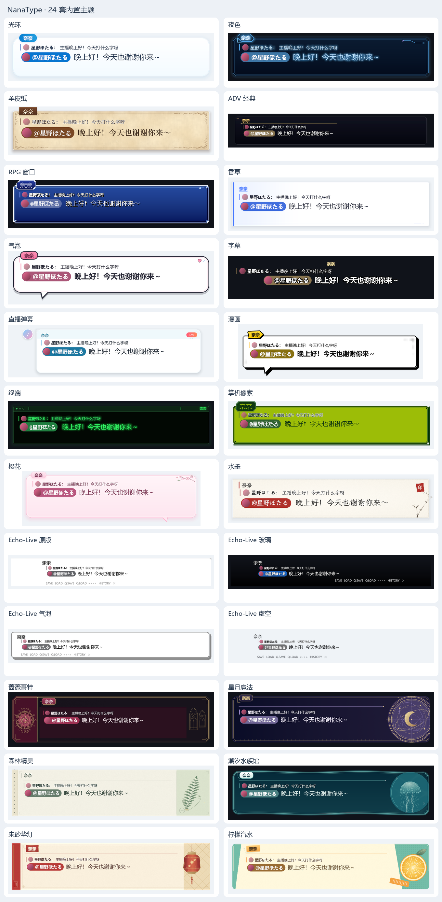
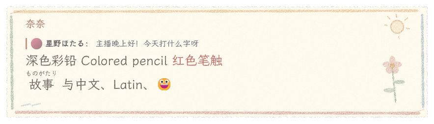

[简体中文](../skins.md) · [English](../en/skins.md) · [日本語](skins.md)

# スキンの形式

スキンパッケージを作成・配布・検証するための TOML リファレンスです。利用者は [使い方ガイド](usage.md) のスキン案内を、作成者は「パッケージ ID と共有リソース」「マニフェスト」から読み始めてください。

**このページの案内**：パッケージ形式 → 内蔵スキン → サウンドパック → マニフェスト → レイアウトと効果 → 検証ルール

スキンは統一パッケージ体系における機能のひとつです。各ディレクトリパッケージは `package.toml` で ID・バージョン・機能（capabilities）・依存関係を宣言し、`skin.toml` でスタイルを記述し、画像・シェーダー・フォント・効果音・ライセンスファイルを同梱します。配布用の圧縮形式は `.ntpkg` です。旧 `.ntskin` 形式はサポートされなくなりました。パッケージはすべて 設定 › プラグインとパッケージ で管理でき、スキンページにはスキン機能を持つパッケージだけが表示されます。

フレームワークの既定値は「透明・枠なし・システムフォント・黒い本文・静的表示」で、特定のスキンデザインは含みません。28 種類の内蔵スキンはそれぞれが自分の見た目を宣言しており、ハローはアプリが既定で選ぶだけの普通のパッケージです。パッケージマニフェストの `base` で別のスキンを継承する場合は、正確なバージョンの依存関係も同時に宣言してください。テーブルは階層ごとにマージされ、配列は丸ごと置き換えられます。`decor = []` で装飾を空にできます。パッケージ ID・名前・タグは親パッケージから継承されません。

## パッケージ ID と共有リソース

```toml
# package.toml
format = 1
schema = 3
id = "my.sakura"
version = "1.0.0"
capabilities = ["skin"]          # skin、resources、lua を組み合わせ可能
name = { zh-CN = "樱", en-US = "Sakura" }
author = "你的名字"
license = "CC-BY-4.0"
base = "nanatype.halo"           # 任意。設定だけを継承

[dependencies]
"nanatype.halo" = "2.1.0"
"my.shared" = "1.0.0"
```

`package.toml` は厳格に解析され、未知のキーがあると読み込みが拒否されます。宣言した機能は中身と一致している必要があります。`skin` には `skin.toml`、`lua` には存在するエントリファイル、`resources` にはリソースファイルが必要です。`skin.toml` はスタイルだけを保持します。パッケージ内のファイルは相対パスで指定し、パッケージをまたぐ参照は `pkg:my.shared/images/paper.png` と書きます。よく使うフォントは引き続き `builtin:fonts/LXGWWenKai-Regular.ttf` で参照できます。見えるのは宣言した依存関係の閉包だけで、欠落・バージョン不一致・衝突・循環・パスの範囲外参照はいずれも読み込みが拒否されます。継承した相対リソースは親パッケージの名前空間に属したままなので、子パッケージの同名ファイルに上書きされることはありません。

エクスポートには依存関係とライセンスファイルがすべて含まれ、依存パッケージは `dependencies/<パッケージID>/` の下に保存されます。同じ依存閉包の中では、各 ID につき正確なバージョンがひとつに固定されます。他のパッケージのリソースを参照しても、そのパッケージのスクリプトは実行されません。詳しくは[プラグインとパッケージのインターフェース](plugins.md)を参照してください。

アプリ全体の UI は独立した NanaUI のニュートラル配色を使い、設定 › 一般 › 外観 で「システムに従う」「ライト」「ダーク」から選べます。スキンに応じて変わるのは、表示ウィンドウ（相手の表示ウィンドウを含む）、履歴ウィンドウ、入力エディタ領域だけです。スキン選択画面のサムネイル、サンプル、カラーパレットもスキンの効果を保ちます。入力ウィンドウのツールバー、ステータスバー、コメントパネルは共通配色です。`chrome` はコンテンツのアクセントカラー、インラインタグの下地色、文字のコントラスト色を提供するもので、アプリの UI は変えません。

## 内蔵スキン

下表の各項目はそれぞれ独立したスキンパッケージで、ディレクトリは `crates/theme/builtin/<ID から nanatype. を除いたもの>/` です。パッケージマニフェスト、スタイル、素材はパッケージと一緒に配布されます。

設定 › スキン › プレビュー で表示ウィンドウと履歴を切り替えると、それぞれ本文フォント（ドロップダウン）、文字サイズ（数値ボックス）、行の高さ（スライダー）、文字色（カラーピッカー）、ウィンドウの幅と高さを調整でき、テスト用テキストも編集できます。変更はまずプレビューに表示され、「保存」を押したときにそのスキンの個人設定へ書き込まれます。ほかのスキンを保存しても、使用中のスキンは切り替わりません。各コントロールの初期値はスキンの既定値で、既定値に戻せばスキンに従う状態に戻ります。幅と高さは空欄にするとスキンの既定に従います。「スキンの既定値に戻す」と「変更を破棄」はアイコンボタンで、ホバーすると説明が出ます。既定値に戻す操作も保存して初めて反映され、設定を閉じると未保存の下書きは破棄されます。個人設定はスキンの元ファイルを変更しません。

表示ウィンドウと履歴はロックを解除すると、四辺や四隅をドラッグして幅と高さを個別に変えられます。文字サイズはそのままで、テキストは折り返し直されます。ウィンドウは 160–8192 × 96–8192 論理ピクセル、文字サイズは 8–200 px、行の高さは 1–3 倍に対応します。背の低い履歴ウィンドウではタイトルを畳み、上下の余白を詰めてメッセージの表示領域を確保します。相手の表示ウィンドウは本文設定を共有し、サイズは別に記憶されます。

| id | 名前 | タグ | 特徴 |
|---|---|---|---|
| `nanatype.machine_learning` | 機械学習 | minimal, game | グラファイトの地に冷たい白の本文と淡い紫のノードネットワーク。文字が高速に演算されてから確定し、段落全体が乱数文字になってランダムに消える |
| `nanatype.crayon` | クレヨン | cute, elegant | オフホワイトの画用紙、柔らかな色のクレヨンと小花の落書き、濃い色鉛筆の文字。静的な GPU マテリアル |
| `nanatype.halo` | ハロー | classic, minimal | 既定。すっきりした青と白の丸いカード、淡い影、空色のカプセル型名前欄。右上のアニメーションなし |
| `nanatype.sonnet` | ソネット | elegant, minimal | 透明な詩句字幕、中国語は文楷・英語は花文字。一文字ずつの金の光と火花の光糸、段落全体が同時に光の塵になる |
| `nanatype.love_letter` | ラブレター | cute, elegant | アイボリーの畝目の便箋に罫線と鎖線、ワインレッドの封蝋、花文字の From 署名。文楷を筆順どおりに時間差で書き、段落全体が同時に溶けて消える。[ラブレターの説明](../love-letter.md)を参照 |
| `nanatype.night` | 夜色 | classic | ネオン管の看板。ナス紫がかった黒地にマゼンタのネオン管と留め具、名前は点灯した一区切りの文字。台詞が替わるとネオン管が二度またたく |
| `nanatype.parchment` | 羊皮紙 | classic, elegant | 子牛皮紙、二重の押し線の枠、四隅の唐草、内側に金線を押した革札の名前欄、明朝体 |
| `nanatype.adv` | ADVクラシック | game | 幅 1280 の映画のレターボックス。上から透明→黒へ溶け、白い細線、明朝の白い名前に短い下線 |
| `nanatype.rpg` | RPGウィンドウ | game, retro | ロイヤルブルーの琺瑯ウィンドウ、三重の面取り、独立した名前欄の小窓とピクセルフォント。待機中はクリスタルが跳ねる |
| `nanatype.vanilla` | バニラ | streaming, minimal | スイス式エディトリアルレイアウト。暖かい白の直角の紙面、バニラビーンズの焦げ茶の縦線、欄見出し風の名前とトンボ |
| `nanatype.bubble` | バブル | streaming, cute | キャンディシール。淡いピンクの地、濃いプラムの太い縁取り、ずらしたピンクの影、キャンディ型の名前欄と弾むハート |
| `nanatype.subtitle` | 字幕 | streaming, minimal | 枠なし。中央揃えで太い縁取りの白文字。名前は金色の縁取り文字で、下地なし |
| `nanatype.livechat` | ライブチャット | streaming | 丸いアバター、テキストだけの名前、角丸のコメント吹き出しと LIVE マーク |
| `nanatype.comic` | コミック | game, cute | モノクロ印刷に印刷イエロー。強弱のある墨線、尖ったしっぽ、二隅の網点、集中線と傾いた黄色のナレーション枠 |
| `nanatype.terminal` | ターミナル | retro, minimal | 琥珀色の蛍光スクリーン、タイトルバーのパスとビジー記号、ごく淡い走査線、中抜きのカーソル |
| `nanatype.pixel` | ポケットピクセル | game, retro | 四階調のグリーン、階段状の枠とピクセルの溝、ピクセルフォント |
| `nanatype.sakura` | さくら | cute | 半透明ピンクのすりガラス、しっぽなし。花枝が右上からはみ出し、枠の外に花びらが数枚舞い、小さな桜が名前を導く |
| `nanatype.ink` | 水墨 | elegant | 生宣紙の余白、下辺にかすれた一筆、墨竹が枠を越えてはみ出し、朱印の落款と楷書体 |
| `nanatype.echo_vanilla` | Echo-Live オリジナル | streaming, minimal | Echo-Live オリジナルを再現。白地、上部の灰色の線、右上の三角、左に張り出した名前、下部のメニューバー |
| `nanatype.echo_glass` | Echo-Live ガラス | streaming | Echo-Live ガラスを再現。下から上への黒のグラデーション、黒縁の白文字、右寄せのメニューバー |
| `nanatype.echo_bubble` | Echo-Live バブル | streaming, cute | Echo-Live バブルを再現。白い角丸の枠、灰色の太い縁、右下のハードシャドウ |
| `nanatype.echo_void` | Echo-Live ヴォイド | streaming, minimal | Echo-Live ヴォイドを再現。完全に透明で、黒い文字と灰色のメニューバーだけ |
| `nanatype.gothic` | 薔薇ゴシック | streaming, elegant | 聖堂のファサード。二枚のステンドグラスの尖頭窓、切妻の薔薇窓、錫銀の窓枠とワインレッドの読書面 |
| `nanatype.celestial` | 星月の魔法 | streaming, elegant | 右下隅を中心にはみ出す真鍮のアストロラーベ、三日月、本文の背後を横切る淡い星の弧 |
| `nanatype.forest` | 森の妖精 | streaming, cute | セージグリーンの台紙に貼った標本紙、マスキングテープの名前欄、上端からはみ出すシダの葉と標本ラベル |
| `nanatype.tidal` | 潮のアクアリウム | streaming, elegant | 波打つ水面が上端になり、クラゲの傘が水面から浮かび、真珠の名前欄が水線に浮かぶ |
| `nanatype.lantern` | 朱の華灯 | streaming, elegant | 黒漆に朱の枠と金の描線。横木から吊るされた二つの提灯が枠の外に下がり、暖かな光が漆面に映る |
| `nanatype.citrus` | シトラスソーダ | streaming, cute | ミントの網点の上に斜めにカットしたソーダのラベル、角からはみ出すレモンの輪切りと傾いたステッカーの名前欄 |



設定 › スキン の上部にあるプレビューカードは、選んだスキン（個人設定を含む）でサンプル台詞をリアルタイムに描きます。行をクリックすると切り替えずにプレビューでき（行末の「⋯」メニューに複製、エクスポートなどの操作があります）、タグとライト／ダークで一覧を絞り込めます。水墨はオープンライセンスの墨竹素材を使い、プロシージャル版画は同じ由来の静的フォールバックを同梱し、複雑な花枝や唐草はオリジナルの透過テクスチャを使います。これらを改造したいときは「複製して編集」を使ってください。サムネイルは表示ウィンドウと同じ静的装飾、しっぽ、サーフェス描画を使い、外側にはみ出す装飾や影のための余白も確保します。続行インジケーターのないスキンでは、プレースホルダーの点は表示されません。

スキンの配色と構図は、通常の表示ウィンドウ、履歴、狭いウィンドウのいずれでも読みやすくなるよう設計されています。紙・線・組版を中心とした静的なスキンに加え、点滅、待機インジケーター、ハート、液晶セルなどを使うスキンがあります。

レスポンシブな縦長レイアウトでは、装飾と状態オブジェクトが利用可能な領域に合わせて配置されます。高度なアニメーションをオフにしても静的な見た目は残ります。長い名前は名前欄内で省略されますが、元の名前は変わりません。個人設定で枠の色を指定した場合は、その色とネイティブの枠描画が優先されます。

履歴は表示ウィンドウの名前欄、枠線、組版を引き継ぎます。装飾は静的に表示され、表示ウィンドウのアニメーションは実行しません。アバター画像は元のまま表示され、画像なしアバターや名前の下地はスキン配色に従います。

水墨には、メトロポリタン美術館のオープン画像から鄭燮『[Bamboo and Poem](https://www.metmuseum.org/art/collection/search/52946)』の墨竹の一部（Public Domain）をそのまま重ねています。切り抜いて紙の地を取り除いただけで、線の描き直しや色の変更はしていません。出典と処理の記録はスキンと一緒に `ink/ART-LICENSE.txt` に収めています。

### Echo-Live のデザイン出典

`echo_vanilla`、`echo_glass`、`echo_bubble`、`echo_void` の四種のスキンは [sheep-realms/Echo-Live](https://github.com/sheep-realms/Echo-Live) のデザインを参考にしており、原作者は Sheep-realms および同プロジェクトの貢献者です。NanaType はこれらのスタイルを独自の TOML スキン形式で実装・調整しています。元のプロジェクトは GPL-3.0-or-later で、詳細はその[ライセンスと声明](https://github.com/sheep-realms/Echo-Live/blob/master/copyright.md)を参照してください。ローカルマニフェストにある CC0-1.0 の表記は、NanaType 自身の貢献部分だけを対象とします。

## サウンドパック

サウンドパックは `capabilities = ["sounds"]` を宣言したパッケージで、ルートに `sounds.toml` を置きます。中身はスキンの `[sounds]` テーブルと同じです。

```toml
[sounds]
open = "sounds/open.ogg"
[sounds.typing]
files = ["sounds/key-1.wav", "sounds/key-2.wav"]
volume = 0.5
[sounds.se]
coin = "sounds/coin.ogg"
```

**設定 › 再生 › サウンドパック** で選ぶと、サウンドパックが `typing` を定義していればスキンのタイプ音とそのリズム（`every_n`、`skip_punct` など）を置き換え、`open`、`advance` を定義していれば対応する効果音を置き換えます。`se` は名前ごとに上書きまたは追加され、スキンのほかの名前付き効果音は残るので、スキン向けに書いた `[se=…]` マークアップもそのまま鳴ります。参照するファイルはパッケージ内（または依存パッケージ内、`pkg:<パッケージID>/<パス>`）になければならず、欠けているとパッケージ全体の読み込みが拒否されます。

選んだサウンドパックが削除された、読み込めない、または現在のビルドから見えない（たとえば GitHub 版では Steam ワークショップの項目が見えない）場合は、一時的にスキン付属の効果音を使って一度だけ通知し、設定はそのまま残します。サウンドパックはスキンと同じパッケージに入れることもできます（`capabilities = ["skin", "sounds"]`）。

## 履歴ウィンドウの共通レイアウト

`history.group_speakers` は、隣り合う同じ話者のメッセージで名前欄を共有するかどうかを決めます。`history.padding` はパネルがないときの左・上・右・下の内側余白、`history.margin` は上・右・下・左の外側余白です。`history.row_padding` は各行の水平の余白、`history.column_inset` は本文カラムの横に追加で確保する幅です。アバターのサイズと `history.text.size` はスキンが設定し、ユーザーの個人設定で通常どおり上書きされます。スキン ID によって書き換える処理は存在しません。

新しいメッセージは `history.entrance`（`slide_up`、`fade`、`slide_left`。`none` はそのまま表示）で入場し、すでに画面にあるメッセージは同じ 220ms のイーズアウトで新しい位置へ滑ります。新しいメッセージが一覧を押し上げると全体が上へ動き、表示件数の上限で最も古いものが消えると下のメッセージがその空きを埋めます。フレームワークの既定は `none` で、内蔵スキンはすべて入場アニメーションを有効にしています。視差効果を減らす設定では、メッセージは即座に定位置に置かれます。

ギフト、スーパーチャット、メンバー加入はイベント行です。スキンは `[history.event]` で専用の見た目（カード、帯、吹き出し、記号、金額ラベル、プラットフォームの価格色）を指定でき、`gift`、`super_chat`、`member` で項目ごとに上書きできます。書かなかった項目はメッセージ行の見た目に戻るため、この節のないスキンではイベントが通常のコメントとして表示されます。内蔵スキンはすべて独自のイベント表示を持ちます。

## マニフェスト

```toml
[meta]                           # 以下の ID 系フィールドは実際には package.toml のルートに置く。ここではフィールドの索引
id = "my.sakura"                  # a-z 0-9 . - _、最大 64 文字
version = "1.0.0"
min_app = "0.1.0"                 # 必要な NanaType の最低バージョン
base = "nanatype.halo"            # 任意：継承するスキン
name = { zh-CN = "樱", en-US = "Sakura", ja-JP = "さくら" }
description = { zh-CN = "粉色樱花", en-US = "Pink blossoms" }   # 選択画面に出る一言紹介（任意）
author = "你的名字"
license = "CC-BY-4.0"
preview = "preview.png"
tags = ["cute", "streaming"]      # 選択画面の分類：classic streaming game retro cute elegant minimal

[chrome]                          # コンテンツの配色。設定やツールバーなどの共通 UI には影響しない
appearance = "light"              # light | dark、スキン選択画面での明暗の分類
accent = "#e86a92"                # 装飾、引用のニックネーム、インラインタグなどのアクセントカラー
surface = "#ffffff"               # エディタのインラインマークアップの下地色の参考
text = "#3a2230"                  # コンテンツ文字のコントラスト縁取りの候補色

[fonts.body]                      # 台詞のフォント。name（名前欄）、accent（装飾文字）も同様
file = "fonts/LXGWWenKai.ttf"     # スキンと一緒に配布するフォント（任意）
families = ["LXGW WenKai", "Microsoft YaHei UI", "PingFang SC"]   # 順に見て最初にインストール済みのものを使う
weight = 500

[dialogue]
region = [760, 150]               # 会話領域（論理ピクセル）
overscan = 18                     # 四方の透明な余白。揺れ／縁取りが切れるのを防ぐ
padding = [20, 22, 20, 14]        # 文字の内側余白：左 上 右 下
background = "images/bg.png"      # 任意
overflow = "scroll"               # 長文：clip 切り捨て / scroll スクロールで追従（既定）/ page 満杯で待機してクリア
overflow_auto_ms = 1500           # page モードで満杯時に自動でページ送りするまでの待ち時間。省略すると続行キーを待つ

[dialogue.box]
# contour = "rounded"             # 任意：Painter で連続した角丸と曲線のしっぽを描く
color = "#ffffffee"
border_color = "#f0cfdc"
border_width = 2
radius = 18
inner_border_color = "#ffe4ee"    # 任意の内枠
inner_border_width = 2
glow = "#e86a9260"                # 任意の外側の光彩
glow_blur = 12                    # 外側の光彩のぼかし半径
shadow = { color = "#00000030", dy = 3, blur = 8 }
frame = { image = "images/frame.png", slice = [24, 24, 24, 24], scale = 1 }   # 9 スライス画像。上の描画の代わりに使う
# repeat = false                 # 9 スライスの中央は既定で引き伸ばし。true でタイル
width_fraction = 1.0              # 領域に対する枠の幅の割合
gradient = { angle = 160, stops = [[0, "#ffffff"], [1, "#ffe9f1"]] }   # グラデーション。color の上に描く
radii = [4, 18, 18, 18]           # 四隅それぞれの角丸：左上 右上 右下 左下（radius の代わり）
border_widths = [0, 0, 0, 4]      # 四辺それぞれの幅：上 右 下 左（border_width の代わり）
border_style = "solid"            # solid | dashed | dotted
shadows = [                       # 追加の影レイヤー。inset = true で内側の影
    { color = "#e86a9240", dy = 6, blur = 18 },
    { color = "#ffffff", dy = 1, inset = true },
]
margin = [0, 0, 26, 0]            # 領域内でしっぽや装飾のために空けるスペース：上 右 下 左

[dialogue.tail]                   # 任意：吹き出しのしっぽ。枠の塗りと縁取りを自動で引き継ぐ
side = "bottom"                   # top | right | bottom | left
at = 0.15                         # しっぽの付け根のその辺上での位置（0–1）
width = 34                        # 付け根の幅
length = 24                       # 枠の外へ伸びる長さ
lean = -10                        # 先端を辺に沿ってずらす量
shadow = true                     # 枠のハードシャドウ（blur = 0 の外側の影）をしっぽにも複製
# color = "#ffe6ef"               # 塗り。既定は枠の色

[[dialogue.decor]]                # 装飾。複数書ける（最大 16 個）
# image = "ink/stroke.png"        # 任意：透過画像素材。元の比率のまま size に収める
# motif = "blossom"               # 任意：曲線図形。polygon や通常の矩形塗りの代わり
anchor = "top_right"              # 装飾自身のこの点を枠の同名の点に合わせ、さらに offset を加える
offset = [-18, -14]
size = [26, 26]                   # ピクセル、または "56%" のような枠サイズに対する割合
# inset = [5, 5, 5, 5]            # 代わりに四辺からの距離で指定（負も可）。内枠線や下敷きに使う
text = "✦"                        # 任意：中央に文字を描く（最大 8 文字）
text_color = "accent"
text_size = 22
font = "accent"                   # body | name | accent
rotate = 12                       # 時計回りの角度
layer = "above"                   # above：枠の上に描く。below：枠の下に描く
when = "always"                   # always | speaker（名前欄があるときだけ表示）
                                  # | display（表示ウィンドウとスキンプレビューでだけ描き、入力ウィンドウでは描かない。
                                  #   メニューバー風のように押せそうに見える装飾に使う）
# motion = { kind = "float", period_s = 6, amplitude = 1.5, phase = 0 }
# ほかに color、gradient、radius、radii、border_color、border_width、
# border_widths、border_style、shadows、opacity、
# さらに polygon = [[0, 0], [100, 0], [50, 100]]（装飾サイズに対する割合で多角形に切り抜く。3–8 点）も使える

[dialogue.text]
color = "#3a2230"
size = 28
line_height = 1.4
letter_spacing = 0                # 字間（ピクセル）。history.text にも書ける
stroke = { color = "#ffffff", width = 2 }
shadow = { color = "#00000055", dx = 1, dy = 1, blur = 2 }
align = "start"                   # start | center | end

[dialogue.nameplate]
color = "#e86a92"
text_color = "#ffffff"
size = 18
radius = 10
padding = [10, 4]
anchor = "top_left"               # 名前欄自身のこの点を枠の同名の点に合わせる
offset = [16, -12]                # さらにずらす。負の値で枠線に重ねる
frame = { image = "images/nameplate.png", slice = [8, 8, 8, 8] }
# 完成した枠画像では layout_inset = false を指定すると、9 スライスは保ったままレイアウトの内側余白を増やさない。既定は true。
stroke = { color = "#000000", width = 3 }   # 名前の縁取り
text_shadow = { color = "#e86a92", blur = 8 }
gradient = { angle = 90, stops = [[0, "#ff8fb8"], [1, "#ffb3cf"]] }
radii = [10, 10, 10, 2]
border_color = "border"
border_width = 2                  # または border_widths = [0, 0, 2, 0] で下線だけ
shadows = [{ color = "#00000040", dx = 3, dy = 3 }]
rotate = -3

[dialogue.portrait]               # 立ち絵 / アバター
visible = true
side = "left"
size = [180, 220]
image = "images/portrait.png"
variants = { smile = "images/portrait-smile.png", angry = "images/portrait-angry.png" }

[dialogue.continue]               # 続行待ちのインジケーター
glyph = "▼"
color = "#e86a92"
size = 16
image = "images/continue.png"     # 任意：文字の代わりに画像を使う
frames = 1                        # 画像が横並びの複数コマのスプライトならコマ数
fps = 8
image_size = [22, 22]
anchor = "bottom_right"
offset = [-14, -8]
motion = "bob"                    # bob（上下に浮く）| blink（点滅）| pulse（拡大縮小）| none
period_s = 0.83                   # 動作の一周期
bob_px = 3
# glyph = "" かつ image がなければ表示しない

[dialogue.reveal]                 # タイプのリズム
base_ms = 50                      # ラテン文字 1 文字あたり
cjk_factor = 2.0                  # CJK 文字 1 文字が何拍に相当するか
space_ms = 50                     # スペース 1 つあたり
punct = { comma_ms = 120, stop_ms = 260, ellipsis_ms = 300 }
entrance = { kind = "fade", ms = 140 }   # none | fade | pop | slide_up

[history]                         # 履歴（配信コメント風）
width = 420
height = 560
avatar = { shape = "circle", size = 40, ring_color = "#ffffff", ring_width = 2 }   # circle | square | none
# アバターには color（画像なしアバターの下地色。既定はアクセントカラーのグラデーション）と radius（square の角丸。既定は辺の 18%）も書ける。
# 配信者と視聴者はスキンの画像なしアバター配色と名前スタイルを共有する。実際のアバター画像は元のまま表示
name_color = "#e86a92"
name_size = 14
name_stroke = { color = "#000000", width = 2 }
name_plate = { color = "accent", text_color = "#ffffff", radius = 9, padding = [9, 2], border_color = "border", border_width = 1 }   # 名前の下地（任意）。contour、gradient、border_widths、shadows に対応
bubble_color = "#ffffffee"
bubble_border = "#f0cfdc"
bubble_border_width = 1
bubble_radius = 14
bubble_radii = [4, 14, 14, 14]
bubble_gradient = { angle = 135, stops = [[0, "#fff0f5"], [1, "#ffe1ec"]] }
bubble_shadows = [{ color = "#00000020", dy = 2, blur = 8, spread = 0 }]  # spread：影の広がり。内側の影で二重線の型押しにも使える
bubble_padding = [12, 8]          # 吹き出しの内側余白：水平 垂直
bubble_frame = { image = "images/bubble.png", slice = [12, 12, 12, 12] }
gap = 10                         # 間隔の目安：stack は文字サイズに応じて 12–20px、同じ発言者の連続メッセージは 8–12px、inline は 8–14px
entrance = "slide_up"             # none | slide_up | fade | slide_left
layout = "stack"                  # stack：名前と時刻を吹き出しの上に | inline：名前・台詞・時刻を同じ行に（チャットログ風）
                                  # stack では同じ人の 2 分以内の連続メッセージをまとめ、最初の一件だけアバター・名前・時刻を表示
name_width = 96                   # inline 時の名前欄の幅。狭いウィンドウでは自動で縮め、本文と @ タグの領域を残す
name_weight = 700
time_size = 11                    # 既定は名前より 3 小さい（「配信者／視聴者」のロールタグにも使う）
time_color = "#8aa0b4"            # 時刻とロールタグの色
time_seconds = false              # true で HH:MM:SS を表示
hide_latest = false               # true：表示ウィンドウにまだ出ている台詞は履歴に入れない（設定 › 履歴 で上書き可）
# 一覧全体の背後のパネル（任意）。gradient / radii / border_widths / border_style / shadows にも対応
panel = { color = "#edeef0", border_color = "#888888", border_width = 0, radius = 0, padding = [18, 18, 18, 18], margin = [0, 0, 0, 0] }   # padding は左上右下、margin は上右下左
title = { text = "HISTORY", color = "#606266", size = 21, weight = 600, background = "#ffffff", height = 42, padding = 18 }   # パネル上部のタイトルバー（任意）

[[history.decor]]                 # パネル上の装飾。フィールドは [[dialogue.decor]] と同じ（when と motion は無効。履歴の装飾は静的）
anchor = "top_right"
size = [11, 11]
polygon = [[0, 0], [100, 0], [100, 100]]
color = "#00000026"
# 紙のテーマでは motif = "paper" で固定のまばらな紙の繊維を描ける。画像の読み込みやコマごとのノイズ生成はしない。

[history.text]
color = "#3a2230"
size = 18

[history.chat]                    # B 站コメントの行（設定 › 履歴 › コメント をオンにすると表示）
text_scale = 0.88                 # history.text に対するコメント文字の大きさ
bubble_opacity = 0.7              # コメント吹き出しの下地全体の不透明度（グラデーション、縁、影、9 スライス画像を含む）。本文は不透明のまま

[history.event]                   # ギフト、スーパーチャット、メンバー加入などのイベント行。この節を書かなければコメント行と同じ見た目
layout = "card"                   # bubble：メッセージ行と同じ配置（既定） | card：行いっぱいのカード。アバター、名前、金額をカード内に置く | notice：アバターなしの帯。名前と内容を一行に並べる
color = "#fff0f5"                 # 以下の外観フィールドを一つでも書くと、吹き出しではなく専用の下地を描く。
border_color = "#f2c4d5"          # 書かなかった項目は吹き出しの bubble_color、bubble_border、bubble_border_width、bubble_radius を使う
border_width = 1.5
radius = 16
# gradient、radii、border_widths、border_style、shadows、contour、material、border_material も使える
padding = [14, 10]                # 水平 垂直。既定は bubble_padding
text_color = "#6b2141"            # 既定は history.text。下地とのコントラストが 4.5:1 未満なら黒か白に切り替える
name_color = "#c2416f"            # カードと通知の名前。bubble 配置で name_plate がない場合は吹き出し上の名前にも使う
icon = "✿"                        # 本文の前の記号。最大 8 文字、fonts.accent で描く
icon_color = "accent"             # 既定は名前の色
price_color = "none"              # プラットフォームが金額に付ける色（スーパーチャットの価格帯の色）の使い道：none | fill（下地全体。文字は黒か白になる）| border | badge（金額ラベルのみ）
opacity = 1.0                     # 下地の不透明度。専用の下地があれば既定 1、なければ history.chat.bubble_opacity
text_scale = 0.88                 # 既定は history.chat.text_scale
badge = { color = "accent", text_color = "#ffffff", radius = 999, border_color = "#ffffff", border_width = 0 }   # 金額ラベル（¥30）。badge を書かず price_color も badge でなければ表示せず、スーパーチャットの金額は本文の先頭に残る

[history.event.super_chat]        # 種類ごとの上書き：gift（ギフト）、super_chat（有料メッセージ）、member（メンバー加入）
price_color = "badge"             # フィールドは [history.event] と同じで、項目ごとに上書きする。書かなかった項目は [history.event]、それもなければメッセージ行の見た目になる

[history.event.member]            # color を変えた種類は [history.event] の gradient を引き継がない
color = "accent"
icon = "★"

[history.reply]                   # 返信コメントへの台詞。吹き出しの上に一行の引用：アバター · ニックネーム：原文（inline レイアウトでは行全体の上、台詞カラムに揃える）
visible = true
size = 12                         # 既定は本文の 62%
color = "#7a6070"                 # 原文の色。既定は本文と同じで、カラーロールも書ける。ニックネームは accent
opacity = 0.8

# 引用のニックネームは fonts.name、原文は fonts.body を使い、現在の表示領域の text の縁取りと影を引き継ぐ。
# 透明な地で縁取りが未指定のときは、配信背景に文字が埋もれないよう引用文字に細いコントラスト縁取りを足す。
# 透明な履歴で縁取りを指定していない浮いたニックネーム、時刻、下地なしの本文にも細いコントラスト縁取りを使い、元の配色は保つ。

[dialogue.reply]                  # 会話ウィンドウ上の返信引用。フィールドは [history.reply] と同じ
visible = true                    # ユーザーも 設定 › 外部コメント › コメントパネル でオフにできる

[dialogue.subtitle]               # セリフの翻訳字幕（設定 › 翻訳字幕）。会話ウィンドウの本文の下に表示。履歴の吹き出しの翻訳もこれを使う
visible = true
size = 18                         # 既定は本文の 70%（11 以上、本文を超えない）
color = "#5a4a55"                 # 既定は本文の色。色ロールも指定可
muted = 0.3                       # 色をウィンドウの地色に寄せる割合（0 はそのまま、1 は地色）。コントラストは 4.5:1 を下回らない
gap = 4                           # 本文との間隔（ピクセル）

# 字幕は本文（[dialogue.text]／[history.text]）のフォント、マテリアル、縁取り（サイズに合わせて縮小）、影、揃えを引き継ぎ、
# 小さく控えめにするだけなので、[dialogue.subtitle] を書かないスキンでもきれいに表示されます。半透明や枠画像の地では色を寄せず、
# 透明な地で縁取りがない場合は細いコントラストの縁取りを付けます。

[mention]                         # 台詞内の [at=…]：アバターとニックネーム付きのタグ。入力欄・会話ウィンドウ・履歴で共通
fill = "accent"                   # タグの下地色。カラーロールも書ける。text_color とのコントラストが 4.5:1 未満なら自動で濃くする
text_color = "#ffffff"            # 常にこのまま使う。タグの下には台詞の影や光彩を描かない
scale = 0.82                      # 周囲の文字に対する文字サイズ
avatar = true                     # ニックネームの前にアバターを表示

[sounds]
typing = { files = ["sounds/key1.ogg", "sounds/key2.ogg"], volume = 0.6, pitch_jitter = 0.05, every_n = 1, min_interval_ms = 30, skip_punct = true }   # skip_punct：句読点では鳴らさない
open = "sounds/open.ogg"          # 一文の開始
advance = "sounds/advance.ogg"    # 続行を押したとき
se = { coin = "se/coin.ogg", boom = "se/boom.wav" }   # [se=coin]

[effects]                         # 文字ごとのエフェクトの既定の強さ
shake_px = 1.6
shake_hz = 14                     # 揺れの周波数
wave_px = 3
wave_period_s = 1.2               # 波の一周期の秒数
jump_px = 6
jump_period_s = 0.9               # 跳ねの一周期の秒数
rainbow_period_s = 2.4
screen_shake_px = 6
contrast_guard = 3.0              # 色付き文字と枠の色のコントラストが 3:1 未満なら 1.5px の縁取りを足す（0 = オフ）
```

## 制限付き WGSL エフェクト（schema 3）

パッケージのルートにある `package.toml` で `format = 1`、`schema = 3`、`capabilities = ["skin"]` を宣言します。`skin.toml` では `shaders` テーブルでエフェクトを定義し、`shader_effects` または装飾の `shader` から参照します。旧形式はサポートされなくなりました。エクスポートには依存関係とすべてのリソースが含まれ、パッケージはオフラインで単独で読み込めます。配列は丸ごと置き換えられ、`shader_effects = []` で継承した表示ウィンドウのエフェクトを、`decor = []` で装飾のエフェクトを空にします。名前付きエフェクトのテーブルはキーごとにマージされ、継承したエフェクトがどこからも参照されなくなれば描画されません。

```toml
# package.toml
format = 1
schema = 3
id = "my.aurora"
version = "1.0.0"
capabilities = ["skin"]
base = "nanatype.halo"
[dependencies]
"nanatype.halo" = "2.1.0"

# 以下は skin.toml として保存
[shaders.world]
source = "effects/aurora.wgsl"
period_s = 12                    # 0.5–3600 秒
intensity = 0.16                 # 0–1。最終的にホストが不透明度に掛ける
textures = []                    # スキン内の画像を最大 2 枚。サンプリングは線形 RGBA を返す
params = [0.35]                  # 最大 8 個の有限な浮動小数点数

[[dialogue.shader_effects]]
shader = "world"
target = "background"           # background | border | artwork

[[dialogue.decor]]
shader = "world"                # この装飾の形の中にエフェクトを重ねる
motif = "moon"
color = "#B5A1E8"
anchor = "top_right"
offset = [-12, -12]
size = [36, 36]
```

WGSL ファイルは `fn effect(input: EffectInput) -> vec4<f32>` だけを実装し、純粋な補助関数を追加できます。戻り値は非プリマルチプライの線形 RGBA です。ホストは色の範囲を制限し、カバレッジマスクと強度を掛けたうえでプリマルチプライし、出力パイプラインに色変換を任せます。本文、名前、引用は常にこれらのエフェクトの上に描かれ、エフェクトが画面を読んだり文字を変えたりすることはできません。

`EffectInput` には `uv: vec2<f32>`（ローカル 0–1）、`size: vec2<f32>`（論理ピクセル）、`phase: f32`（ループの位相 0–1）、`seed: f32`（固定シード）が含まれます。`line_age` / `speaker_age` は対応するイベントからの秒数、`reveal` は現在のページのタイプ進捗、`waiting` は 0 または 1 です。`base`、`accent`、`border`、`text` は線形 `vec4<f32>` のテーマカラーです。`params0` / `params1` にはそれぞれ 4 つのパラメーターが入り、指定のない値は 0 です。

ホストは `sample0(uv)`、`sample1(uv)`、`particles(uv, phase, seed)`、`param(i)` を提供します。サンプリングは宣言した画像にしかアクセスせず、UV は画像の端に制限され、画像がバインドされていなければ透明を返します。`particles` は固定の 16 点を使い、フレームをまたぐ状態は不要です。`param(i: u32) -> vec4<f32>` は `bindings` の `i` 番目を読み（[スキンパラメーター](#スキンパラメーター)を参照）、バインドされていないスロットは 0 です。プログラムは phase、三角関数、固定シードを組み合わせて、流れる光、コースティクス、星の環、泡、短いイベント反応などを作れます。

シェーダーインターフェースのバージョンは ABI 2 です。ABI 1 に `param(i)` とそのバインディングが加わりました。`param` は `fx_` 接頭辞と同様にホスト予約で、同名の独自関数は拒否されます。

```toml
[shaders.art]
source = "art.wgsl"
bindings = [
    [34, 100, 100, 40],                     # リテラル
    ["ear_height", "ear_width", "tail", 3], # 最大 4 つのスカラー：数値はそのまま、真偽値は 0/1、列挙型は選択肢の番号
    "fur",                                  # 色：線形 rgba（ストレートアルファ）。base/accent と同じ
]
owns_continue = true                        # artwork の再生中はプログラムが続行インジケーターを自前で描く
```

`bindings` は最大 64 項目で、各項目が `vec4` ひとつを占めます。テキストパラメーターはバインドできず、色パラメーターは単独で一項目を占める必要があります。パラメーターが変わっても更新されるのはこの uniform だけで、シェーダーは再コンパイルされません。`owns_continue = true` は `target = "artwork"` のプログラムにだけ効きます。プログラムの再生中はホストが `dialogue.continue` を隠し、凍結時・高度なエフェクトのオフ時・コンパイル失敗時はホストが通常どおり描くので、静止画にも続行インジケーターが出ます。

```wgsl
fn effect(i: EffectInput) -> vec4<f32> {
    let wave = 0.5 + 0.5 * sin(i.uv.x * 12.0 + i.phase * 6.28318);
    let event = 1.0 - clamp(i.line_age, 0.0, 1.0);
    return vec4(i.accent.rgb, wave * (0.15 + event * 0.15));
}
```

制限：枠ごとのエフェクトインスタンスは最大 4 個、名前付き定義は最大 16 個。ソースは UTF-8 で 1 ファイル最大 64 KiB、タブと改行以外の制御文字は不可。IR と呼び出し展開後の複雑度はそれぞれ最大 4096 ノード、呼び出しの深さは最大 8 段。1 つの文（`;`、`{`、`}` の間）に含められる演算子・呼び出し・カンマ・メンバーアクセス・添字は最大 256、1 つの式の演算のネストは最大 64 段、`if`/`switch`/`{}` のネストは最大 32 段です。超える場合は `let` で分割してください。ユーザー関数ではループ、独自エントリポイント、グローバル変数、バインディング、ポインターインターフェース、アトミック、ストレージリソース、discard、拡張、診断ディレクティブが禁止されています。`compute`、`workgroup`、`storage`、`ptr`、`atomic…`、`texture_storage_…`、`textureStore`、各種 barrier、`arrayLength`、`subgroup…` はソースに現れた時点で拒否されます（コメントを除く）。`fx_`、`nm_`、`__` はホスト予約の接頭辞です。ホストのラッパーと結合したモジュールのエントリポイントはホストの頂点・フラグメントの 2 つだけで、コンピュートシェーダーは決して実行されません。固定長配列は最大 64 要素、1 つの型は最大 4096 バイト、1 関数のローカル変数は最大 16 KiB。テクスチャは長辺 2048 まで、1 スキンのデコード後のテクスチャは最大 32 MiB、プロキシのテクスチャとマスクのキャッシュは合計 64 MiB の予算です。

実行時の隔離：WGSL の検証は独立したスレッドで行われ、検証器がクラッシュしてもそのシェーダーがエラーになるだけで、スキンのほかの部分は通常どおり読み込まれます。GPU コンパイルも独立したスレッドのエラースコープ内で行われ、失敗するとそのエフェクトが無効になります。すべてのスキンプログラムは 1 秒あたりの GPU 予算を共有します（ピクセルあたりの展開複雑度 × カバーするピクセル数を描画ごとに累計。最も重い内蔵テーマが 3840×2160 全面を 60 fps で描く場合の約 1.6 倍）。1 秒以内に超えると、最もコストの高いプログラムからまず凍結され（アニメーションオフとして描画）、凍結しても超える場合は停止されて通知が出ます。GPU デバイスロストが起きると、ロスト前 2 秒以内に描画していたプログラムが 1 回カウントされ、2 回目で停止されます。クラッシュ保護は初めて描画するプログラムを `config/shader-guard.json` に記録し、約 2 秒または 120 回正常に描画したら削除します。その間にアプリやドライバーが終了した場合、次回起動時からそのプログラムは停止されたままです。「スキンの高度なエフェクト」をオフにしてからオンにし直すと、これらの停止・凍結の記録が消去されて再試行されます。スキンがプログラムを変更するとハッシュが変わるので、それも再試行されます。`materials.*` は UI フレームワークが描画し、同じ予算とクラッシュ保護の対象です。そのデバイスでエフェクトも描画していれば、デバイスロストのカウントにも含まれます。フレームワークはコンパイルと描画のたびにホストへ問い合わせ、形状の面積または文字の描画範囲でコストを計上します。マテリアル自体は静的で凍結できるアニメーションがないため、予算を超えると停止され、停止したマテリアルは元のスタイルで描かれます。これらの対策は障害が起きた後の被害を抑えるもので、単発のドライバー障害を防ぐことはできません。

`cargo run -p nanatype-theme --example check_package -- <包>` を実行すると、各シェーダーの式のネストの深さも一覧表示されます。

設定 › スキン › スキンの高度なエフェクト は既定でオンです。視差効果を減らす設定ではこの節の動的 WGSL を止め、次の節の静的な汎用マテリアルは残します。エディタ、履歴、サムネイルは静的で、現在のテーマはプレビューカードの再生ボタンを押したときだけ再生されます。ループは描画フレームだけを要求し、スキン独自のループは既定で 30 fps です。設定 › スキン › スキンのフレームレート で 60 fps に変えられます。表示ウィンドウのタイプや文字ごとのエフェクトはこの設定に制限されません。設定 › スキン › スキンのアニメーション は既定でオンです。オフにすると、すべてのスキンプログラムと光の帯が視差効果を減らすときと同じように凍結されます。各プログラムはオフスクリーンで静止画を 1 コマだけ描き、以降のフレームはその画像をそのままコピーします（サイズ、拡大率、デバイスが変わったときに一度描き直す）。シェーダーをコマごとに実行することはなくなり、静的な汎用マテリアルは影響を受けません。インポートエラーではファイルパスと WGSL の診断（行・列はスキンファイルにそのまま対応）が表示されます。無効なホットリロードでは直前の有効なスキンが保持され、GPU コンパイルに失敗したエフェクトは無効になって静的な見た目が残ります。

作者向けの完全なサンプルは [aurora/skin.toml](../examples/aurora/skin.toml) で、[aurora.ntpkg](../examples/aurora.ntpkg) をそのままインポートできます。新しい内蔵テーマの六種はそれぞれ WGSL 1 本、透過の装飾テクスチャ 1 枚を使い、独自パラメーターも装飾ノードもゼロです。構図と静的フォールバックは[デザインノート](../skin-art-direction.md)、素材の参考とベクターの原図は[出典の記録](../skin-art-sources.md)を参照してください。

`target = "artwork"` はフル画面の構図に使います。プログラムが透明な輪郭、マテリアル、枠、装飾を自分で描き、ホストは表示ウィンドウの矩形キャンバスを提供して、元の枠のカバレッジマスクは使いません。複数の artwork インスタンスは `shader_effects` の順に重なります。1 つのプログラムがノード上限を超える場合は、背面レイヤーと前面レイヤーに分けられます。`dialogue.box.frame` を完全な静的フォールバックとして設定してください。`cargo run -p nanatype --example skin_artwork -- crates/theme/builtin` で内蔵画像を焼き直せます。`-- --package <目录> [--preset <预设>] [--out <png>] [--at <毫秒>] [--scale <倍数>]` を付けると 1 つのパッケージを焼きます（すべての artwork レイヤーを順に重ねます。`--at` は 16 秒ループの別の時点を描いてアニメーションを確認するため、`--scale` は高 DPI 倍率で描いて線幅とアンチエイリアスを確認するためのものです）。`cargo run -p nanatype-theme --example check_package -- <目录或 .ntpkg>` はアプリと同じ方法でパッケージを検証し、各シェーダーの IR と展開コストを一覧表示します。上限を超えた場合も報告します。フォールバックと WGSL はどちらも本文、引用、名前より前に描かれます。静的フォールバックを宣言していないサードパーティのプログラムは、アニメーションオフ時にユーザーコードを送信しません。`static_fallback = true` のレスポンシブ版画は時計を凍結して完全なマテリアルと装飾を保ち、アニメーションフレームの要求を止めます。

## コンテンツ配色の参考（chrome）

`[chrome]` には `appearance`、`accent`、`surface`、`text` だけが含まれます。`appearance` はスキン選択画面での明暗の分類、`accent` は装飾・引用のニックネーム・インラインタグなどのアクセントカラー、`surface` はエディタのインラインマークアップの下地色に使われ、`text` はコンテンツ文字のコントラスト縁取りの候補色を提供します。

UI の明暗は 設定 › 一般 › 外観 で決まり、既定はシステムに従います。履歴に時刻を表示するかどうかは 設定 › 履歴 で決まり、一覧は常にコンテンツ領域の上端から並びます。

共通 UI は NanaUI 標準のライト・ダーク配色と固定のアクセントカラーを使い、既存の角丸、余白、カードの影、アニメーションを保ちます。スキンの個人設定のアクセントカラーはスキンのコンテンツにだけ影響し、アプリのボタンや選択状態は変わりません。

## 汎用マテリアル



schema 2 のスキンは NanaUI の汎用フラグメントマテリアルを使い、枠や字形の内側にテクスチャを描けます。クレヨンのスキンは静的な紙の目、クレヨンの枠、色鉛筆のハッチングを使います。本文、名前、引用、ルビには対応する領域の文字マテリアルを使い、エディタでは文字マテリアルを有効にしません。

汎用マテリアルはパラメーターだけを更新し、シェーピングやグリフの再アップロードを避けます。マテリアルを使わない場合はネイティブ経路と同じ描画になり、静止フレームでは不要なアニメーション更新を要求しません。

高度なエフェクトをオフにしてからオンに戻すと、停止・凍結されたプログラムを再試行できます。入力や履歴の内容を変えずに、スキンの描画だけを切り替えます。

```toml
[materials.paper]
source = "materials/paper.wgsl"
params = [0]                    # 最大 8 個の有限な浮動小数点数。0 で埋めて vec4 2 組にする
textures = []                   # 最大 2 スロット：画像パスまたはパイプラインのテクスチャ出力。画像は 2048×2048 以下
# uniforms = [{ pipeline = "…", output = "…" }]  # パイプラインの vec4 出力。params の後ろに並ぶ

[materials.pencil]
source = "materials/pencil.wgsl"

[dialogue.box]
material = "paper"              # 背景の塗りのマテリアル
# border_material = "paper"     # 独立した枠のマテリアル

[dialogue.text]
material = "pencil"

[history]
bubble_material = "paper"

[history.text]
material = "pencil"
```

形状の共通フィールド `material`、`border_material` は名前欄、パネル、通常の図形装飾にも使えます。現在のマテリアルは通常の矩形、角丸矩形、polygon による切り抜きに対応しています。contour/motif を使う独自パスの描画はそのままです。テーブルは名前ごとにマージされ、参照するファイルは複製やエクスポートのときにすべて同梱されます。マテリアル定義は全体で最大 16 個、マテリアルテクスチャのデコード合計は 32 MiB が上限です。ソース、ファイルパス、計算の複雑度はスキンのシェーダーと同じ制限付き検証に従います。

### 宣言的な処理パイプライン

シェーダー専用のデータはホストに登録された処理器（processor）が変換し、Lua は実行しません。データは `package.toml` で `[data.<id>]` として宣言します（[統一パッケージの全体設計](../package-design.md)を参照）。`skin.toml` の `[pipelines.<名前>]` で処理器 `processor` とバージョン `version` を選び、`inputs` で各入力をデータ参照 `{ data = "<id>" }`（依存パッケージなら `pkg:<パッケージID>/<id>`）または別のパイプラインの出力 `{ pipeline = "…", output = "…" }` にバインドします。`params` には処理器が宣言した有限の数値だけを指定できます。マテリアルの `textures` スロットには `{ pipeline = "…", output = "…" }` を書け、`uniforms` は `vec4` 出力をバインドして静的な `params` の後ろに順に並べます。

```toml
[pipelines.stroke_map]
processor = "text.stroke_time_map"   # 入力は nthz の筆順データと現在の文字組版
version = 1
inputs = { strokes = { data = "strokes" } }

[materials.write]
source = "write.wgsl"
textures = [{ pipeline = "stroke_map", output = "time" }]   # 時間テクスチャ
uniforms = [{ pipeline = "stroke_map", output = "extent" }] # material_param(0u)
```

現在登録されている処理器は `text.stroke_time_map` v1（`time` テクスチャと `extent` を出力）です。パイプラインは最大 8 本、連鎖の深さは 4 以下で、循環してはいけません。未登録の処理器やバージョン、入力の不足や余分、ポートの型の不一致、パラメーターの範囲外、テクスチャスロットが 2 を超える、`params` と `uniforms` の合計が vec4 4 組を超える、のいずれも読み込みが拒否されます。マテリアルから使われていないパイプラインには警告が出ます。文字組版に依存するマテリアルは `dialogue.reveal.entrance.material` でしか使えません。履歴や編集欄などその文脈がない場所では、パイプラインのテクスチャスロットは透明なプレースホルダーになり、シェーダーは通常のフェードインにフォールバックします。処理結果はデータ内容のハッシュ、マテリアル、組版ごとにキャッシュされ、文字・フォント・組版・サイズ・書字方向が変わったときだけ作り直されます。再生の進捗は GPU が計算します。

WGSL は `fn material(i: MaterialInput) -> vec4<f32>` だけを実装し、純粋な補助関数を追加できます。`i.position` はローカルの論理ピクセル、`i.uv` は正規化座標、`i.size` はローカルのサイズです。文字の場合、ローカル領域は現在の字形セルで、`i.glyph_uv` はその正規化座標です。形状の場合この値は 0 です。`i.color.rgb` は解決済みの線形の文字色または形状色で、alpha は 1 です。戻り値は非プリマルチプライの線形 RGBA で、alpha は追加のカバレッジとして扱われます。フレームワークが元の不透明度、字形／形状のマスク、クリッピングをまとめて掛けるので、マテリアルが描画範囲を広げることはできません。テクスチャは `material_sample0(uv)` / `material_sample1(uv)` でサンプリングし、`material_param(0u)`、`material_param(1u)` でパラメーターを読みます。

マテリアルは静的で、連続フレームを自動では要求しません。視差効果を減らす設定でも残ります。高度なエフェクトをオフにするとマテリアルが外れ、静的な枠と通常のフォントで表示されます。コンパイルに失敗したりリソースが使えなかったりすると基本スタイルにフォールバックします。明示した文字色、コントラスト縁取り、タイプライター、既存の文字エフェクトは引き続き有効です。貼り付け画像やカラー絵文字には文字マテリアルは適用されません。

クレヨンの静的な枠は本番のマテリアルアダプターで生成されており、再現できます：

```powershell
cargo run -p nanatype --example material_artwork -- crates/theme/builtin/crayon/paper.wgsl crates/theme/builtin/crayon/still.png 860 230
cargo run -p nanatype --example material_artwork -- crates/theme/builtin/crayon/paper.wgsl crates/theme/builtin/crayon/bubble.png 320 108 1
```

## 文字効果とコントラスト

- **光彩**：文字の `[shadow=颜色,0,0,模糊]`（オフセットなし＝光彩）を明るい枠の上に描くと、不透明度は最大 55%、ぼかしは最低 10px になり、汚れた影ではなく光に見えるようになります。ツールバーから挿入する光彩は既定でスキンの `accent` を使います。
- **コントラスト保護**（`effects.contrast_guard`）：色付きの文字と `dialogue.box.color`（履歴では `history.bubble_color`）のコントラストがこの値を下回ると、その下に 1.5px の縁取りを加えます。色はスキンの文字色と枠線色のうち、その文字から最も遠い墨色です（pixel は `#0f380f`）。すでに縁取りのある文字は変わりません。枠の色の不透明度が 50% 未満のときは判定しません。内蔵の明るいスキン、pixel、terminal は既定で 3.0、それ以外は 0（オフ）です。
- **スキンの文字の影**：`dialogue.text.shadow` が色付きの光彩（terminal の緑、night の青など）のとき、色付きの文字は自分の色で光るようになり、スキンの緑の光がかぶることはありません。黒などのニュートラルな影はそのままです。
- 以上は表示ウィンドウ、履歴、スキンプレビューにだけ作用します。入力欄の文字は、そのまま保存できるよう常に元のとおり表示されます。

## 色、グラデーション、影

色は `#rgb`、`#rgba`、`#rrggbb`、`#rrggbbaa` で書きます。上で新しく加わったフィールド（グラデーションの色標、`shadows`、しっぽ、装飾、名前欄の枠、履歴の名前カプセル、アバターのリング）にはカラーロールも書けます。スキン内の対応する色に従い、ユーザーの個人設定にも追従します。

| ロール | 対応 |
|---|---|
| `box` | `dialogue.box.color` |
| `border` | `dialogue.box.border_color` |
| `accent` | `chrome.accent` |
| `text` | `dialogue.text.color` |
| `name` | `dialogue.nameplate.color` |
| `name_text` | `dialogue.nameplate.text_color` |

枠、名前欄、履歴パネル、装飾は任意の `contour` に対応します。履歴の吹き出しは `bubble_contour` を使い、履歴の名前カプセルも `name_plate` の中に `contour` を書けます。プリセットは `rounded`（なめらかな角丸と連続した曲線のしっぽ）、`orbit`（偏心した角丸）、`hud`（計器風の面取り）、`parchment`（紙の縁）、`cinema`（ワイドの面取り）、`rpg`（階段状の枠）、`slant`（斜めカット）、`cloud`（雲）、`chat`（コメント吹き出し）、`comic`（漫画のコマ）、`terminal`（筐体）、`pixel`（ピクセルの溝）、`sakura`（花びらの縁）、`ink`（不規則な紙）、`ribbon`（リボン）、`seal`（印章）です。書かなければ従来の矩形、角丸、辺ごとの枠線のままです。異形の枠では塗り、縁取り、影が同じパスを共有します。`dialogue.tail` の位置、幅、長さ、傾きは輪郭に統合され、しっぽは枠の塗りと影を共有します。`tail.color` / `tail.shadow` は従来の独立した三角のしっぽにだけ使われます。コンテンツ領域は矩形のままで、輪郭が本文を切り抜くことはありません。小さな履歴の吹き出しや名前欄では、縁の起伏が自動的に小さくなります。

装飾には任意で `motif` を指定できます：`orbit`（軌道の弧）、`sparkle`（曲線の星の光）、`blossom`（切れ込みのある五弁の桜）、`petal`（花びら）、`flourish`（巻き葉）、`rays`（放射線）、`halftone`（網点）、`fold`（折り返し）、`circuit`（回路線）。図形は装飾の既存の色、グラデーション、枠線色を使います。装飾は `image` でパッケージ内の PNG、JPEG、WebP、GIF を参照することもでき、元の比率のまま `size` の中に完全に表示されます。画像は `opacity`、`rotate`、アニメーションを引き継ぎ、読み込みに成功するとその装飾の塗り、グラデーション、`motif`、`contour`、`polygon` を上書きします。画像はスキンと一緒にエクスポートされ、継承したスキンからも元の画像をそのまま使えます。それ以外のサーフェスの優先順位は、使用可能な 9 スライス画像、`motif`、`contour`、従来の矩形／`polygon` の順です。画像スキンは従来の描画のままです。プレビュー、サムネイル、履歴、表示はすべて Surface のサーフェス描画と Painter を共有し、外部スクリプトや SVG は読み込みません。独自の輪郭や図形も既存の `rotate`、`opacity`、装飾のレイヤー順、カラーロールに従います。

装飾には任意で `motion = { kind, period_s, amplitude, phase }` を指定できます。`kind` は `float`（上下に漂う。`amplitude` はピクセルで 0–32）または `breathe`（不透明度の呼吸。`amplitude` は最大で下げる不透明度の割合で 0–1）です。周期 `period_s` は 0.5–120 秒、`phase` は 0–1 の周期オフセットです。既定値は `float`、6 秒、0.1px、0 で、`motion` を書かなければ完全に静止します。漂いは 2px 以下、呼吸は 0.15 以下、周期は 5 秒以上を推奨します。動きは元の回転と不透明度に重ねられ、描画だけを変えてレイアウトや折り返しは変えません。再生されるのは自分の表示ウィンドウと連携相手の表示ウィンドウだけで、編集領域、履歴、スキンプレビュー、サムネイルは元の姿勢を使います。システムやアプリで視差効果を減らす設定が有効なときも元の姿勢です。空の表示ウィンドウが装飾のために連続してフレームを要求することはありません。ウィンドウを隠していても OBS 出力があれば通常どおり描画します。

グラデーション `gradient = { kind, angle, center, circle, stops }`：`kind` は `linear`（既定。`angle` は CSS と同じで 0 = 上向き、90 = 右向き、既定は 180）または `radial`（`center` は割合で、既定は `[50, 50]`）です。`stops` は 2–8 個の `[位置 0–1, 色]` で、位置は減ってはいけません。グラデーションは枠線には描けません。グラデーションの枠線が必要なら、`layer = "below"` で `inset` を負の値にした装飾を枠の下に敷いてください。

枠ごとの影は最大 4 層で、旧フィールドの `inner_border_color`、`glow`、`shadow` もそれぞれ 1 層を占めます。

設定で「ウィンドウの色」を上書きすると枠のグラデーションが、「名前欄の色」を上書きすると名前欄のグラデーションがオフになり、選んだ色が見えるようになります。

## フォント

NanaUI は一度にひとつのフォント名しか使わないため、NanaType は `families` のうち最初にインストール済みのものを先頭に置きます。どれもインストールされていなければシステムの既定フォントを使います。スキンに同梱した `file` のフォントは常に優先されます。

`file = "builtin:fonts/X.ttf"` はプログラムに組み込まれたフォント（`crates/theme/fonts/`、[フォント](fonts.md)を参照）を参照します。内蔵スキンはこれでフォントを持ち、ユーザーのスキンからも参照できます。登録されるのはスキンを選んだときだけで、複数のロールやスキンが同じフォントを共有しても登録は 1 回です。このバージョンにそのフォントが含まれていなくてもエラーにはならず、そのまま `families` にフォールバックします。スキンライブラリがスキンに「代替フォント」の印を付けるのは、`families` に使えるフォント（インストール済み、または NanaUI 付属の Noto Sans SC）がひとつもなく、使える同梱フォントファイルもない場合だけです。

現在同梱している内蔵フォント（バージョン、出典、SHA-256 は[フォント](fonts.md)を参照）：

| 参照 | フォント | バージョン | サイズ | 使っている内蔵スキン |
| --- | --- | --- | --- | --- |
| `builtin:fonts/FusionPixel12pxProportionalSC.ttf` | Fusion Pixel 12px Proportional 簡体字（GB2312 サブセット） | 2026.09.25 | 1.39 MiB | `pixel`、`rpg` |
| `builtin:fonts/LXGWWenKai-Regular.ttf` | 霞鶩文楷 Regular（常用 3,755 字のサブセット） | 1.522 | 2.04 MiB | `ink`、`crayon` |

`echo_*` はフォントファイルを同梱せず、`families` の末尾が NanaUI 付属の `"Noto Sans SC"` です。

## 検証ルール

インポート時に次のいずれかを満たさないとスキン全体が拒否され、該当するフィールドが表示されます。

- `schema` が現在のプログラムより新しい、または `min_app` が現在のバージョンより高い
- `id` が不正、または内蔵スキンと重複している
- パスが範囲外（`..`、絶対パス、ドライブ文字）またはファイルが存在しない
- 1 ファイルが 64 MiB を超える、またはスキン全体が 256 MiB を超える
- 画像が PNG / JPEG / WebP / GIF でない、辺が 8192 を超える、または 9 スライスのスライスが画像からはみ出している
- フォントを解析できない。効果音が WAV / OGG / FLAC / MP3 でない
- 色や数値が不正（文字サイズが 4–400 の範囲外など）
- グラデーションの色標が 2–8 個でない、または位置が減少している。角丸が 0–2000、枠線が 0–64 の範囲外。影が 4 層を超える
- `[history.event]` と種類ごとの `icon` が 8 文字を超える、`padding` が 0–1024、`opacity` が 0–1、`text_scale` が 0.3–3 の範囲外
- 装飾が 16 個を超える、多角形が 3–8 点でない、文字が 8 文字を超える。しっぽや `continue` のコマ数・速度が範囲外。`margin` が領域を埋め尽くしている
- パラメーター宣言、プリセット、`{ param = … }` プレースホルダーが不正、またはパラメーターが取りうる値（範囲の両端、各選択肢、最長のテキスト、各プリセット）が埋め込み先のフィールドを範囲外にする（[スキンパラメーター](#スキンパラメーター)を参照）

`tags` の不備は警告のみです。

マニフェスト内の未知のフィールドは警告されて無視されます。スキンを作るときはこうしたフィールドを整理してください。

## スキンパラメーター

スキンはパラメーターの組を宣言でき、ユーザーは 設定 › スキン › プレビュー で調整します。パラメーターの値はそのスキンの個人設定に保存され、スキンのファイルは変更しません。「スキンの既定値に戻す」で一緒にクリアされ、「既定」プリセットでも既定値に戻ります。パラメーターはホストが描くフィールドに埋め込むことも、シェーダーにバインドすることも、その両方もできます。

```toml
[param_groups.ears]
name = { zh-CN = "耳朵", en-US = "Ears" }
order = 1                                   # グループもパラメーターも order、次に id の順に並ぶ

[params.fur]
type = "color"                              # number | color | bool | enum | text
group = "ears"
name = { zh-CN = "毛色", en-US = "Fur" }
default = "#fff7ec"
# alpha = true                              # 半透明を許可。既定では不透明でなければならない

[params.ear_height]
type = "number"
default = 36
min = 16
max = 80
step = 1
unit = "px"                                 # 表示単位。"%" は 0–1 の値をパーセントで表示する

[params.motion]
type = "enum"
default = "cat"
options = [{ id = "cat", name = { zh-CN = "猫" } }, { id = "fox", name = { zh-CN = "狐" } }]

[params.sign]
type = "text"
default = "喵"
max_len = 4                                 # 1–64 個の書記素クラスタ。allow_empty = true で空欄を許可

[presets.red_fox]
name = { zh-CN = "赤狐" }
values = { fur = "#fff3e6", motion = "fox" } # 書かれていないパラメーターは既定値

[[param_checks]]                            # 警告のみで、拒否はしない
foreground = "text"                         # 色パラメーター、またはカラーロール box、border、accent、text、name、name_text
background = "fur"
min = 4.5

[dialogue.box]
color = { param = "fur" }                   # どのフィールドもプレースホルダーにできる
```

**プレースホルダー**：`{ param = "<id>" }` は値全体でなければならず、ほかのキーを併記できません。読み込み時はまず既定値を代入し、通常のマニフェストとして検証します。ユーザーの値はその後で同じ位置に書き込まれます。プレースホルダーは `fonts`、`sounds`、`pipelines`、`materials` の下、`shaders` の中の `params`・`intensity` 以外の場所、`dialogue.responsive.rules` の下には置けず、`image`、`file`、`source`、`textures`、`families`、`font_family` フィールドにも使えません。したがってパラメーターがスキンの読むファイルを変えることはありません。`[dialogue]` に書いたプレースホルダーはレスポンシブレイアウトと一緒に展開されます。整数のフィールドには、範囲もステップも整数の数値パラメーターしか埋め込めません。

**検証**：
- パラメーター id、グループ id、プリセット id、選択肢 id はいずれも a-z、0-9、`_` からなる 1–32 文字
- 数の上限：パラメーター 64 個、グループ 16 個、プリセット 32 個、チェック 16 件
- number は有限の `min` < `max` が必要で、`step` は 0 より大きく範囲を超えず、既定値はステップの格子上にあること
- enum は重複のない 1–16 個の選択肢を持ち、既定値はそのいずれか
- text は改行と制御文字を許可しない
- プリセットの各値は対応するパラメーターのルールに合っていること
- 読み込み時には、各パラメーターの両端、各選択肢、最長のテキスト、各プリセットをそれぞれマニフェストに代入して再検証します。たとえばテキストパラメーターを装飾の `text`（最大 8 文字）にバインドした場合、`max_len` は 8 を超えられません。

宣言しただけで使っていないパラメーターには警告が出ます。

**保存とフォールバック**：
- 個人設定には既定値と異なる値だけを保存し、読み込みは寛容に扱います。真偽値・有限の数値・文字列のいずれでもない値はそのまま捨てられ、設定ファイルが無効になることはありません。
- スキンを適用するとき、パラメーターのルールに合わなくなった値は既定値に戻り、一度だけ通知されます。ホットリロード後に再び有効になる可能性があるため、保存された値はそのまま残ります。
- ある値の組でスキンの検証が失敗した場合は、パラメーター全体を無視して通知します。
- 旧来のグローバルな色の上書きは引き続きパラメーターより優先されます。

**UI**：設定ページはパラメーターの型に応じてコントロールを生成します。

| 型 | コントロール |
|---|---|
| number | 数値表示付きのスライダー |
| color | カラーピッカーと 16 進数の入力欄 |
| bool | スイッチ |
| enum | 短い選択肢が 4 つ以下ならセグメントコントロール、それ以外はドロップダウン |
| text | テキストボックス |

入力を解析できないときはフィールド内に理由が表示され、プレビューは直前の有効な値を保ち、保存時には有効な値だけが書き込まれます。プリセットはタグの列として表示され、現在の値がちょうどあるプリセットと一致するとそれが強調表示されます。`param_checks` を満たさない色の組み合わせは警告として一覧表示されます。

**継承とエクスポート**：`[params.<id>]`、`[param_groups.<id>]`、`[presets.<id>]` は id ごとに深くマージされ、子スキンは既定値、範囲、名前を変えられます。`param_checks` と `bindings` は配列なので丸ごと置き換えられます。エクスポートと単独マニフェストではプレースホルダーが保持されます。「複製して編集」は現在のパラメーター値を複製先のパラメーターの既定値として書き込みます。

**静止画**：

| 場面 | 表示 |
|---|---|
| サムネイル、入力ウィンドウ、エディタ | `still.png`、つまり既定値 |
| 表示ウィンドウと設定のプレビュー（`static_fallback = true` のとき） | 現在のパラメーターで同じプログラムを実行。アニメーションオフ時は静止姿勢で凍結 |

[NanaTypeSkins](https://github.com/sena-nana/NanaTypeSkins) の Kemomimi（ケモミミ）は最初のパラメーター化スキンです。46 個のパラメーターと 10 個のプリセットを持ち、耳、しっぽ、枠はすべて同じ SDF プログラムがパラメーターに従って生成します。背面レイヤー（影、枠とひと続きの輪郭になったしっぽ、枠の面と斑紋）と前面レイヤー（耳とその頭頂へのつながり）の 2 つの artwork に分かれています。耳が表情を担い、文の始まりで立ち、話者が替わると一度ピンと立ち、タイプ中は警戒し、待機中はくつろぎます。文と文の間は 16 秒のスクリプトに従って耳を震わせ、片耳を横に向けて聞き耳を立て、首をかしげると一緒に傾き、耳の先は動きに少し遅れてついてきます。

## ホットリロード

スキンを作るときは 設定 › スキン で「ファイルの変更時に再読み込み」をオンにすると、フォルダー内のファイルを変更したとたんに表示ウィンドウが更新されます。

スキンのカタログは静的な選択画面のためだけに使われます。内蔵 WGSL はスキンを適用したときか現在のプレビューを再生したときに検証とテクスチャのデコードを行い、以降はその結果を再利用します。選択画面の更新やディレクトリの再スキャンで内蔵プログラムを何度も準備し直すことはありません。適用していないスキンを見ている間も個別にアニメーションを再生でき、現在のスキンは変わりません。ユーザーフォルダーとインポートしたパッケージは引き続き完全に検証され、ホットリロード後は選択画面と表示が同じスキャン結果を使います。ユーザースキンを手動で切り替えたりプレビューを再生したりするとファイルを読み直すので、ファイル監視を有効にしていない編集にも対応します。検証に失敗した場合は直前の有効なバージョンを表示し続けます。テーマライブラリの `load` を直接使うとユーザーファイルを読み直し、`load_scanned` は直近のスキャンのスナップショットを返します。

WGSL を含むエクスポートパッケージでも継承は展開されリソースは同梱されますが、単独マニフェストでは文脈の既定値と同じフィールドは省略されます。元の継承マニフェストはそのまま保たれ、`decor = []` のような明示的なクリアは削られません。作者向けツールは `standalone_manifest` で解決済みのスキンから同じ単独マニフェストを生成できますが、まだマージしていない子スキンを削るのに使ってはいけません。

完全な Artwork は自分で透明な輪郭を提供するので、そのカバレッジマスクは白い 1 ピクセルを使い回し、サイズや DPI に応じて作り直しません。背景、枠線、装飾は引き続き対応する実際のマスクを使います。プレビューは静的描画に必要な画像だけを読み込み、適用中のスキンは `skin:` でパッケージ内のほかの画像も使えます。

内蔵スキャンを静的カタログの生成だけにし、WGSL をオンデマンドで準備・再利用するようにした後の、同じマシンでの開発ビルドの計測値（当時 24 種、5 回測定の中央値）：

| 操作 | 最適化前 ms | 最適化後 ms |
| --- | ---: | ---: |
| コールドなカタログスキャン | 1151.23 | 24.53 |
| 全スキンの繰り返し読み込み | 1301.739 | 0.004 |
| 実体化済み選択画面の更新 | 1121.494 | 0.063 |
| 内蔵カタログの再スキャン | 1157.951 | 0.029 |

安定したフレームでは文字のシェーピングやレイアウトの更新はありません。静的なベースラインと比べ、単一出力の WGSL はフレームごとに 176 バイトのパラメーターアップロードが増えるだけです。単独マニフェストで既定値を省略した結果、24 種の合計は 113,900 バイトから 62,439 バイトに減り、各スキンを往復変換しても同じ Skin が得られます。再計測には `cargo run -p nanatype --example skin_load_perf -- <输出.json>` と `gpu_perf` を使います。

## 文字エフェクトの組み合わせと会話ウィンドウのスイープ光

`[wave][rainbow]文字[/rainbow][/wave]` のように文字ごとのエフェクトを組み合わせられ、変位は加算、拡大率と不透明度は乗算されます。脈打つ拡大縮小の `[pulse]` と点滅の `[flicker]` が加わり、同じく `amp` / `speed` に対応します。スキンの既定パラメーターは `effects.pulse_amount`（既定 0.12、0–2）、`effects.pulse_period_s`（既定 1 秒、0.05–3600）、`effects.flicker_amount`（既定 1、0–1）、`effects.flicker_hz`（既定 8、0–60）です。視差効果を減らす設定では持続するエフェクトをオフにします。リズムや入場だけを設定した文字は、表示し終えたら更新を止めます。

`dialogue.sweep` は枠の表面、本文の下に部分的なスイープ光を描きます。既定はオフです。`dialogue.sweep.enabled` で有効にし、`dialogue.sweep.color` は光の色、`dialogue.sweep.intensity` は 0–1、`dialogue.sweep.period_s` は 0.1–3600 秒です。例：

```toml
[dialogue.sweep]
enabled = true
color = "#ffffff"
intensity = 0.18
period_s = 4.0
```

編集欄、スキンプレビュー、視差効果を減らすモードでは光の位置が固定されます。表示ウィンドウ、相手の表示ウィンドウ、OBS 出力は同じ効果と不透明度を共有します。スイープ光は枠の輪郭、角丸、グラデーションの透明度、9 スライス画像の透明度に沿って切り抜かれます。静的マスクはサイズやスキンが変わったときに更新され、アニメーションフレームでは時間パラメーターだけが更新されます。

## 文字のトランジションマスク

`dialogue.reveal.entrance.material` は `materials` を参照し、`dialogue.reveal.entrance.scope` は `glyph`（既定）または `text` です。`kind` はネイティブのフォールバック、`ms` は 1 文字あたりの時間です。
`dialogue.reveal.exit` は任意の退場テーブルで、`material`、`scope`（既定は `text`）、`ms` を持ちます。これを設定すると、クリア、文の切り替え、ページ送りのときにまず退場してから次の段落を始めます。

「機械学習」は任意の文字置換エフェクトを使います。変わるのは表示の描画だけで、エディタ、履歴、送信される内容は元の文のままです。乱数文字は元の字の位置で変化し、折り返しは変わりません。リアルタイムミラーの編集では、変更していない文字のタイミングを保ちます。高度なアニメーションをオフにするか視差効果を減らす設定を有効にすると、エフェクトはスキップされます。

```toml
[dialogue.reveal]
entrance = { kind = "fade", ms = 185 } # 140ms の乱数文字 + 45ms の確定時の明るさ
exit = { ms = 400, scope = "text" }

[dialogue.reveal.scramble]
alphabet = "ABCDEFGHIJKLMNOPQRSTUVWXYZ0123456789+-=<>[]{}()/" # 1–128 個の可視 ASCII 文字
interval_ms = 25
entrance_ms = 140
exit_hold_ms = 80       # まず段落全体が同時に乱数文字になる
exit_ms = 400           # 続いて残りの 320ms で全文がランダムに消える
```

3 つの 0 でない時間は 1–2000ms に対応し、`exit_hold_ms` は `exit_ms` より短くなければなりません。乱数文字を有効にすると、`scramble.exit_ms` が退場の総時間になります。空白は元の位置に残り、絵文字は完全な文字クラスタとして扱われ、画像やインラインアバターは退場時に元の画像のままフェードアウトします。動的プレビューは一度再生すると止まり、静的サムネイルは収束後の元の文を表示します。
マスクは内容に依存しない NanaUI の `PresentationMask` を再利用し、WGSL の `material` が返す alpha がカバレッジで、RGB はマスクに関与しません。`MaterialInput.progress` は 0–1 で、`position`/`uv`/`size` は scope に応じて 1 文字または本文のビューポートに対応します。`target_position`、`target_size` は常に本文の可視ビューポートに対応します。`glyph_uv` は文字アダプター層が提供する字形のローカル座標です。
クレヨンは 1 文字ずつ 180ms で斜めに拭き込み、本文全体を 320ms で拭き消します。どちらも境界線は左下—右上に 45° 傾き、左上から右下へ進みます。名前、引用、枠は安定したままで、入力エディタではマスクを再生しません。高度なエフェクトをオフにするとネイティブのフォールバックを使い、視差効果を減らす設定では文字ごとのリズムは保ちつつ、拭き動作や退場待ちは再生しません。続行キーで退場をすぐに完了させて次の段落を始められ、連続した置き換えはキューの方針に従います。すでにある履歴は本文の退場と一緒に拭き消されることはありません。
[実際の GPU アニメーション](../crayon-typewriter.webp) · [幅 300px の狭いウィンドウ](../crayon-typewriter-narrow.webp)。文字の拭き込みと退場は表示ウィンドウだけで再生され、名前・引用・枠は安定します。高度なエフェクトやアニメーションを無効にすると静的なフォールバックを使います。


## 表示ウィンドウのレスポンシブレイアウトと縦書き

`dialogue.responsive` は任意の宣言で、宣言していない旧スキンはそのままです。宣言すると、クライアント領域の論理的な高さが幅より大きいときは本文が縦書き（列は右から左）になり、それ以外は横書きです。正方形は横書きです。履歴と入力エディタは横書きのままです。設定のプレビューは論理サイズで組版してから全体を等比で縮小します。

継承したスキンでもこの動作を有効にするには明示的な宣言が必要です。`dialogue.responsive = {}` で基礎スキンの 2 つのレイアウトとリソースをそのまま継承できます。この宣言を省略した旧来の子スキンは、自分の元のレイアウトを使い続けます。

`landscape`、`portrait` はレイアウトの上書きで、`padding`、`box`、`nameplate`、`continue`、`portrait`（アバター）、`decor`、`shader_effects` に対応します。このうち `box`、`nameplate`、`continue`、`portrait` は部分的な上書きで、基礎の表示ウィンドウと異なるフィールドだけを書けば、読み込み時に `[dialogue]` の同名の部分へ深くマージされます（入れ子のテーブルはフィールドごとにマージ）。配列は要素ごとにはマージされず丸ごと置き換えられます。`padding`、`decor`、`shader_effects` や、各部分の中の `shadows`、`stops`、`polygon` なども同様です。基礎にはあるがレイアウトでは取り除きたい任意のフィールドは `unset` にドット区切りのパスで列挙します（例：`unset = ["box.frame", "nameplate.gradient"]`）。これはマージの後に実行され、そのレイアウトが書いた部分（空のテーブルでもよい）にだけ作用し、パスが存在しなければ警告が出ます。

レイアウトにある部分が登場すると（空のテーブル `box = {}` であっても）、一致したときにその部分は「基礎の表示ウィンドウ + そのレイアウトの差分」で丸ごと置き換えられ、向きのレイアウトや先行するルールによる設定も上書きされます。登場しない部分は前の層の結果のままです。本文の組版パラメーターは引き続きユーザーの個人設定から来ます。初期の書き方で部分を完全に書き出していても有効な上書きのままですが、そこで省略した任意のフィールド（`frame` など）は今では基礎の値を引き継ぐので、取り除きたい場合は `unset` に書き直してください。装飾はネイティブの枠線、9 スライス、独立した画像を重ねて使い分けるべきで、横長の一枚絵を引き伸ばして縦長の構図の代わりにしてはいけません。

内蔵スキンのマニフェストは、既定値を省略し、基礎スキンとの差分だけを保持する形式で管理されています。エクスポートしたスキンも同じ形式を使い、レスポンシブレイアウトでは配列を丸ごと置き換えるルールに従います。

フル画面のプロシージャル版画の既定の横長レイアウトは、元の描画と主体専用のアニメーションを保ちます。縦長と狭いウィンドウでは独立した構図を使い、主体の文様は比率を固定した `decor` か論理ピクセルで描く図形要素で配置し直します。装飾の重複を避けるため、各レイアウトの主体の出どころはひとつだけにします。

`shaders.<id>.static_fallback = true` は、アニメーションオフ、スキンのアニメーションのオフ、視差効果を減らす設定のときにも同じ版画を描きつつ、時間・表示進捗・イベント入力を凍結し、持続フレームを要求しないことを表します。凍結した画面は一度だけ描いてキャッシュし再利用します。パイプラインの初回準備では限られた回数だけ更新します。`animated = false` は完全に静的な描画（クレヨンの紙など）を宣言でき、常に凍結されます。どちらのフィールドも宣言していないサードパーティのプログラムは従来の動作のままです。

動的なプログラムは画面がいつ変化するかを宣言でき、表示ウィンドウがスキンのフレームレートで空回りしないようにできます。

```toml
[shaders.artwork]
active = ["line:0.6", "waiting"]  # 省略すると always
cadence = 2                       # 1 秒あたりの変化回数。省略または 0 で連続
```

`active` にはフレームが必要になる条件を列挙します：`always`、`typing`（本文がまだ表示中）、`waiting`（続行待ち）、`line:<秒>`／`speaker:<秒>`（新しい台詞または話者の交代から数秒間、0–60）。どの条件も成り立たないときホストはフレームを要求しないので、その間プログラムは時間によって画面が変わらないことを保証しなければなりません。イベント自体は 1 回の再描画を引き起こします。`cadence`（0.1–60）はステップアニメーション用で、`phase` を 1/cadence 秒単位で丸め、ホストは次のステップの開始時にだけ起こします。たとえば 3 つのセルが 16 秒で 12 ステップ順に点灯するなら `cadence = 0.75` です。イベント入力は丸められません。検証器は WGSL の入力フィールドを読み取り、動的プログラムが `phase` を読まないのに `active` を宣言していなければ追加を促し、`phase` もイベントも読まなければ `animated = false` への変更を促します。

内蔵のネオン（夜色）は新しい台詞の後 0.6 秒だけ点滅し、RPG はページ送りを待つ間だけ矢印を跳ねさせ（`cadence = 0.5`）、ターミナルの回転記号とピクセルの液晶セルはそれぞれ `cadence = 2`、`0.75` です。この 4 種は画面が安定しているとき、30／60 fps でウィンドウ全体を描き直すことはなくなりました。

`rules` は宣言した順に向きのレイアウトを上書きします。`max_width`、`max_height` の既定は 8192 で、両方の条件が成り立つときに一致します。ルールの `portrait` で縦長か横長に限定でき、省略すると両方に一致します。`layout` は同じ形式のレイアウト上書きです。ルールは最大 16 個で、しきい値は有限かつ 1–8192 でなければなりません。

```toml
[dialogue.responsive]
landscape = { padding = [24, 40, 80, 20] }

[dialogue.responsive.portrait]
padding = [20, 24, 56, 80]
shader_effects = []
unset = ["box.frame"]              # 縦長では横長用の 9 スライスを使わない
box = { margin = [0, 0, 0, 0] }    # 残りの枠のフィールドは [dialogue.box] を引き継ぐ
nameplate = { anchor = "top_right" }

[[dialogue.responsive.rules]]
max_width = 240
portrait = true
layout = { padding = [12, 16, 48, 32], decor = [] }
```

レスポンシブレイアウトを有効にした表示ウィンドウの装飾は、`aspect_ratio`（0.01–100、物理的な縦横比）、`max_fraction`（ウィンドウの幅・高さに対する最大の割合、それぞれ 0.001–4）、`min_window`（ウィンドウの幅か高さのいずれかが足りなければ隠す、それぞれ 0–8192）を宣言できます。これらの制約は装飾を縮めるだけで拡大はせず、配置の前に論理ピクセルに解決されます。画像は contain で、形状と 9 スライスの角は比率を保ちます。ごく小さいサイズでは本文を優先し、副次的な装飾はルールに従って隠せます。

9 スライスの `fill` は既存スキンとの互換のため既定で `true` です。`fill = false` にすると縁だけを描き、その下にある独立したネイティブの下地色やプロシージャルマテリアルを残します。これによりクレヨンの縁と本文の画用紙をそれぞれサイズに合わせられ、紙全体の花が引き伸ばされることはありません。

縦書きの中に埋め込んだ名前タグは引き続き 1 つの再生単位で、字形は同じフォントエンジンの登録済みフォントとフォールバックを使います。静的タグ、画像、動くステッカーは物理的な縦横比を保ちます。入力エディタと履歴は従来のタグ組版を使い続けます。

縦長と狭いウィンドウでは、各スキンの元のマテリアル、輪郭、装飾リソースを使います。羊皮紙はパルプ繊維と四隅の唐草を、水墨は宣紙・竹の枝・印章を、さくらは元の枝を保ち、ターミナル・夜色・ピクセルはそれぞれの状態図形を保ちます。もともとなかった汎用の文様、サイドバー、軌道を代わりの装飾にすることはありません。Citrus の縦長は下部の斜めカットのパッケージだけを残し、横長の左側の色帯を繰り返しません。ごく小さいウィンドウでは宣言に従って minimal バリアントを選び、独立した小物だけを減らし、テクスチャと枠は常に残します。スキンを選んだときに現在の静的プレビューを準備し、明示的に再生したときだけアニメーションを起動します。

`[fonts.latin]` でラテン文字用に独立した `file`、`families`、`weight` を指定できます。指定しなければ本文のフォントとフォールバックを使い続けます。

### ソネットの文字の光

`nanatype.sonnet` の本文は 1 文字ずつ光が凝って現れ（360ms）、文の切り替え、ページ送り、クリアのときには現在見えている本文が同時に明るくなって光の塵になります（700ms）。履歴は静的なままです。設定ページの再生ボタンで入場、滞留、退場を一度再生し、止めた後にもう一度再生できます。視差効果を減らす設定や高度なエフェクトのオフでは、動的な光と退場待ちはなくなります。

```toml
[fonts.latin]
file = "builtin:fonts/Tangerine-Bold.ttf"
families = ["Tangerine", "Segoe Script", "Noto Sans SC"]
weight = 700

[dialogue.reveal.light]
color = "#FFD593"
intensity = 1.0 # 0–2
radius = 12.0   # 1–32 logical pixels
```

`light` は任意の有限な字形の光レイヤーで、既存の 1 文字ずつの入場／段落全体の退場マテリアルと組み合わせて使います。マスクが変えるのはカバレッジだけで、グロー、短い光糸、光の塵は独立した GPU レイヤーで描かれます。字形のジオメトリとぼかしマスクは文字レイアウトごとにキャッシュされ、アニメーションフレームでは時間だけが更新されます。この設定のないスキンは従来のレンダリング経路のままです。
