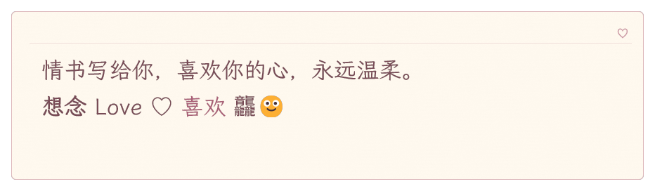

# 情书

[皮肤源目录](../crates/theme/builtin/love_letter) · [实际书写与消融动效](love-letter-motion.webp) · [窄窗、竖版及历史记录对照](love-letter-layouts.png)



`nanatype.love_letter` 是浅色信纸皮肤：霞鹜文楷正文 32px、行高 1.6，玫瑰棕墨迹与淡粉边饰。每字约 500ms，沿用播放速度、标点停顿和速度标记逐字起笔，多个字自然重叠书写；清空、换句或翻页时，当前可见墨迹整段同步消融 700ms，信纸保持静态。历史记录使用完整信纸底板，姓名、时间和正文均保持可读，正文静态完整显示。

## 数据与分发

数据来自 [Make Me a Hanzi](https://github.com/skishore/makemeahanzi)，固定提交 `bddc96d41bef78427ed0e034e9f7e31d71fd1b92`，取 `graphics.txt` 与 GB2312 汉字范围的交集，共 6,763 字。保留上游笔画顺序、轮廓与中心线，采用字符索引、坐标差分变长编码和每 64 字独立 zlib 压缩，不分发字典数据。用标准库 Python 重建：

```powershell
python scripts/assets/build-love-letter-data.py
```

精简数据、来源哈希、修改声明、原始 COPYING 与完整文鼎 APL 随皮肤分发；字体及其对应 OFL 亦在皮肤包内。导出的 `.ntpkg` 不需要原目录、另装字体或运行时网络访问。设计授权只覆盖原创设计，各项资源继续使用各自授权。

## 皮肤接口

在 schema 2 的皮肤中增加可选笔顺配置：

```toml
[dialogue.reveal]
handwriting = { data = "love_letter/strokes.nthz" }
entrance = { kind = "fade", ms = 500, material = "write", scope = "glyph" }
exit = { ms = 700, material = "dissolve", scope = "text" }
```

笔顺数据统一使用 `.nthz` 二进制资源，实际大小 4.91 MB。含字体和授权的完整皮肤包为 6.20 MB，相比压缩前减少约 35%。内置加载只解析索引，遇到字符再解码对应块，最多缓存 8 块；缺字不触发解压。外部资源导入时完整验证所有块，校验不填充运行时缓存。导出的资源保持独立，可离线使用。

资源加载沿用皮肤路径隔离和包大小限制，并限制字符、笔画、路径、点列以及解压后大小。继承的笔顺数据与材质在导出时随独立清单一起保存。

### 二进制格式

所有固定宽度整数采用小端序。容器头为 8 字节 `NTHZ\0\0\0\x01`，接四个 `u32`：元数据长度、字符数、块数、每块字符数（固定 64）。随后依次存储 UTF-8 JSON 元数据（`format = 2`、来源和修改声明）、字符索引、块表和压缩负载。

每条字符索引为三个 `u32`：Unicode 码点、块内解压偏移、字形字节数。字符按码点严格递增，每连续 64 字组成一块。块表每项为三个 `u32`：相对负载区的压缩偏移、压缩长度、原始长度。负载为独立 zlib 流，包含校验和。索引和块必须连续且完全覆盖资源，不允许重复字符、越界或尾随数据。

字形使用无符号 LEB128 整数：笔画数；每笔的命令数及命令流；中心线点数及点流。命令码 `0..4` 分别代表绝对 `M/L/Q/C/Z`，参数数为 `2/2/4/6/0`。各笔轮廓与中心线分别从 `(0,0)` 开始，按轴对前一坐标做差，再经 ZigZag 和 LEB128 编码。轮廓单位为整数，中心线单位为四分之一，完全保留当前数据精度。命令与点的原始顺序保持不变。

## 渲染与回退

字体字形保持原样；参考笔画轮廓用于分区，中心线方向和长度决定显露时间。字体轮廓与数据集不同，书写顺序为近似映射，收笔后严格显示完整字体。数据集外汉字、拉丁字母、标点、表情、注音和内联对象逐字淡入；文字与富文本源数据保持不变。

字形时间图有界缓存，布局时间图随实际字体、字号、字形位置和书写方向缓存；动画帧只推进 GPU 进度，滚动不重建时间图。跳过立即显示全文，中途清空冻结当前书写状态后消融。减少动态效果、关闭高级动效、显式入场设置和关闭打字模拟沿用应用回退规则。皮肤预览播放一次后停止动画帧。

## 验证

```powershell
cargo test -p nanatype-theme handwriting
cargo test -p nanatype --test love_letter -- --test-threads=1
$env:NANATYPE_LOVE_LETTER_CAPTURES='target/love-letter/captures'
cargo test -p nanatype --test love_letter -- --test-threads=1
```

第二次运行会把实际 GPU 捕获帧写入 `NANATYPE_LOVE_LETTER_CAPTURES` 指定的目录，供人工检查。

导出测试可通过 `NANATYPE_LOVE_LETTER_EXPORT` 指定保留 `.ntpkg` 的路径。全皮肤回归沿用 `snapshots` 与 `chat_parity` 的默认宽度、300px 窄窗及历史记录检查。
