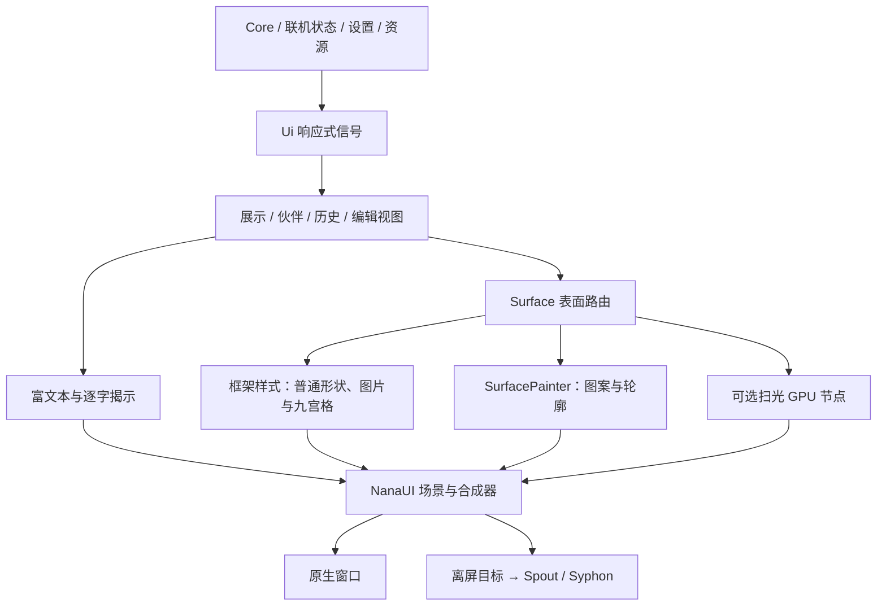

# 渲染管线

应用层统一决定「画什么、何时刷新、是否输出」，普通样式与复杂轮廓保留各自的绘制机制。皮肤 schema 版本和设置结构保持不变。



## 帧需求与时钟

宿主的 `frame_policy` 在查询需求和准备帧时分别读取最新状态，不跨回调缓存。策略只保留应用时钟、是否推进该时钟及框架的 `FrameDemand`，直接表达持续刷新、指定时刻或按需刷新。

| 工作 | 应用时钟 | 帧来源 |
| --- | --- | --- |
| 对话框入退场、整框淡出、震屏、逐帧继续图 | 本地或伙伴 `now` | 应用请求 60 FPS，结束后停止 |
| 跟随文字滚动、分页测量 | 不单独推进动画时钟 | 跟随器／分页器请求连续帧或指定时刻 |
| 扫光 | 0.4326 → 0.4312 | 0.1685 → 0.1670 |
| 字形揭示、连续字形效果、周期装饰 | 框架 presentation clock | NanaUI 合成器自身请求帧 |
| 历史淡出 | `history_now` | 可见条目的淡出区间或下次淡出时间 |
| 输入／设置状态脉动 | 各自脉动时钟 | 应用请求 30 FPS |

文档存在待处理响应式或 Runtime 工作时，准备帧仍会同步对应应用时钟，确保新挂载内容取得正确时间。本地与伙伴的时钟、跟随器、布局缓存保持独立；伙伴仅滚动，本地保留分页。

历史列表与淡出调度共用条目选择规则：从最新记录向前取可见条数，排除设置要求隐藏的本地／伙伴当前台词，再按正序挂载。调度只遍历这批条目，一次得到动画状态和最近期限。淡出时长为 600 ms，调度前后保留 100 ms 余量。

### Windows 原生拖动

Windows 移动／缩放窗口时，`DefWindowProc` 运行嵌套消息循环，外层 Winit 的
`WaitUntil` 等待不会执行。NanaUI 的 `nana-window::LiveSizeMove` 在这段操作中
安装窗口定时器，每 16 ms 唤醒宿主事件源。Scene host 在代理唤醒中运行正常
帧需求调度，继续服务其他窗口与隐藏 GPU 输出。退出操作、移除钩子或销毁窗口
时停止定时器；静止窗口不因此获得额外重绘需求。

透明窗口的自定义拖动还会从输入回调同步发送 `WM_NCLBUTTONDOWN`，占用应用
回调直至拖动结束。NanaUI 将这类移动／缩放请求投递到消息队列，使输入回调
先返回，再开始原生操作，避免渲染事件只能被缓冲。

修复位于 [NanaUI 上游提交 8ad85c8fd](https://github.com/sena-nana/NanaUI/commit/8ad85c8fd4b4029b327cfb252be1c4431cf95978)，已包含在当前固定依赖的 `e06201ecd` 中。NanaType 直接使用上游 Winit，不保留
vendor 或 Cargo patch。`host_managed_drag` 保持默认关闭，系统标题栏、原生
拖动、Aero Snap 与缩放仍由 Windows 处理。

## 表面与扫光

表面路由优先级为九宫格、图案、轮廓、普通样式。路径绘制、实际绘制边界与扫光遮罩共享该优先级；轮廓构造共享圆角、最大边框宽度和内置尾巴参数。对话框只解析一次表面，尾巴与扫光复用它。

九宫格仍由框架绘制；普通背景、图片、圆角与边框继续使用框架样式。图案和复杂轮廓由 retained Painter 绘制，布局边框宽度仍参与文字视口计算。切换表面时清除上一次的图片、边框、阴影及变换字段，切回普通样式时移除旧 Painter。

扫光只有在启用、强度大于零且颜色非全透明时创建 GPU 节点。展示窗口可动画，编辑预览与减少动态效果显示静态相位。九宫格图片读取／解码失败时使用透明遮罩，不退化为矩形光斑。普通轮廓与图案共用栅格化和 Alpha 合成流程，图案各部分复用同一临时栅格缓冲。遮罩的尺寸／DPI 缓存和预乘 Alpha 保持不变。

保留两种绘制机制的原因是能力和成本不同：当前 SurfacePainter 没有九宫格、普通图片背景等完整样式能力；框架又能将部分 Painter 矩形转为 Quad，统一 API 本身不意味着减少 GPU 工作。是否迁移应以同场景实测和视觉一致性为依据。

## 输出

`output::resolve` 为配置、发送端同步和帧投递提供同一资格判断：关闭或伙伴会话不存在时停止输出；不支持的平台、空名称和已启用名称冲突产生对应错误；合格配置保留尺寸、Alpha 模式及隐藏窗口输出行为。

已启用的伙伴名称在未联机时仍保留唯一性约束。资格恢复或改名后状态重新进入连接中，旧发送端释放；后续 Runtime／发布回调报告实际状态。过期 Runtime 回调不覆盖当前无效配置的错误。

## 验证

回归命令：

```powershell
cargo test --workspace --all-targets --locked
cargo run --release -p nanatype --example render_perf -- target/render-pipeline/cpu-after.json
cargo run --release -p nanatype --example gpu_perf -- target/render-pipeline/gpu-after.json
```

性能比较必须先记录修改前当前版本，不能复用旧 revision 的优化报告。CPU flush 与实际 GPU 录制／提交分别统计，GPU 时间只使用时间戳结果；静态场景无绘制时保留空 GPU 时间。比较中位数、塑形、布局、上传和实际绘制目标数，调查重复出现的 5% 以上回退。

截图使用相同皮肤、固定会话时钟及 1×／1.5×／2× DPI。真实历史时间标签应单独检查，不能将墙钟变化认作渲染差异。Windows 原生窗口与 Spout 验证需隔离 APPDATA／LOCALAPPDATA；OBS 接收端及 macOS Syphon 需要另行实机验证。

### 本次结果（2026-10-15）

基线为修改前的 `e26339cf45e7a39d698bf71210d61f9b78a1f971`，通过独立源码副本构建并保留可执行文件。NanaUI 两侧均为 `5cd2b70`。本机为 Ryzen 7 5800X、GeForce RTX 5060、Rust 1.99.0；与旧优化报告的设备不同，不能直接比较绝对耗时。

使用 release、Vulkan、960×540、1× DPI，测量进程固定到逻辑 CPU 0。前后各运行三次，每次三组 trial，各预热 60 tick、记录 120 tick；下表为九组中位数的中位数。测量时未同时运行本次编译、截图或原生验证，但共享主机存在其他工作区任务，亚微秒差异不作提速结论。

| 场景 | CPU 录制／提交 前 → 后（ms） | GPU 前 → 后（ms） |
| --- | ---: | ---: |
| 静止 | 0.0398 → 0.0401 | — |
| 仅节奏 | 0.0400 → 0.0397 | — |
| 减少动态效果 | 0.0398 → 0.0401 | — |
| 逐字揭示 | 0.0912 → 0.0916 | 0.1654 → 0.1637 |
| 波浪 | 0.0909 → 0.0899 | 0.1652 → 0.1636 |
| 波浪＋彩虹 | 0.0916 → 0.0900 | 0.1652 → 0.1634 |
| 装饰 | 0.2229 → 0.2226 | 0.1643 → 0.1627 |
| 1000 条弹幕 | 0.0394 → 0.0390 | — |
| 自己／伙伴／历史 × 双目标 | 0.1972 → 0.2022 | 0.6614 → 0.6552 |
| 脉动＋闪烁 | 0.1185 → 0.1153 | 0.1651 → 0.1636 |
| 扫光 | 0.4326 → 0.4312 | 0.1685 → 0.1670 |

CPU 中位数最大增加约 2.54%，GPU 中位数均未增加，未观察到超过 5% 的回退。静止、仅节奏、减少动态效果和静止弹幕仍为零绘制；所有场景的测量区间均未新增塑形或布局。动画目标数、绘制调用和上传计数保持原有量级。CPU flush 单测与 GPU 实际录制／提交数据分开保存。

240 组截图覆盖当时的 18 个内置皮肤（现为 28 套）和 2 个图片／字体夹具、4 种视图与三档 DPI。展示、输入和皮肤库的 180 组像素一致；60 组历史截图差异位于真实时间标签。差异坐标已记录。精简遮罩流程后，另对普通形状、复杂轮廓和九宫格开启扫光，三档 DPI 的 9 组精简前后截图均像素一致。

Windows 原生静止测试前后均在预热后停止呈现。隐藏输出验证使用隔离设置、25 秒运行、长台词逐字揭示，并令历史在 8 秒后淡出；展示输出 165 帧、历史输出 35 帧，桌面呈现均为零，第 6 秒后仍分别输出 143／35 帧。日志确认两路 `native: true`。系统 `MinAnimate=0`，验证遵从减少动态效果设置；此用例验证逐字揭示与历史期限唤醒，不以波浪作为持续动画来源。

`cargo test --workspace --all-targets --locked` 共 296 项通过，`cargo fmt --all -- --check` 和差异空白检查通过。原生窗口与 Spout 发送端已验证；OBS 接收端和 macOS Syphon 未实测。

原始测量数据与截图未纳入仓库，可按上文命令在本机重新生成。
