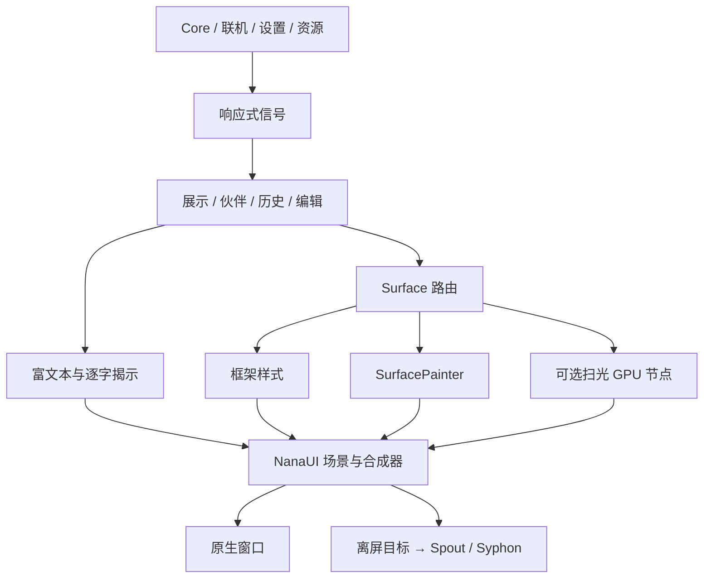

# 渲染管线（项目记录）

应用层统一决定“画什么、何时刷新、是否输出”；普通样式和复杂轮廓保留不同绘制机制。皮肤 schema 与设置结构不变。



## 帧需求与时钟

`frame_policy` 在查询与准备帧时都读取最新状态，不跨回调缓存。对话框入退场、震屏、继续图使用本地/伙伴 `now`；跟随滚动和分页按需连续刷新；字形揭示与循环效果由 NanaUI presentation clock；历史淡出使用 `history_now`；输入/设置脉动各自请求 30 FPS。

活动字形存在时窗口可请求 120Hz 合成帧，展示与伙伴不设上限，输入/历史取 60，皮肤本身仍按 30/60 FPS；上限减少采样次数，不减慢绝对时间动效。文字之前没有宿主纹理或自定义 GPU 节点时，稳定背景可复用、每帧只重画文字。历史从最新记录向前选可见条目，排除隐藏台词；淡出 600ms，调度保留 100ms 余量。

Windows 移动/缩放时，`LiveSizeMove` 用 16ms 定时器唤醒宿主事件源，继续服务其他窗口和隐藏输出；退出、移除钩子或销毁窗口时停止。透明窗口拖动请求投递到队列，避免输入回调阻塞渲染。修复在 NanaUI 上游提交 [8ad85c8fd](https://github.com/sena-nana/NanaUI/commit/8ad85c8fd4b4029b327cfb252be1c4431cf95978) 中，`host_managed_drag` 默认关闭。

## 表面与输出

表面优先级为九宫格、图案、轮廓、普通样式；对话框只解析一次，尾巴和扫光复用表面。普通背景/图片/圆角/边框走框架；图案与复杂轮廓走 retained Painter。切换表面清除上一次图片、边框、阴影和变换字段。

扫光启用且强度/颜色有效时才创建 GPU 节点；九宫格读取/解码失败使用透明遮罩，不退化成矩形光斑。编辑预览和减少动态效果静止。输出资格由 `output::resolve` 统一判断：关闭、伙伴不存在、不支持平台、空名称和名称冲突分别给出状态；资格恢复或改名会释放旧发送端，过期 Runtime 回调不能覆盖当前错误。

## 验证

```powershell
cargo test --workspace --all-targets --locked
cargo run --release -p nanatype --example render_perf -- target/render-pipeline/cpu-after.json
cargo run --release -p nanatype --example gpu_perf -- target/render-pipeline/gpu-after.json
```

先记录当前 revision，再比较中位数、塑形、布局、上传量和实际绘制目标数；CPU flush、GPU 录制/提交和 GPU 时间戳分开统计。截图固定皮肤、会话时钟及 1×/1.5×/2× DPI。原生窗口、Spout、OBS 和 Syphon 各自实机验证，不把离屏结果替代为端到端结论。