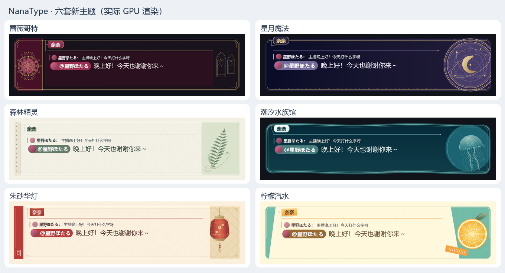
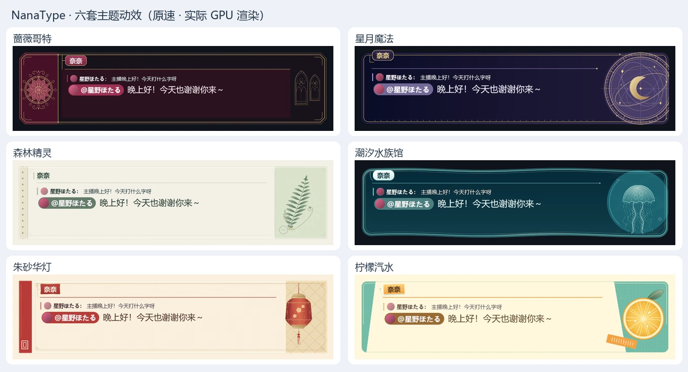

# 六套程序版画

原有十八套的后续细化见[经典皮肤设计记录](classic-skin-refinement.md)，沿用静态设计优先、正文稳定和少参数的做法。

先确定二维画面的构图、墨色、材质和阅读区域，再加入时间。每套的主画面只有一个 `artwork.wgsl`，没有自定义数值参数或装饰节点。框体、色块、材质和光线由像素函数绘制；复杂装饰根据馆藏参考新绘为 SVG，再导出一张透明纹理合成。姓名、正文、引用和继续提示由宿主绘制，保留正常排版。参考来源、设计源图和重建步骤见[装饰来源说明](skin-art-sources.md)。



| 主题 | 平面设计 | 阅读区域与层次 | 克制的运动 |
| --- | --- | --- | --- |
| 蔷薇哥特 | 酒红色装订侧栏、十二瓣花窗与蔷薇、卷草细金饰和右端尖拱窗棂 | 双层细金框与包角，侧栏铆点在框内收口；切角酒红名牌通过短金属支架接入横线 | 单道柔光沿完整金边经过包角；蔷薇玻璃微微呼吸，开句短暂增强 |
| 星月魔法 | 大幅偏心天球仪、同心刻度、椭圆轨道与金色新月 | 细金边名牌仍轻搭上沿，用短刻线承托；框底刻度、双线边和菱形端点沿用星盘的蚀刻笔触 | 星盘刻线和月亮固定，细椭圆轨道缓慢偏转，小星沿轨道移动，开句星弧只在装饰面展开 |
| 森林精灵 | 无涂层纸张、左侧装订孔、右侧羽状叶标本、分支叶脉和卷芽 | 装订栏与标本面通过压纸细边、角线及折缝连成整页；姓名保留墨绿印字，加短竖线与浅色下划线 | 茎根固定、上部叶片弯动，两个微弱萤光点错相漂移；等待时标签竖线轻呼吸 |
| 潮汐水族馆 | 起伏玻璃外缘、双层水线、水母标本与深海色面 | 玻璃唇口的细反光与珍珠渐变名牌同色，开放弧托连接姓名与水线，维持原有阅读比例 | 水母绕伞体轻倾、收缩推进，触须渐进拖曳；玻璃反光、低对比焦散和两颗小泡同处水域，开句涟漪限于边线 |
| 朱砂华灯 | 朱砂版画侧栏、小印记、金色菱格窗棂与垂灯 | 金色窗框横贯阅读面与菱格面，榫角和侧栏压线统一收口；朱砂名牌用浅金细包边接入窗框 | 灯笼与吊绳绕固定悬挂点轻摆，流苏稍滞后，暖光慢呼吸；金线弱扫，说话人切换时支架与上沿回应 |
| 柠檬汽水 | 薄荷斜向包纸、网点底印、大尺寸水果剖面与斜贴纸 | 外缘印线和斜向虚切缝连成包纸，原位倾斜名牌补上奶油白贴纸边、薄荷色纸层与小穿孔引线 | 三颗错相小泡从水果后方上升，在边缘前淡出；包纸边缘有微弱反光，打字时气泡轻微增强 |

本轮细化保留六套主题的 `region`、正文 `padding`、姓名偏移与字号，以及主装饰的位置和大小。框线、支架和接缝继续在同一个 WGSL 中绘制；姓名表面使用现有的轮廓、渐变与边框能力，宽度由实际姓名排版决定，没有固定长度的假名牌，也没有增加自定义数值参数、纹理或效果实例。所有姓名渐变色标均检查文字对比度。

## 装饰自身的运动

六套仍各用一个 WGSL、一张透明纹理、零自定义数值参数。水母倾角约 9°、伞体横向收缩约 15%，每四秒划水一次：约 0.9 秒收伞，较慢地展开；上推稍晚于收伞，单次位移约 8.5 逻辑像素，触须越往下拖曳越明显，并滞后于身体转向。伞缘与触须根部使用连续变形连接，不做分离摆动。

植物纹理重绘为交错着生、逐渐收尖的连续羽片，增加终端小叶、侧叶脉和较疏的幼叶。叶根与纸质束带不动，主轴先弯，侧羽片稍后轻屈，叶尖横向偏移约 3–4 逻辑像素。灯笼纹理补齐上下束口、分面、丝绢细纹、折枝梅花、珠结与流苏绕线；约 1° 的轻摆保留，束口和珠结保持刚性，只有自由丝线延迟弯曲。名牌、正文和整体框体不随装饰摇动。

循环统一为 16 秒，使用整数时间谐波、速度在首尾平滑归零的划水周期与固定轨迹。气泡在上下边缘前淡出后回绕，焦散从水域内渐隐，不在阅读面产生硬切线。开句和换说话人的增强沿用宿主事件时间，约一秒内回落；开句涟漪也被限定在水线、装饰弧和横线上。



[水母游动局部原速预览](tidal-motion.webp)。预览来自同一个保留场景的真实 GPU 输出，8 fps、16 秒；另有 [GIF 兼容版](skins-motion.gif)。应用正常运行仍按原来的 30/60 fps 调度。

植物与灯笼的新版纹理及弯曲方式可在[植物局部动效](forest-motion.webp)、[灯笼局部动效](lantern-motion.webp)中查看；[静态源图细节](skin-ornament-details.png)同时更新。

生成完整循环并验证阅读区域、外轮廓透明度、首尾像素和缓存稳定性：

```powershell
cargo build -p nanatype --example snapshots
$env:NANATYPE_SNAPSHOT_MOTION_FRAMES='128'
foreach ($id in @('gothic','celestial','forest','tidal','lantern','citrus')) {
    & target/debug/examples/snapshots.exe "target/skin-motion/nanatype.$id" "nanatype.$id" zh-CN
}
Remove-Item Env:NANATYPE_SNAPSHOT_MOTION_FRAMES
python scripts/render-skin-motion.py
```

循环测试固定 UI 状态，只推进渲染时钟。每个采样帧断言正文与回复引用区域逐像素不变、外轮廓透明度不变；完整周期首尾完全一致，程序、尺寸遮罩和缓存占用不增长。另触发开句与说话人切换，在 0、125、250、500、1000、2000 毫秒检查阅读区域仍然稳定。结果见 [skin-motion-checks.json](skin-motion-checks.json)。

## 静态画面是设计基准

`still.png` 是同一 WGSL 经生产渲染代理、固定时间 16 秒与固定种子烘焙的透明图。编辑器、默认设置预览、主题缩略图，以及关闭高级动效、减少动态效果或 GPU 编译失败时，都使用这张完整画面；这些场景不执行用户 WGSL。缩略图保持原始宽高比。

重新烘焙：

```powershell
cargo run -p nanatype --example skin_artwork -- crates/theme/builtin
```

烘焙后重新编译，让图片进入内置资源。实时程序在逻辑像素坐标中绘图，左右装饰分别锚定边缘；静态图使用现有九宫格接口的零切片完整缩放。建议作者先确认目标尺寸下的静态画面，再检查缩放与运动。

## 最小配置

内置清单约 39 行：保留身份、四个配色参考、正文与姓名的排版、历史气泡、一个程序及一张装饰纹理引用。主画面不通过 TOML 描述花瓣、线段、粒子或动态曲线。

```toml
[dialogue]
region = [920, 220]
padding = [36, 65, 217, 28]
shader_effects = [{ shader = "artwork", target = "artwork" }]
box = { frame = { image = "celestial/still.png", slice = [0, 0, 0, 0] } }

[shaders.artwork]
source = "celestial/artwork.wgsl"
period_s = 16
intensity = 1
textures = ["celestial/ornament.png"]
```

`artwork` 目标覆盖展示框的矩形画布，自行返回轮廓透明度；原有 `background` 和 `border` 仍按宿主框体遮罩叠加。它沿用同一验证、资源预算和失败恢复流程，没有新增执行权限。

可直接导入[星图版画示例包](examples/lunar-atlas.ntskin)。包内只有清单、一个 WGSL、一张装饰纹理和静态回退图，无父皮肤依赖。更新源文件后，运行 `python scripts/package-artwork-sample.py` 重建示例包。
