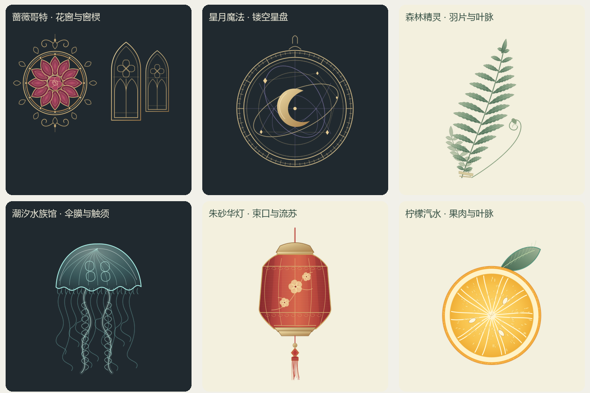

# 装饰图的参考与源文件

原有皮肤本轮另新增两幅原创矢量：`parchment/ornament.svg` 为由细双线生长、长边渐疏的古籍卷叶压印包角，`sakura/ornament.svg` 为连续樱花枝、五瓣缺口花冠、花蕊和叶脉。两者由 `scripts/refine-classic-skins.py` 生成，CC0-1.0，无外链、下载素材或字体依赖；两倍 PNG 分别为 720×280 和 768×264。其余经典款使用程序几何；水墨原有馆藏素材及其授权记录保留。具体构图见[十八套细化记录](classic-skin-refinement.md)。

本轮沿用现有框体、正文区域与名牌布局，只细化图形。下列馆藏图用于观察结构、比例和线条；仓库中的装饰是重新绘制的 SVG，没有把馆藏照片裁贴进皮肤，也不是逐像素描摹。

| 主题 | 参考记录 | 落到设计中的细节 |
| --- | --- | --- |
| 羊皮纸 | [Armagh Robinson Library，Decorative Bookbinding Styles](https://armaghrobinsonlibrary.co.uk/decorative-bookbinding-styles/) 的 Narrow Rolls／Frames；[Huntington 馆藏装帧记录](https://hdl.huntington.org/digital/collection/p15150coll7/id/77524/)；[V&A，The Leman Binding](https://www.vam.ac.uk/blog/caring-for-our-collections/the-leman-binding) 的角部工具压印图 | 只参考双层细压线、角部叶簇和重复工具的连接规律；重新绘制一条连续茎、附着其上的不对称尖叶和渐细末梢，四角镜像合成；淡褐墨色与纸面微小明暗形成静态压印感。借鉴的是装帧纹样结构，底材仍为现有羊皮纸程序材质；不裁贴或描摹馆藏照片 |
| 蔷薇哥特 | [The Met，Ornamental Window，约 1180 年](https://www.metmuseum.org/art/collection/search/466633)，条目及开放接口标记 Public Domain | 参考彩窗的分格、花叶和层叠窗棂；新绘十二瓣花窗、中心蔷薇、卷草收尾及带四叶孔的尖拱 |
| 星月魔法 | [The Met，Regiomontanus 的 Astrolabe，1462](https://www.metmuseum.org/art/collection/search/923639)，条目及开放接口标记 Public Domain | 借鉴同心刻度、镂空星图、交错轨道和悬挂环；保留原有月相与紫金配色 |
| 森林精灵 | [Haeckel，Filicinae 图版](https://commons.wikimedia.org/wiki/File:Haeckel_Filicinae.jpg)；另参照 [Smithsonian，Samuel Colman 的 Maidenhair Fern](https://www.si.edu/object/maidenhair-fern%3Achndm_1939-85-71)，后者条目标记 CC0 | 用羽状小叶、分支叶脉、逐渐收尖的叶片和初展卷芽替换椭圆叶片；是风格化植物装饰，不作为物种鉴定图 |
| 潮汐水族馆 | [Haeckel，Discomedusae 第 18 图版](https://commons.wikimedia.org/wiki/File:Haeckel_Discomedusae_18.jpg)；[Smithsonian Libraries 的水母图版记录](https://library.si.edu/image-gallery/108984) | 参考伞部放射管、伞缘小垂片、内层结构及长短错落的触须；重新绘制薄透的伞膜与卷曲口腕 |
| 朱砂华灯 | [The Met，Lantern (one of a pair)](https://www.metmuseum.org/art/collection/search/51039)，条目及开放接口标记 Public Domain | 参考灯器的分面、上下束口与花卉装饰；另行设计为朱砂灯体、金色骨架、梅花、珠结和流苏，不复刻原器形 |
| 柠檬汽水 | [USDA Pomological Watercolor Collection 的 Meyer 柠檬图 POM00006424](https://commons.wikimedia.org/wiki/File:Pomological_Watercolor_POM00006424_(cropped).jpg) | 观察果皮厚度、瓣膜、果心与种子；新绘果肉汁囊、果皮小孔和带叶脉的叶片。保留明快包装风格，不采用原作水彩外观 |

查阅日期：2026-10-17。馆藏原图仅用于本地参考，不随应用分发。各图的权利信息以链接的具体媒体记录为准；本项目的新绘 SVG、导出 PNG 和生成代码采用皮肤清单声明的 CC0-1.0。

植物与灯笼的后续细化沿用以上结构参考，直接重绘矢量纹理：植物改用连续分裂羽片、交错着生位置、细叶脉与终端小叶，疏开根部幼叶；灯笼连接上下束口与灯体，补上分面、丝绢细纹、折枝梅花、珠结和流苏绕线。两套依然各使用一张透明 PNG。

## 文件与分工

- `crates/theme/builtin/<主题>/ornament.svg`：可编辑设计源文件，没有脚本、外链、字体或远程资源。
- 同目录 `ornament.png`：两倍尺寸透明纹理，供受限 WGSL 的 `sample0` 读取。哥特图为 1024×640 的双栏图集，其余为 512×640。
- `artwork.wgsl`：继续绘制底色、框体、材质、光线及事件响应，并在原有位置合成装饰。没有增加装饰实例或作者数值参数。
- `still.png`：经同一生产 GPU 代理烘焙，静态场景仍保留完整细节。运行时与 `.ntpkg` 示例只使用 PNG，不解析 SVG。

上述六套仍是一个 WGSL、零自定义数值参数、零装饰节点；清单只新增一条纹理资源引用。纹理沿用既有资源校验、继承、导入导出和缓存预算。

## 重建

```powershell
python scripts/build-skin-ornaments.py
# 需要可解析的 sharp Node.js 包；可通过 NODE_PATH 指向已有依赖目录。
node scripts/render-skin-ornaments.cjs
cargo run -p nanatype --example skin_artwork -- crates/theme/builtin
python scripts/package-artwork-sample.py
```

重新编译应用后，烘焙图与纹理一起进入内置资源。源图无字体依赖，果肉细节使用固定种子，重复生成不依赖当前时间。


