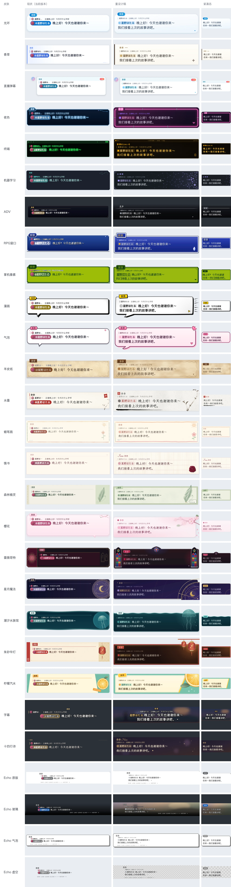
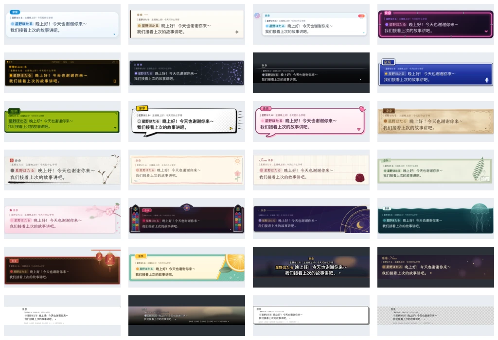
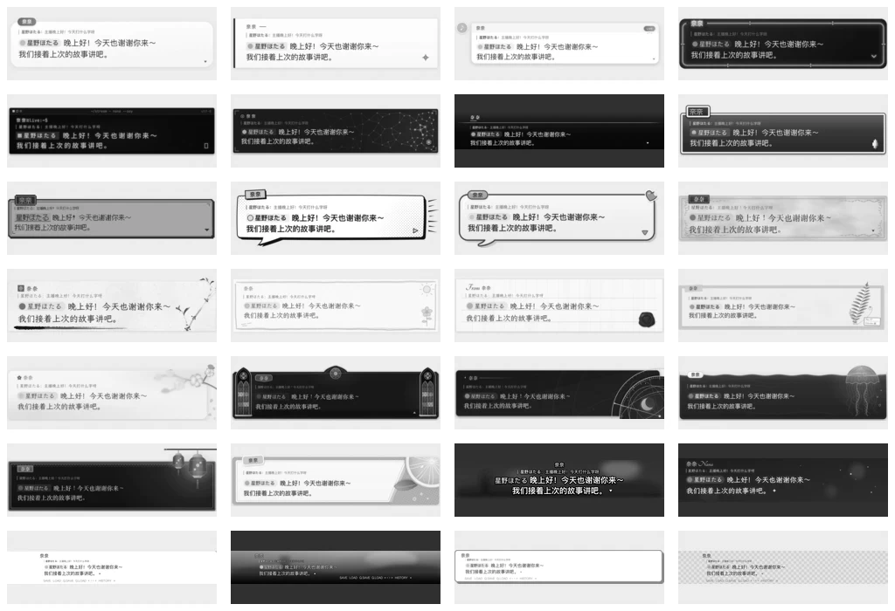

# 皮肤重设计：平面稿与实现映射

前两轮（[经典皮肤设计记录](classic-skin-refinement.md)、[六套程序版画](skin-art-direction.md)）锁定了框体比例、正文留白、姓名位置和字号，只细化表面图形。这一轮放开版式，按平面设计的标准把 28 套重新过一遍：信息层级、网格、字体、色彩、材质，以及每个装饰为什么在那里；再看整套目录是否彼此可分。先定平面稿，然后才决定哪些画面用素材、哪些用着色器。

本文是设计稿，不改运行时文件。逐套效果稿在 [`skin-redesign/`](skin-redesign/)（`<id>.svg` 为主稿，`<id>-compact.svg` 为 300×120 窄窗），对比度见 [contrast.md](skin-redesign/contrast.md)。



## 一、目录级诊断

| # | 问题 | 现状证据 | 影响 |
|---|---|---|---|
| 1 | 提及胶囊抢层级 | 26 套没有写 `[mention]`，沿用默认：强调色实底 + 白字 + 头像（`crates/theme/src/manifest.rs` `MentionSpec`）。只有掌机、RPG 改过 | @提及成了画面里最饱和的块，读者先看到观众名，再看到说话人和正文 |
| 2 | 名牌重量不足 | 名牌字号 13–20，正文 24–30，比例 0.54–0.73 本身可以；问题在名牌多是浅底小标签，权重低于提及胶囊 | 「谁在说」比「说了谁」弱 |
| 3 | 光环蓝泄漏 | `#0876d0` 出现在全部 28 个 `skin.toml`，多在紧凑／极简响应式规则的名牌色，十四行诗的继续提示和框线也是它 | 窗口一缩小，所有皮肤的名牌都变成光环蓝 |
| 4 | 头像占位单一 | 无图头像都是同一个粉红圆 | 终端、掌机、潮汐、星月里跳色 |
| 5 | 字体不参与区分 | 内置字体只有像素体、霞鹜文楷、Tangerine；其余 19 套落在雅黑／思源黑／Segoe | 关掉装饰后多数皮肤认不出来；系统字体还随平台变化 |
| 6 | 六套版画共用骨架 | 哥特、星月、森林、潮汐、华灯、柠檬都是「侧栏或角饰 + 顶部横线 + 右侧方形装饰窗」，右窗占 155–217px 的右内边距 | 缩略图并排像同一模板换色；正文行长被压到 60% 左右 |
| 7 | 色域重叠 | 深蓝：夜色、RPG、星月、潮汐、机器学习；金：ADV、哥特、星月、华灯；奶油纸：香草、蜡笔、情书、华灯、森林、羊皮纸；绿：终端、掌机 | 选择器里同类挤在一起，个性靠细节才分得开 |
| 8 | 竖向节奏 | 光环、香草、直播、Echo 系列正文贴顶，下半空；ADV 与 Echo 的 1280 宽框里正文显得小 | 框看起来「没装满」，像尺寸没调好 |
| 9 | 发丝线 | 大量 1px 金线、刻度和网点 | OBS 缩放和视频编码后糊掉或闪烁 |
| 10 | 对比度 | 樱花粉字粉底、情书 `#784b56` 字、蜡笔浅棕名、ADV 小号金名 | 需按 WCAG AA 复核（见第七节） |

## 二、设计系统

所有皮肤遵守同一套骨架规则，个性只放在色彩、材质、字体和装饰上。

**字号阶梯**（B = 正文字号）

| 层 | 字号 | 处理 |
|---|---|---|
| 正文 | B | 最高对比 |
| 说话人 | 0.7–0.8 B，不低于 17px | 粗体或专用字体；有底板时底板用强调色，无底板时用强调色字。霞鹜文楷没有粗体，四套文楷皮肤只靠颜色和底板区分 |
| @提及 | 0.72 B（`[mention] scale = 0.72`） | 浅底（强调色 10–20% 透明度）+ 强调色深字，字重 400，不用实底白字 |
| 回复引用 | 0.5–0.55 B，不低于 14px | 次级文字色，左侧 2px 引用线；14px 已接近推流可读下限，对比度必须达到 4.5:1 |
| 时间、栏目信息 | 0.45 B | 辅色 |

**网格**：正文左缘与说话人左缘对齐（ADV 与字幕是有意居中或外置的例外）；装饰物不进入正文行的前 80%；外边距约 0.5 B。

**框高**：上边距 + 名牌行（名牌在框内时）+ 引用行 + 8px + 两行正文 × 行高 + 下边距；名牌外凸时另加名牌高度的一半；尾巴、错位阴影和越出框外的装饰各自再加余量。第四节的 region 已按这个公式和效果稿实测重算，多数比现状高 20–30px，因为现状只为一行正文留了空间。

**色板**：每套五色——底（box）、面（内层或纸面）、字（正文）、强调（名牌、提及）、辅（引用、细节）；另给紧凑态名牌色，替换 `#0876d0`。

**线宽**：结构线 2px，次级线 1.5px，1px 只用于材质和刻度。

**动效**：沿用「物件有理由才动」。周期 16s 整数谐波；正文与引用区逐像素不变；状态动效读 `reveal`、`waiting`、`line_age`、`speaker_age`。

## 三、色域与母题分配

| 分区 | 皮肤 | 主色域 | 母题 | 调整方向 |
|---|---|---|---|---|
| 界面 | 光环 | 雾白 + 天蓝 | 胶囊卡片 | 保持现有风格 |
|  | 香草 | 暖白 + 墨炭 + 香草荚棕 | 瑞士编辑版式 | 离开蓝白 |
|  | 直播弹幕 | 白 + 浅青 + 珊瑚 LIVE | 消息流 | 保持现有风格 |
|  | 夜色 | 茄紫黑 + 品红霓虹 | 霓虹灯管招牌 | 让出蓝 |
|  | 终端 | 黑 + 琥珀 | P3 琥珀荧光屏 | 让出绿 |
|  | 机器学习 | 石墨 + 冷白 + 淡紫 | 节点网络 | 让出青 |
| 游戏 | ADV | 中性黑 + 白 | 电影遮幅 | 让出金 |
|  | RPG | 皇家蓝 | 搪瓷窗口 | 独占皇家蓝 |
|  | 掌机像素 | DMG 四阶绿 | 液晶屏 | 独占绿 |
|  | 漫画 | 黑白 + 印刷黄 | 网点分镜 | 只留一个专色 |
|  | 气泡 | 糖果粉 + 深梅 | 贴纸 | 梅色描边，与漫画的黑描边分开 |
| 纸本 | 羊皮纸 | 犊皮纸棕 + 皮革 | 西式装帧 | 加强皮签 |
|  | 水墨 | 生宣冷白 + 焦墨 + 朱 | 留白 | 朱印化名牌 |
|  | 蜡笔画 | 米白 + 柔彩 | 蜡笔涂鸦 | 保持现有风格 |
|  | 情书 | 象牙 + 酒红 | 罗纹信纸与火漆 | 加深字色 |
|  | 森林精灵 | 鼠尾草绿 | 标本卡与纸胶带 | 纸色转绿 |
|  | 樱花 | 半透明粉 | 春雾与落瓣 | 去纸感、去尾巴 |
| 版画 | 蔷薇哥特 | 酒红 + 锡银 + 彩窗宝石色 | 尖拱与花窗 | 让出金 |
|  | 星月魔法 | 靛紫 + 黄铜 | 星盘 | 保留金 |
|  | 潮汐水族馆 | 深青 | 水线与水母 | 独占青 |
|  | 朱砂华灯 | 黑漆 + 朱砂 + 金 | 夜里的灯 | 改暗底 |
|  | 柠檬汽水 | 薄荷 + 柠檬黄 | 包装标签 | 保留 |
| 无框 | 字幕 | 白字黑边 | 广播字幕 | 去名牌胶囊 |
|  | 十四行诗 | 透明 + 暖金 | 光尘 | 去蓝 |
| 还原 | Echo 原版／玻璃／气泡／虚空 | 原作配色 | 原作 | 只修共性问题 |

光环、直播弹幕、蜡笔画按用户决定保持现有风格，只做第二节的共性修正（与 Echo 四套相同）。金色只留给星月（黄铜）和华灯（朱漆描金）；明暗大致平衡：浅色 15 套，暗色 13 套（含透明叠加）。

**版画构图骨架**：六套不再共用「侧栏 + 横线 + 右窗」。

| 皮肤 | 新骨架 | 主装饰位置 |
|---|---|---|
| 蔷薇哥特 | 左右对称双尖窗，顶边中央升起小山墙与花窗 | 两端 + 顶部中轴 |
| 星月魔法 | 星盘大圆以右下角为圆心出血，弧线淡淡穿过正文背后 | 右下，越出框 |
| 森林精灵 | 标本卡 + 纸胶带名牌，植物越过卡片上沿 | 右上，越出框 |
| 潮汐水族馆 | 框顶是一条水线，水母伞体浮出水面 | 右上，越出框 |
| 朱砂华灯 | 顶部横梁垂下两盏大小不一的灯，悬在框外 | 顶部，越出框 |
| 柠檬汽水 | 斜切包装标签，果片从右上角出血 | 右上，出血 |

## 四、逐套规格

下表数字为逻辑像素。region 是新尺寸；padding 为左、上、右、下；色值五色依次为底／面／字／强调／辅。字体中「宋」「黑（展示）」为拟新增的两款内置字体（第六节），效果稿以系统字体代替。

### 界面类

#### 光环 `halo`

保持现有风格（用户决定）：蓝白圆润卡片、轻阴影、压在上沿的天蓝渐变胶囊名牌。只做共性修正。

- **版式**：region 760×200（两行正文）；padding 与名牌偏移沿用现状 [28, 26, 24, 14]、[24, -15]；B 28／1.45；名牌 18 粗。
- **色板**：沿用现状——面 `#FFFFFF`→`#EEF6FD` 渐变、字 `#1B2F4B`、名牌 `#087FD1`→`#249FDF`、引用 `#5A6B85`。
- **提及**：`#0876D01F` 底、`#0B5FA8` 字；头像占位 `#8CC8F2`。
- **紧凑态**：保留 `#0876D0`（光环本身的颜色）。
- **动效**：静态。
- **实现**：B，现有 still 不变；只加 `[mention]` 与更高的 region。

#### 香草 `vanilla`

- **问题**：与光环、Echo 原版同为白卡蓝字，难分；圆角与渐变削弱了「端正」的初衷。
- **设计**：瑞士编辑版式。暖白纸、直角，左侧 6px 香草荚深棕粗竖线；说话人是正文上方的小型栏目头（字距加宽 + 一段 24px 短横线）；右下角一个对位十字。
- **版式**：region 760×200；padding [40, 30, 32, 24]；B 27／1.45；名牌 17，字距 0.12em。对位十字兼作继续提示。
- **色板**：`#FBF8F1` / `#FFFDF8` / `#24201B` / `#8A6A3A` / `#6E655A`；竖线 `#3B2A20`。
- **提及**：`#EFE6D2` 底、`#5B4128` 字；头像占位 `#C9A86A`。
- **紧凑态**：名牌 `#8A6A3A`。
- **字体**：黑体，名牌 700。
- **动效**：静态。
- **实现**：B；`radius = 2`、`border_widths` 左 6，其余原生，不需 still。

#### 直播弹幕 `livechat`

保持现有风格（用户决定）：卡片外的蓝粉渐变圆头像、浅青标题带、青色纯文字姓名、珊瑚色 LIVE 与三点。只做共性修正。

- **版式**：region 800×184（两行正文）；其余沿用现状；姓名 16→17，达到说话人下限。
- **色板**：沿用现状——卡片 `#FFFFFF`、标题带 `#EEF7FB`、字 `#1F2A36`、姓名 `#137C9A`、引用线 `#23ADE5`；引用字加深为 `#5F6E80`（原色不到 4.5:1）。
- **提及**：`#23ADE524` 底、`#106F8A` 字；头像占位 `#7ED0FF`（取头像渐变的青端，不再是粉红）。
- **LIVE**：渐变起点由 `#FF5C7A` 微调为 `#F5506F`，白字达到 3:1，观感不变。
- **紧凑态**：`#137C9A`。
- **动效**：保留打字时 LIVE 下三点弹跳（`reveal`）。
- **实现**：C，现有 still 与动效不变。

#### 夜色 `night`

- **问题**：深蓝 HUD 与 RPG、潮汐、机器学习同色域；右上电路线和整体仪表感关系弱。
- **设计**：霓虹灯管招牌。边框是一根连续的品红灯管（亮芯 + 外辉），转角处是灯管弯头和金属卡扣；说话人是「点亮的一段字」，打断上沿灯管。夜色来自茄紫黑底，不来自蓝。
- **版式**：region 760×192；padding [30, 40, 30, 24]；B 27／1.45；名牌 22，骑在上沿，灯管在名牌两端以电极帽断开。
- **色板**：`#120B1C` / `#1B1128` / `#F3E9FF` / `#FF4FB8` / `#9B6BFF`；灯芯 `#FFE3F4`。
- **提及**：`#FF4FB824` 底、`#FFC2E6` 字；头像占位 `#9B6BFF`。
- **紧凑态**：`#FF4FB8`。
- **字体**：黑（展示）用于名牌。
- **动效**：换句时灯管频闪 2 次后稳定（`line_age` 0–0.6s），其余时间静止；不做呼吸。
- **实现**：C。灯管几何用 WGSL 距离场画（圆角路径 + 高斯辉光），still 烘焙稳定态；频闪只调整亮度系数。

#### 终端 `terminal`

- **问题**：荧光绿与掌机绿撞；姓名 13px 过小。
- **设计**：琥珀 P3 荧光屏。标题栏写真实的提示符路径；姓名是 shell 提示 `奈奈@live:~$`；扫描线只作极弱静态材质。
- **版式**：region 760×184；标题栏 24；padding [24, 46, 24, 18]；B 24／1.5；名牌 16。
- **色板**：`#0D0A05` / `#1A1308` / `#FFC547` / `#FFB000` / `#A88536`。
- **提及**：`#FFB00024` 底、`#FFD27A` 字；头像占位实心方块 `#FFB000`。
- **紧凑态**：`#FFB000`。
- **字体**：等宽（Cascadia Mono + 更纱等宽），效果稿以 Maple Mono 代替。
- **动效**：保留忙碌符号（竖线／斜线／横线／反斜线），等待时空心方块。
- **实现**：C。

#### 机器学习 `machine_learning`

- **问题**：冰青与潮汐撞；HUD 轮廓与夜色撞。
- **设计**：石墨中性底上的淡紫节点网络，节点集中在右侧，向左稀疏；正文冷白。演算与消隐效果是皮肤的个性，保留。
- **版式**：region 860×200；padding [32, 48, 32, 26]；B 26／1.45；名牌 17 粗等宽，前置六边形标记（中文名无大小写可言）。框面用纯色 `#191C22`，近似平坦的渐变会出色带。
- **色板**：`#15171C` / `#1C1F26` / `#E8ECF2` / `#A99BFF` / `#7C8394`。
- **提及**：`#A99BFF1F` 底、`#CFC7FF` 字；头像占位六边形 `#A99BFF`。
- **紧凑态**：`#A99BFF`。
- **字体**：正文黑体；名牌等宽。
- **动效**：保留字符演算、整段消隐；背景网络静态。
- **实现**：E；背景网络沿用 `background` 效果（静态回退），只改颜色与节点密度梯度。

### 游戏类

#### ADV `adv`

- **问题**：1280×180 里正文 30px 显得小；金色姓名与哥特、星月、华灯撞；框是一个圆角盒，不是电影遮幅。
- **设计**：电影遮幅。框没有边，从上方透明渐变到底部深色；一条 1.5px 白色细线定出上沿；姓名白色宋体、加字距，在框左上外置，下面一段 40px 白色短线。
- **版式**：region 1280×228；padding [96, 70, 96, 26]；B 34／1.5；名牌 26，最粗一档宋体并加柔和投影——遮幅上沿几乎透明，亮场景里白字没有投影会消失。
- **色板**：`#050507` / `#0D0D12` / `#FFFFFF` / `#FFFFFF` / `#B8BCC6`。
- **提及**：`#FFFFFF1F` 底、`#FFFFFF` 字；头像占位 `#9AA0AC`。
- **紧凑态**：`#3A3D46` 底、白字。
- **字体**：姓名宋；正文黑体。
- **动效**：静态；继续标记白色 ▼。
- **实现**：A 原生——线性渐变 + 1.5px inset 阴影线，去掉 still。

#### RPG 窗口 `rpg`

- **问题**：辨识度高；名牌标签比例小，正文字体普通。
- **设计**：经典 JRPG 搪瓷窗：外暗边、白色主边、浅蓝内边三层倒角；名牌是同材质的独立小窗，像素字。
- **版式**：region 760×188；padding [30, 40, 30, 22]；B 26／1.45（黑体，不强制像素）；名牌 24 像素体。
- **色板**：`#10206E` / `#2A3FB8` / `#FFFFFF` / `#FFD45C` / `#C6D0FF`。
- **提及**：`#FFFFFF26` 底、白字；头像占位 8×8 像素方块 `#FFD45C`。
- **紧凑态**：`#10206E` 底、白字。
- **字体**：名牌像素体（12 倍数），正文黑体加 2px 深蓝投影。
- **动效**：保留准备水晶（`waiting`）。
- **实现**：C。

#### 掌机像素 `pixel`

- **问题**：已经一致；提及胶囊仍是圆角，打破像素网格。
- **设计**：DMG 液晶屏，所有边、名牌和提及都是直角像素块。
- **版式**：region 768×168（宽高取 12 倍数）；padding [24, 36, 24, 24]；B 24／1.5；名牌 24 反白。
- **色板**：`#9BBC0F` / `#8BAC0F` / `#0F380F` / `#306230` / `#306230`。
- **提及**：`#8BAC0F` 底、`#0F380F` 字、无头像、`radius = 0`；引用用最深的 `#0F380F`（四阶绿里只有它对浅底达到 4.5:1）。
- **紧凑态**：`#0F380F` 底、`#9BBC0F` 字。
- **字体**：像素体全局。
- **动效**：保留液晶格逐格切换。
- **实现**：C。

#### 漫画 `comic`

- **问题**：与气泡同为黑描边白底；黄色名牌和粉色提及让画面有三种颜色。
- **设计**：黑白印刷 + 一个印刷黄专色。手绘墨线粗细有变化；说话人是倾斜的黄色说明框；网点只在左上与右下角渐疏；速度线在框外右侧。
- **版式**：region 760×214；padding [32, 40, 32, 22]；B 28／1.4 粗；名牌 20 粗，旋转 -3°。
- **色板**：`#FFFFFF` / `#FFFFFF` / `#111111` / `#FFD400` / `#555555`。
- **提及**：`#EDEDED` 底、`#111111` 字；头像占位网点圆。
- **紧凑态**：`#FFD400` 底、黑字。
- **字体**：黑（展示）。
- **动效**：静态。
- **实现**：B；墨线粗细变化与网点在 WGSL 中离线绘制成 still，速度线进 region 余量。

#### 气泡 `bubble`

- **问题**：黑描边白底和漫画重叠；粉色名牌与提及同色同形。
- **设计**：糖果贴纸。浅粉渐变底、深梅色粗描边、粉色色块错位阴影（不是黑色）；名牌是带梅色描边的糖果胶囊；右上爱心贴纸。
- **版式**：region 760×214；padding [32, 38, 32, 30]；B 28／1.4；名牌 19。
- **色板**：`#FFE8F1` / `#FFF4F8` / `#4A2440` / `#FF7AA8` / `#86566F`；描边 `#7A2E59`，阴影 `#FFB3CF`；名牌字 `#5A1E42`（白字在 `#FF7AA8` 上只有 2.4:1）。
- **提及**：`#FFD6E6` 底、`#7A2E59` 字；头像占位 `#FFB3CF`。
- **紧凑态**：`#FF7AA8`。
- **字体**：黑（展示）用于名牌，正文黑体 600。
- **动效**：保留爱心倾斜挤压回弹。
- **实现**：C。

### 纸本类

#### 羊皮纸 `parchment`

- **问题**：纸纹好，皮签太小、像贴上去的标签。
- **设计**：西式装帧的皮签：深棕皮革底、内压一圈细金线，压在双线框的上沿；正文宋体放大。
- **版式**：region 780×178；padding [34, 42, 34, 24]；B 30／1.45；名牌 20 粗宋。
- **色板**：`#F1DFBC` / `#F6E8CC` / `#3A2617` / `#5C341C` / `#7A5A3C`；压线 `#8A5A2B`，皮签金线 `#D9B26A`。
- **提及**：`#E3C99A` 底、`#4A2E17` 字；头像占位 `#A9743F`。
- **紧凑态**：`#5C341C` 底、`#FFF1D6` 字。
- **字体**：宋。
- **动效**：静态。
- **实现**：B；皮签用名牌九宫格 `frame`（左右各 12px 固定，中段拉伸），金线随姓名长度伸展。

#### 水墨 `ink`

- **问题**：最接近好设计。朱色竖线作为名牌标识语义不明；墨竹被框住，留白没用上。
- **设计**：不对称留白。框只剩底边一段干笔（走到约 55%），左侧不画，留白更完整；说话人前面是一方小朱印，姓名用墨色（朱印 + 朱字重复，墨字配印是落款的写法）；墨竹从右边出血，竹梢越出框。
- **版式**：region 780×204；padding [36, 46, 120, 24]；B 32／1.4；名牌 20。
- **色板**：`#FBFAF6` / `#FBFAF6` / `#1E1E1E` / `#B0302A` / `#6E6A62`。
- **提及**：`#B0302A14` 底、`#8E241F` 字；头像占位淡墨圆 `#2B2B2B99`。
- **紧凑态**：`#B0302A`。
- **字体**：霞鹜文楷。
- **动效**：静态。
- **实现**：B；墨竹仍用原馆藏素材（不重绘、不变形），只改位置和出血。

#### 蜡笔画 `crayon`

保持现有风格（用户决定）：米白画纸、柔彩蜡笔四边（上桃、右灰蓝、下粉、左灰绿）、右上淡橙太阳、右下粉色小花、左下几笔短线，深色彩铅文楷。只做共性修正。

- **版式**：region 860×236（两行正文）；其余沿用现状。
- **色板**：沿用现状——纸 `#FFF9EC`、字 `#51413A`、名 `#A65B49`、引用线 `#D98C7A`；引用字 `#6E6058`。
- **提及**：`#B46A5824` 底、`#8A4A3C` 字；头像占位为浅棕粉蜡笔圆 `#E9B4A6`。
- **紧凑态**：`#A65B49`。
- **动效**：保留书写与擦除。
- **实现**：E，材质与纸面程序不变。

#### 情书 `love_letter`

- **问题**：画面几乎只有一个浅框和小爱心，「信」的物件感弱；字色对比偏低。
- **设计**：象牙罗纹信纸：竖向链纹 + 横向信笺格线；右下角一枚酒红火漆是唯一的强装饰；说话人写成「From 奈奈」，From 用 Tangerine 花体。
- **版式**：region 900×240；padding [48, 58, 120, 30]；B 32／1.6；名牌 20。
- **色板**：`#FFFBF2` / `#FFFDF7` / `#4E2A33` / `#7E1F35` / `#7E5F68`；格线 `#E4C9C9`，链纹 `#E9DCC8`。
- **提及**：`#7E1F3514` 底、`#7E1F35` 字；头像占位 `#D9A3AE`。
- **紧凑态**：`#7E1F35`。
- **字体**：霞鹜文楷；From 用 Tangerine。
- **动效**：保留笔顺书写与整段消融。
- **实现**：E；格线和链纹在 `paper.wgsl` 内程序生成（行距取正文行高，对齐文字基线）；火漆是一张小透明纹理。

#### 森林精灵 `forest`

- **问题**：骨架与其他版画相同；奶油纸与其他纸本撞。
- **设计**：标本卡。蕨叶缩到约 0.34 倍仍越出卡片上沿，标本签避开叶柄卷曲。鼠尾草绿底卡上放一张浅色标本纸，左上一条半透明纸胶带就是名牌；蕨叶从卡片右上越出；右下有一个小标本签。
- **版式**：region 920×216；卡片内缩 [上 20，右 18]；padding [44, 64, 150, 28]；B 26／1.45；名牌 19。
- **色板**：`#C9D3B6` / `#EEF0E2` / `#22382B` / `#2E4A36` / `#536957`；胶带 `#B8CDA4B3`。
- **提及**：`#DDE5CF` 底、`#2E4A36` 字；头像占位 `#88A68A`。
- **紧凑态**：`#2E4A36`。
- **字体**：正文黑体；名牌宋。
- **动效**：保留叶片弯动，萤光点去掉（与标本卡语境不合）。
- **实现**：D；胶带是名牌九宫格（锯齿两端固定）；蕨叶纹理沿用现有 `ornament.svg`，只改锚点和出框。

#### 樱花 `sakura`

- **问题**：粉字粉底对比不足；带尾巴的圆角气泡与「气泡」重叠。
- **设计**：春雾。半透明粉色毛玻璃面板，无尾巴；正文深梅色；花枝从右上越出框外，几片落瓣只在框外右下。说话人是一朵小樱花加粉色字，不用胶囊。
- **版式**：region 780×210；框内缩 [上 24，右 36]；padding [34, 50, 70, 26]；B 27／1.45；名牌 18。
- **色板**：`#FFF0F5D9` / `#FFF7FA` / `#6B2141` / `#C2416F` / `#8E4C68`。
- **提及**：`#F8D3E1` 底、`#8E2A55` 字；头像占位 `#F7B8CE`。
- **紧凑态**：`#C2416F`。
- **字体**：霞鹜文楷。
- **动效**：保留花枝轻摆；可加 2–3 片落瓣，仅在框外区域。
- **实现**：C；花枝沿用 `ornament.png`，落瓣用 `particles()` 限制在框外遮罩。

### 版画类

#### 蔷薇哥特 `gothic`

- **问题**：金色与他套撞；左侧栏 + 右窗骨架模板化。
- **设计**：教堂立面的对称。左右两扇窄尖窗，填彩窗宝石色；顶边中央升起一座小山墙，里面是一扇小玫瑰窗；两扇尖窗也越出上沿，轮廓读作教堂立面；全部线条换成锡银。名牌是盾形切角的锡银描边小牌，位于左上。
- **版式**：region 920×244（顶部 24 给山墙）；padding [108, 76, 108, 28]；B 25／1.45；名牌 19。
- **色板**：`#17111A` / `#2A1420` / `#F3E6EC` / `#B3224A` / `#B79AA8`；锡银 `#A8A9B4`，彩窗 `#B3224A` `#2F4DA8` `#2E8B6A` `#D99A3A`。
- **提及**：`#B3224A33` 底、`#F3C6D3` 字；头像占位 `#B3224A`。
- **紧凑态**：`#B3224A`。
- **字体**：宋。
- **动效**：彩窗透光缓慢呼吸（16s），开句时短暂增强；银线不扫光。
- **实现**：D；两张纹理——尖窗窗棂、玫瑰窗；彩窗色块在 WGSL 中按纹理通道上色，以便呼吸。

#### 星月魔法 `celestial`

- **问题**：右窗骨架；217px 右内边距让正文只有约 60% 宽。
- **设计**：星盘以右下角为圆心，大圆出血，外圈越过上沿，最外圈刻度弧线以 12% 透明度穿过正文背后；新月在星盘中心附近（右下）。正文区让到 75% 宽。
- **版式**：region 920×230；padding [40, 64, 170, 28]；B 26／1.45；名牌 19。
- **色板**：`#1B1638` / `#2A1E52` / `#F4EEFF` / `#C9A35A` / `#A99CC8`；名牌字 `#E7CC94`。
- **提及**：`#C9A35A26` 底、`#E7CC94` 字；头像占位 `#8E7CC3`。
- **紧凑态**：`#C9A35A` 底、`#1B1638` 字。
- **字体**：宋。
- **动效**：保留轨道偏转与小星沿轨道移动。
- **实现**：D；星盘纹理重绘为四分之一圆，WGSL 负责外圈透明度渐变。

#### 潮汐水族馆 `tidal`

- **问题**：右窗骨架；水母关在圆窗里，「水族馆」只剩一个展示框。
- **设计**：框顶是起伏的水线（玻璃唇口），水母伞体浮出水面，触须垂进水里；正文在水下。名牌是珍珠色胶囊，浮在水线上。出水的伞体背后衬一层不透明深青，否则半透明伞体在亮画面上会消失；水下触须略错位、减淡，表现折射。
- **版式**：region 920×244（顶部 40 给浮出的伞体）；padding [40, 70, 170, 30]；B 26／1.45；名牌 19。
- **色板**：`#072630` / `#0E3A44` / `#E5F8F5` / `#79D4CE` / `#8FC1BD`；名牌 `#EEF9F6` 底、`#0E3A44` 字。
- **提及**：`#79D4CE26` 底、`#BDF0EB` 字；头像占位 `#3E8F93`。
- **紧凑态**：`#79D4CE` 底、`#072630` 字。
- **字体**：黑体。
- **动效**：保留水母游动（伞体出水部分幅度减半）；焦散只在水下。
- **实现**：D；水母纹理沿用，水线在 WGSL 中作为 artwork 轮廓的一部分。

#### 朱砂华灯 `lantern`

- **问题**：奶油底让灯笼失去意义；右窗骨架。
- **设计**：夜里的灯。黑漆底、朱砂外框、描金内线；顶部一条横梁，两盏大小不一的灯笼垂下，悬在框外右上；灯光在漆面上投下暖色径向光。菱格窗棂只作顶部一条饰带。名牌是朱砂木牌描金边。
- **版式**：region 920×276（顶部 56 给灯笼；30 只能让灯笼压边，挂不出去）；padding [44, 72, 160, 28]；B 26／1.45；名牌 20。
- **色板**：`#1A0F0E` / `#24140F` / `#F6E7D4` / `#B83B38` / `#C7A88C`；描金 `#D9A84E`，灯光 `#FF8A3D`。
- **提及**：`#D9A84E26` 底、`#F2CE8A` 字；头像占位 `#B83B38`。
- **紧凑态**：`#B83B38` 底、`#FFF1D8` 字。
- **字体**：宋。
- **动效**：保留灯笼轻摆与流苏滞后；暖光随摆动轻微移动。
- **实现**：D；灯笼纹理沿用，灯光与漆面高光在 WGSL 中计算。

#### 柠檬汽水 `citrus`

- **问题**：已是最有个性的一套；名牌贴纸小，果片关在右栏。
- **设计**：斜切包装标签。奶油标签的右边斜切，露出薄荷网点底；柠檬片从右上角出血；名牌是一张更大的模切贴纸（奶油白描边 + 投影），倾斜 -4°。
- **版式**：region 920×230；padding [56, 66, 180, 28]；B 26／1.45；名牌 20。
- **色板**：`#7CC4AE` / `#FFF6D6` / `#4A3720` / `#FFC93C` / `#7A6243`；名牌字 `#5A3B12`。
- **提及**：`#7CC4AE33` 底、`#2F6E5C` 字；头像占位 `#F4A340`。
- **紧凑态**：`#FFC93C` 底、`#5A3B12` 字。
- **字体**：黑（展示）。
- **动效**：保留三颗气泡上升。
- **实现**：D；倾斜贴纸用名牌九宫格 `frame` 加 `rotate = -4`（`NameplateSpec` 已支持旋转），宽度仍随姓名伸展。

### 无框类

#### 字幕 `subtitle`

- **问题**：方向对；金色名牌胶囊不符合字幕惯例。
- **设计**：广播字幕规范。白字黑描边 + 柔投影，居中；说话人用颜色区分，写在引用上方，无底板；提及不加胶囊，只换色。
- **版式**：region 960×180；padding [24, 40, 24, 12]；B 36／1.35 居中；名牌 22。
- **色板**：透明 / 透明 / `#FFFFFF` / `#FFD27F` / `#E6E6E6`；描边 `#000000` 3px。
- **提及**：透明底、`#FFD27F` 字、无头像。
- **紧凑态**：`#FFD27F` 字。
- **动效**：静态。
- **实现**：A。

#### 十四行诗 `sonnet`

- **问题**：光环蓝继续提示和框线混进暖金画面。
- **设计**：保留透明诗句、花体与光尘；继续提示改暖金四芒星，框线删除。
- **版式**：region 960×200；姓名写成「奈奈 Nana」，中文霞鹜文楷 + 拉丁 Tangerine，单写中文时花体没有字形可用。
- **色板**：透明 / 透明 / `#FFF8EA` / `#E5BF83` / `#CDB89A`。
- **提及**：`#E5BF8326` 底、`#FFE9C2` 字。
- **紧凑态**：`#E5BF83`。
- **实现**：E，只改配置。

### Echo-Live 四套

`echo_vanilla`、`echo_glass`、`echo_bubble`、`echo_void` 是对 [Echo-Live](https://github.com/sheep-realms/Echo-Live) 的还原，构图、字号和菜单栏不改；为放下两行正文，region 改为 1280×200（气泡 1280×210），菜单栏保持原锚点。只修：

- 紧凑态名牌色改为各自原作强调色（原版、气泡、虚空 `#606266`／`#888888`，玻璃 `#1A62BE`）。
- 提及改浅底：原版、气泡、虚空 `#0000000F` 底 + 原文字色；玻璃 `#FFFFFF26` 底 + 白字。
- 头像占位用原作灰。
- 继续提示改为各自的灰（玻璃为白），去掉 `#0876d0`。

## 五、实现映射

### 能力边界

- 效果：`fn effect(i: EffectInput) -> vec4<f32>`，目标 `background`／`border`／`artwork`；每框最多 4 个实例、每皮肤 16 个定义、2 张纹理（≤2048²）、8 个参数，不允许循环。输入有 `phase`、`line_age`、`speaker_age`、`reveal`、`waiting` 和四个配色（`crates/theme/src/shader.rs`，取值在 `crates/frame/src/ui/shader_effects.rs`）。
- 文字材质：`fn material(i: MaterialInput)`，可挂正文、历史文字、框体、边框；入场与退场按字或整段。
- 原生原语：16 种轮廓、九宫格 `frame`（框体、名牌、历史气泡）、decor、tail、responsive。
- 提及：`[mention]` 的 `fill`、`text_color`、`scale`、`avatar` 已可按皮肤设置，层级修正不需要改宿主。
- 头像占位色暂无皮肤字段，实现时先查生成逻辑；若确实没有入口，再单独提一个小字段。

### 分层

| 层 | 做法 | 皮肤 |
|---|---|---|
| A 原生 | 只用 skin.toml 原语 | 字幕、Echo 玻璃、Echo 虚空、ADV |
| B 静态烘焙 | `artwork.wgsl` 离线绘图 → `still.png` 九宫格；运行时不跑 WGSL | 光环、香草、羊皮纸、水墨、漫画、Echo 原版、Echo 气泡 |
| C 静态 + 单物件动效 | still 兜底 + 一个 artwork 实例只画动的物件 | 夜色、RPG、气泡、直播弹幕、终端、掌机像素、樱花 |
| D 版画 | `ornament.svg → ornament.png`（≤2 张）+ WGSL 画框线、材质、光 + still | 哥特、星月、森林、潮汐、华灯、柠檬 |
| E 文字材质 | 正文材质 + 入场／退场，纸面用框体材质 | 蜡笔、情书、十四行诗、机器学习 |

分工：**有机形状**（植物、水母、灯笼、果片、花窗、星盘刻字、火漆）画成 SVG 纹理；**几何**（框线、灯管、水线、格线）、**材质**（纸纤维、漆面、网点、扫描线）、**光**（辉光、灯光、焦散）和**运动**在 WGSL 中计算；**随姓名伸缩的形状**（皮签、木牌、纸胶带、盾牌、贴纸）用名牌九宫格 `frame`。

### 新版式的注意事项

- 装饰越出框外（灯笼、水母、蕨叶、花枝、星盘、速度线）：region 放大，框用 `margin` 内缩，artwork 画满 region。`app/examples/skin_artwork.rs` 目前只有六套版画按 region 烘焙，其余按框尺寸烘焙，需要把漫画、樱花、水墨加进按 region 烘焙的名单。
- 每套紧凑与竖版规则重写配色；新增目录测试：除光环外，内置皮肤不得出现 `#0876d0`。
- 保留现有 motion-check（正文与引用区逐像素不变、周期首尾一致）和 GPU P95 预算（约 0.16 ms）作为验收线。

## 六、字体

现有内置字体约 3.6 MiB，预算 12 MiB（`NANATYPE_BUILTIN_FONTS_BUDGET_KB`）。拟新增两款 SIL OFL 字体，按霞鹜文楷的做法子集到 GB2312 常用 3755 字 + 拉丁 + 假名，各约 2 MiB：

| 角色 | 候选 | 用于 |
|---|---|---|
| 宋／明 | 思源宋体 或 霞鹜新致宋 | 羊皮纸、哥特、星月、华灯、ADV 姓名、森林名牌 |
| 黑（展示） | 得意黑 | 漫画、柠檬、气泡名牌、夜色名牌 |

最终选型与授权核对放在实现第 4 批。效果稿中宋用 Songti SC、黑（展示）用 PingFang SC 粗体代替，等宽用 Maple Mono 代替。

## 七、验证与审稿结论

**对比度**：[contrast.md](skin-redesign/contrast.md) 按 WCAG 2.x 计算每套正文、名牌、引用、提及。第一版色板有 10 项不足，几乎都是引用行的辅色（香草、直播、情书、森林、樱花、柠檬），另有掌机的引用与提及、气泡名牌的白字（2.4:1）。第四节已换成修正后的色值，现在全部通过。Echo 紧凑态 `#888888` 白字约 3.5:1，只满足大字标准。

**目录差异**：缩略图（240px 宽）彩色下 28 套都能一眼分开，版画六套不再像同一个模板。转成灰度后，终端、机器学习、ADV、RPG 都是深色长条，只能靠轮廓区分；它们的辨识依赖色相，实现时不要再把其中任何一套改成中性灰。




**字体**：效果稿在 macOS 上用 fontconfig 渲染。终端用的 Maple Mono 把中文画成约 1.2em 宽，行长多出约 20%；最终的 Cascadia + 更纱等宽组合实现时要复核。Songti SC 在 fontconfig 下只有 400 与 900 两档，稿中「粗宋」都是 900，新增宋体时应选有中间字重的。

**重建效果稿**：

```bash
scripts/assets/render-skin-redesign.sh target/skin-redesign
NANATYPE_THEME_SNAPSHOTS_ONLY=1 NANATYPE_SNAPSHOT_VIEWS=display NANATYPE_SNAPSHOT_TRANSPARENT=1 target/debug/examples/snapshots target/skin-redesign-old all zh-CN
scripts/assets/skin-redesign-sheet.sh target/skin-redesign target/skin-redesign-old docs/skin-redesign
python3 scripts/assets/skin-redesign-contrast.py > docs/skin-redesign/contrast.md
```

需要 `rsvg-convert`、fontconfig 与 ImageMagick。渲染脚本设置 `PANGOCAIRO_BACKEND=fc`，否则 macOS 的 Pango 走 CoreText，忽略内置字体并静默换成系统字体；像素字体族名含「12px」，在 SVG 中必须加引号：`font-family="'Fusion Pixel 12px Prop zh-Hans'"`。

**待确认**：

1. 新增的两款字体（第六节）的具体选择。
2. 头像占位色是否加一个皮肤字段（唯一可能的宿主改动）。
3. 字幕是否保留继续提示（广播字幕惯例没有）。

## 八、实现批次（确认后）

1. 共性修正：28 套 `[mention]`、紧凑态去光环蓝、字号阶梯、头像占位。只改 skin.toml。
2. 色域迁移：终端琥珀、夜色霓虹、华灯暗底、哥特锡银、ADV 去金、机器学习石墨、香草／情书／森林纸色。改 WGSL 配色并重烘焙 still。
3. 版式骨架：六套版画新构图、樱花去尾巴、出框装饰、名牌九宫格；新 SVG 纹理与烘焙名单。
4. 字体：新增两款子集字体并逐套切换。
