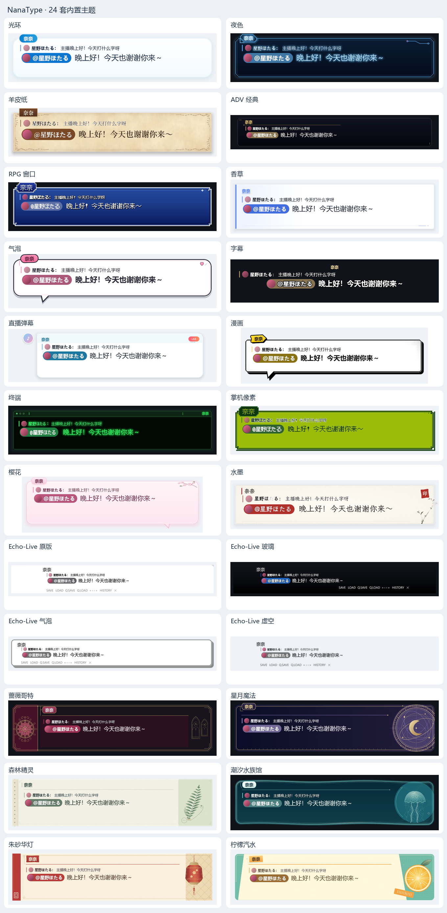
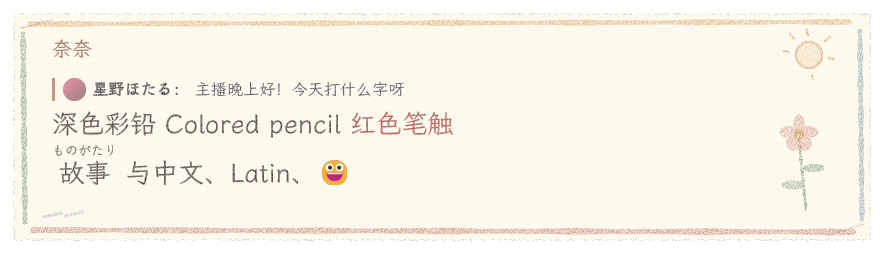

# 皮肤格式

皮肤是统一包体系的一种能力。每个目录包以 `package.toml` 声明身份、版本、能力和依赖，以 `skin.toml` 描述样式，并携带图片、着色器、字体、音效及授权文件。压缩分发格式为 `.ntpkg`；旧 `.ntskin` 格式不再支持。设置 › 插件与资源包 可以管理全部包，皮肤页只显示提供皮肤能力的包。

框架默认值是透明无框、系统字体、黑色正文和静态表现，不携带任何具体皮肤设计。全部 28 套内置皮肤分别声明自己的外观；光环只是应用默认选择的普通包。用包清单中的 `base` 继承另一皮肤时需同时声明精确版本依赖；表格逐层合并，数组整体替换，`decor = []` 可清空装饰。包身份、名称和标签不从父包继承。

## 包身份和共享资源

```toml
# package.toml
format = 1
schema = 3
id = "my.sakura"
version = "1.0.0"
capabilities = ["skin"]          # 可组合 skin、resources、lua
name = { zh-CN = "樱", en-US = "Sakura" }
author = "你的名字"
license = "CC-BY-4.0"
base = "nanatype.halo"           # 可选，只继承配置

[dependencies]
"nanatype.halo" = "2.1.0"
"my.shared" = "1.0.0"
```

`package.toml` 严格解析，未知键会拒绝加载；声明的能力须与内容一致：`skin` 对应 `skin.toml`，`lua` 的入口文件必须存在，`resources` 须携带资源文件。`skin.toml` 仅保存样式。包内文件使用相对路径；跨包引用使用 `pkg:my.shared/images/paper.png`。常用字体继续使用 `builtin:fonts/LXGWWenKai-Regular.ttf`。只有声明的依赖闭包可见；缺失、版本不符、冲突、循环和路径越界均会拒绝加载。继承来的相对资源保留父包所属命名空间，避免被子包同名文件覆盖。

导出会携带完整依赖和授权文件，依赖保存在 `dependencies/<包ID>/` 下；同一依赖闭包内每个 ID 固定一个精确版本。引用其他包的资源不会执行该包的脚本。详情见[功能插件接口](plugins.md)。

通用界面采用独立的 NanaUI 中性配色，在设置 › 常规 › 界面外观中选择跟随系统、浅色或深色。只有展示框（含对方展示框）、历史记录框和输入编辑区域随皮肤变化；皮肤选择器中的缩略图、示例及色板也保留皮肤效果。输入窗工具栏、状态栏和弹幕面板均使用通用配色。`chrome` 提供内容强调色、行内标签底色和文字对比色，不改变应用界面。

## 内置皮肤

下表每一项均为独立皮肤包，其目录为 `crates/theme/builtin/<ID 去掉 nanatype. 前缀>/`；包清单、样式和素材随包分发。

在设置 › 皮肤 › 预览中切换展示框或历史记录，可分别调整正文字体、字号、行高、颜色和窗口宽高，并编辑测试文本。改动先显示在预览里；点击「保存」才写入该皮肤的个人配置，保存其他皮肤不会切换正在使用的皮肤。字段留空表示跟随皮肤默认；「恢复皮肤默认」也需要保存才生效，关闭设置会丢弃未保存的草稿。个人配置不修改皮肤原文件。

展示框和历史记录解锁后，可拖动四边或四角独立调整宽高，文字保持字号并重新换行。窗口支持 160–8192 × 96–8192 逻辑像素，字号支持 8–200 px，行高支持 1–3 倍。很矮的历史窗口会收起标题并压缩上下留白，为消息保留显示空间。对方展示框共享正文设置，尺寸独立记忆。

| id | 名称 | 标签 | 特点 |
|---|---|---|---|
| `nanatype.machine_learning` | 机器学习 | minimal, game | 石墨底、冷白正文与淡紫节点网络；字符快速演算后锁定，整段乱码随机消隐 |
| `nanatype.crayon` | 蜡笔画 | cute, elegant | 米白画纸、柔彩蜡笔与小花涂鸦，深色彩铅文字；静态 GPU 材质 |
| `nanatype.halo` | 光环 | classic, minimal | 默认。精简蓝白圆润卡片、轻阴影、天蓝胶囊名牌，无右上角动效 |
| `nanatype.sonnet` | 十四行诗 | elegant, minimal | 透明诗句字幕，中文文楷与英文花体；逐字金光、星火光丝，整段同步化为光尘 |
| `nanatype.love_letter` | 情书 | cute, elegant | 象牙罗纹信笺、横格与链纹、酒红火漆，From 花体署名；文楷按笔顺错峰书写，整段同步消融，见[情书说明](love-letter.md) |
| `nanatype.night` | 夜色 | classic | 霓虹灯管招牌：茄紫黑底、品红灯管与卡扣，姓名是点亮的一段字；换句时灯管闪两下 |
| `nanatype.parchment` | 羊皮纸 | classic, elegant | 犊皮纸、双压线框、四角卷草，内压金线的皮签名牌，宋体 |
| `nanatype.adv` | ADV 经典 | game | 1280 宽电影遮幅：上方透明渐入深黑、白色细线，宋体白名带短下划线 |
| `nanatype.rpg` | RPG 窗口 | game, retro | 皇家蓝搪瓷窗、三层倒角、独立名牌小窗与像素字，等待时水晶跳动 |
| `nanatype.vanilla` | 香草 | streaming, minimal | 瑞士编辑版式：暖白直角纸面、香草荚深棕竖线、栏目式姓名与对位十字 |
| `nanatype.bubble` | 气泡 | streaming, cute | 糖果贴纸：浅粉底、深梅粗描边、粉色错位阴影、糖果胶囊名牌与弹性爱心 |
| `nanatype.subtitle` | 字幕 | streaming, minimal | 无框，居中粗描边白字；姓名为金色描边字，不加底板 |
| `nanatype.livechat` | 直播弹幕 | streaming | 圆形头像、纯文字姓名、圆角评论气泡与 LIVE 标识 |
| `nanatype.comic` | 漫画 | game, cute | 黑白印刷加印刷黄：粗细变化的墨线、尖尾巴、两角网点、速度线与倾斜黄色说明框 |
| `nanatype.terminal` | 终端 | retro, minimal | 琥珀荧光屏、标题栏路径与忙碌符号、极淡扫描线、空心光标 |
| `nanatype.pixel` | 掌机像素 | game, retro | 四阶绿色、阶梯框与像素凹槽、像素字 |
| `nanatype.sakura` | 樱花 | cute | 半透明粉色毛玻璃、无尾巴，花枝越出右上角、框外几片落瓣，小樱花引出姓名 |
| `nanatype.ink` | 水墨 | elegant | 生宣留白、底边一笔干笔，墨竹出血越框，朱印落款与楷体 |
| `nanatype.echo_vanilla` | Echo-Live 原版 | streaming, minimal | 还原 Echo-Live 原版：白底、顶部灰线、右上角三角、名字左凸、底部菜单栏 |
| `nanatype.echo_glass` | Echo-Live 玻璃 | streaming | 还原 Echo-Live 玻璃：自下而上黑色渐变、黑边白字、菜单栏靠右 |
| `nanatype.echo_bubble` | Echo-Live 气泡 | streaming, cute | 还原 Echo-Live 气泡：白色圆角框、灰色粗边、右下硬投影 |
| `nanatype.echo_void` | Echo-Live 虚空 | streaming, minimal | 还原 Echo-Live 虚空：完全透明，只有黑字和灰色菜单栏 |
| `nanatype.gothic` | 蔷薇哥特 | streaming, elegant | 教堂立面：两扇彩窗尖窗、山墙玫瑰窗、锡银窗棂与酒红阅读面 |
| `nanatype.celestial` | 星月魔法 | streaming, elegant | 以右下角为圆心出血的黄铜星盘、新月与穿过正文背后的淡星弧 |
| `nanatype.forest` | 森林精灵 | streaming, cute | 鼠尾草绿衬卡上的标本纸、纸胶带名牌、越出上沿的蕨叶与标本签 |
| `nanatype.tidal` | 潮汐水族馆 | streaming, elegant | 起伏水线为上沿，水母伞体浮出水面，珍珠名牌漂在水线上 |
| `nanatype.lantern` | 朱砂华灯 | streaming, elegant | 黑漆朱框描金，横梁垂下两盏灯笼悬在框外，暖光映在漆面上 |
| `nanatype.citrus` | 柠檬汽水 | streaming, cute | 薄荷网点上的斜切汽水标签、从角上出血的柠檬片与倾斜贴纸名牌 |



设置 › 皮肤 顶部的预览卡会用示例台词实时画出所选皮肤（含个性化设置），点击某一行即可预览而不切换（行尾的“⋯”菜单里有复制、导出等操作）；标签和浅色 / 深色可用来筛选列表。水墨保留开放授权墨竹素材，程序版画携带同源静态回退，复杂花枝与卷草使用原创透明纹理；想改造它们时用「复制为可编辑」。缩略图使用与展示框相同的静态装饰、尾巴与表面绘制，并为外扩装饰和阴影留出空间；无继续提示的皮肤不显示占位圆点。

2026-10 按[皮肤重设计](skin-redesign.md)重新拉开色域与构图：版画六套各换独立骨架，终端改琥珀、夜色改霓虹、华灯改暗底、哥特改锡银、ADV 去金；光环、直播弹幕、蜡笔画与 Echo 四套保持原风格。全部皮肤的 @提及改为浅底深字，紧凑态不再借用光环蓝。更早的细化见[经典皮肤设计记录](classic-skin-refinement.md)。七套使用物件或状态动效：霓虹灯管闪烁、准备水晶、弹性爱心、打字三点、终端符号、液晶格和花枝；其余皮肤以纸张、线条和排版保持静态。响应式竖版与窄窗复用原来的版画程序重排纹理、角花和状态物件；静态程序不申请动画帧。关闭高级动效后保留静态外观。完整画面为超长姓名预留空间，姓名在名牌内省略，原始姓名不变。显式设置个性化框色时优先使用所选颜色与原生框体。

历史记录延续展示框的名牌、框线和排版：纸张主题使用静态纤维、双线或朱印；六套新增主题各自保留酒红装订、星轨、装订孔、玻璃水线、朱砂印章和薄荷纸层。历史装饰保持静态，不执行展示框的动效。主播和观众的姓名底板、无图头像遵循同一套皮肤配色，真实头像保留原图。掌机像素和 RPG 的正文、姓名、时间与引用使用 12px 的整数倍字号；字幕不显示头像。

重新生成全部皮肤的展示框／历史记录对照图，并在默认宽度与 300px 窄窗中检查长昵称、多行正文、回复引用和行距：

```powershell
cargo build -p nanatype --example snapshots --example chat_parity
$env:NANATYPE_THEME_SNAPSHOTS_ONLY='1'
$env:NANATYPE_SNAPSHOT_VIEWS='display,history'
$env:NANATYPE_SNAPSHOT_TRANSPARENT='1'
& target/debug/examples/snapshots.exe target/history-style-fixed all zh-CN
& target/debug/examples/chat_parity.exe target/history-style-layout all zh-CN audit history
```

六套新增主题的[原速动效预览](skins-motion.webp)包括水母倾斜游动、叶片弯动、灯笼轻摆、星轨与金边游光、果片后方上升的气泡。文字、名牌和框体位置保持稳定；动幅、周期与逐帧检查方法见[设计说明](skin-art-direction.md#装饰自身的运动)。

水墨直接叠加大都会博物馆开放图像中郑燮 [Bamboo and Poem](https://www.metmuseum.org/art/collection/search/52946) 的墨竹局部（Public Domain）。只裁切并去掉纸底，不重绘线条或改色；来源与处理记录随皮肤附在 `ink/ART-LICENSE.txt` 中。

### Echo-Live 设计来源

`echo_vanilla`、`echo_glass`、`echo_bubble`、`echo_void` 四套皮肤的设计参考自 [sheep-realms/Echo-Live](https://github.com/sheep-realms/Echo-Live)，原作者为 Sheep-realms 及该项目贡献者。NanaType 使用本地 TOML 皮肤格式实现和适配这些样式。原项目采用 GPL-3.0-or-later，详见其 [授权协议与声明](https://github.com/sheep-realms/Echo-Live/blob/master/copyright.md)；本地清单中的 CC0-1.0 声明仅覆盖 NanaType 自身的贡献。

## 音效包

音效包是声明 `capabilities = ["sounds"]` 的包，根目录有 `sounds.toml`，内容与皮肤的 `[sounds]` 表相同：

```toml
[sounds]
open = "sounds/open.ogg"
[sounds.typing]
files = ["sounds/key-1.wav", "sounds/key-2.wav"]
volume = 0.5
[sounds.se]
coin = "sounds/coin.ogg"
```

在 **设置 › 播放 › 音效包** 中选择后：音效包定义了 `typing` 就替换皮肤的打字音及其节奏（`every_n`、`skip_punct` 等），定义了 `open`、`advance` 就替换对应音效；`se` 按名字覆盖或补充，皮肤的其他命名音效保留，写给皮肤的 `[se=…]` 标记照常发声。引用的文件必须在包内（或依赖包中，`pkg:<包ID>/<路径>`），缺失时整包拒绝加载。

选中的音效包被删除、无法加载或在当前构建中不可见（例如 GitHub 版看不到 Steam 创意工坊的条目）时，暂用皮肤自带的音效并提示一次，设置保持不变。音效包可以和皮肤放在同一个包里（`capabilities = ["skin", "sounds"]`）。

## 历史窗口的通用布局

`history.group_speakers` 控制相邻同一说话人的消息是否共用姓名栏；`history.padding` 是无面板时的左、上、右、下内边距，`history.margin` 是上、右、下、左外边距；`history.row_padding` 是每行的水平留白，`history.column_inset` 是正文列旁额外预留的宽度。头像尺寸与 `history.text.size` 由皮肤配置，用户个性化设置正常覆盖，不存在按皮肤 ID 改写的流程。

## 清单

```toml
[meta]                           # 以下身份字段实际放在 package.toml 根层；此处为字段索引
id = "my.sakura"                  # a-z 0-9 . - _，最长 64
version = "1.0.0"
min_app = "0.1.0"                 # 需要的 NanaType 最低版本
base = "nanatype.halo"            # 可选：继承的皮肤
name = { zh-CN = "樱", en-US = "Sakura", ja-JP = "さくら" }
description = { zh-CN = "粉色樱花", en-US = "Pink blossoms" }   # 选择器里的一句话介绍（可选）
author = "你的名字"
license = "CC-BY-4.0"
preview = "preview.png"
tags = ["cute", "streaming"]      # 选择器里的分类：classic streaming game retro cute elegant minimal

[chrome]                          # 内容配色；不影响设置、工具栏等通用界面
appearance = "light"              # light | dark，皮肤选择器的明暗分类
accent = "#e86a92"                # 装饰、引用昵称、行内标签等的强调色
surface = "#ffffff"               # 编辑器行内标记的底色参考
text = "#3a2230"                  # 内容文字对比描边的候选色

[fonts.body]                      # 台词字体；name（名牌）、accent（装饰文字）同理
file = "fonts/LXGWWenKai.ttf"     # 随皮肤分发的字体（可选）
families = ["LXGW WenKai", "Microsoft YaHei UI", "PingFang SC"]   # 按顺序取第一个已安装的
weight = 500

[dialogue]
region = [760, 150]               # 对话区域（逻辑像素）
overscan = 18                     # 四周透明边距，防止跳动 / 描边被裁切
padding = [20, 22, 20, 14]        # 文字内边距：左 上 右 下
background = "images/bg.png"      # 可选
overflow = "scroll"               # 长文本：clip 裁掉 / scroll 跟随滚动（默认）/ page 满页后等待并清空
overflow_auto_ms = 1500           # page 模式下满页自动翻页的等待时间；省略则等继续键

[dialogue.box]
# contour = "rounded"             # 可选：用 Painter 绘制连续圆角与曲线尾巴
color = "#ffffffee"
border_color = "#f0cfdc"
border_width = 2
radius = 18
inner_border_color = "#ffe4ee"    # 可选的内框
inner_border_width = 2
glow = "#e86a9260"                # 可选的外发光
glow_blur = 12                    # 外发光的模糊半径
shadow = { color = "#00000030", dy = 3, blur = 8 }
frame = { image = "images/frame.png", slice = [24, 24, 24, 24], scale = 1 }   # 九宫格贴图，替代上面的绘制
# repeat = false                 # 九宫格中心默认拉伸；true 使用平铺
width_fraction = 1.0              # 框宽占区域的比例
gradient = { angle = 160, stops = [[0, "#ffffff"], [1, "#ffe9f1"]] }   # 渐变，画在 color 之上
radii = [4, 18, 18, 18]           # 四个角分别的圆角：左上 右上 右下 左下（替代 radius）
border_widths = [0, 0, 0, 4]      # 四条边分别的宽度：上 右 下 左（替代 border_width）
border_style = "solid"            # solid | dashed | dotted
shadows = [                       # 更多阴影层；inset = true 为内阴影
    { color = "#e86a9240", dy = 6, blur = 18 },
    { color = "#ffffff", dy = 1, inset = true },
]
margin = [0, 0, 26, 0]            # 在区域内为尾巴、装饰留出的空间：上 右 下 左

[dialogue.tail]                   # 可选：对话气泡的尾巴，自动沿用框的填充和边框
side = "bottom"                   # top | right | bottom | left
at = 0.15                         # 尾巴根部在这条边上的位置（0–1）
width = 34                        # 根部宽度
length = 24                       # 伸出框外的长度
lean = -10                        # 尖端沿边偏移
shadow = true                     # 为尾巴复制框的硬阴影（blur = 0 的外阴影）
# color = "#ffe6ef"               # 填充，默认是框的颜色

[[dialogue.decor]]                # 装饰，可写多个（最多 16 个）
# image = "ink/stroke.png"        # 可选：透明图片素材，按原始比例完整放入 size
# motif = "blossom"               # 可选：曲线图形，代替 polygon 和普通矩形填充
anchor = "top_right"              # 装饰自己的这个点对齐框的同名点，再加 offset
offset = [-18, -14]
size = [26, 26]                   # 像素，或框尺寸的百分比如 "56%"
# inset = [5, 5, 5, 5]            # 改为距四边的距离（可为负），用于内框线、底衬
text = "✦"                        # 可选：居中画一个字符（最多 8 个字）
text_color = "accent"
text_size = 22
font = "accent"                   # body | name | accent
rotate = 12                       # 顺时针角度
layer = "above"                   # above：画在框上；below：画在框下
when = "always"                   # always | speaker（仅在有名牌时显示）
                                  # | display（只在展示框与皮肤预览中画，输入窗不画；
                                  #   用于仿菜单栏这类看起来能点的装饰）
# motion = { kind = "float", period_s = 6, amplitude = 1.5, phase = 0 }
# 也可以有 color、gradient、radius、radii、border_color、border_width、
# border_widths、border_style、shadows、opacity，
# 以及 polygon = [[0, 0], [100, 0], [50, 100]]（按装饰尺寸的百分比裁成多边形，3–8 点）

[dialogue.text]
color = "#3a2230"
size = 28
line_height = 1.4
letter_spacing = 0                # 字间距（像素）；history.text 同样可写
stroke = { color = "#ffffff", width = 2 }
shadow = { color = "#00000055", dx = 1, dy = 1, blur = 2 }
align = "start"                   # start | center | end

[dialogue.nameplate]
color = "#e86a92"
text_color = "#ffffff"
size = 18
radius = 10
padding = [10, 4]
anchor = "top_left"               # 名牌自己的这个点对齐框的同名点
offset = [16, -12]                # 再偏移；负值压在边框上
frame = { image = "images/nameplate.png", slice = [8, 8, 8, 8] }
# 完整框图可指定 layout_inset = false，保留九宫格切片而不增加布局内边距；默认 true。
stroke = { color = "#000000", width = 3 }   # 名字描边
text_shadow = { color = "#e86a92", blur = 8 }
gradient = { angle = 90, stops = [[0, "#ff8fb8"], [1, "#ffb3cf"]] }
radii = [10, 10, 10, 2]
border_color = "border"
border_width = 2                  # 或 border_widths = [0, 0, 2, 0] 只画下划线
shadows = [{ color = "#00000040", dx = 3, dy = 3 }]
rotate = -3

[dialogue.portrait]               # 立绘 / 头像
visible = true
side = "left"
size = [180, 220]
image = "images/portrait.png"
variants = { smile = "images/portrait-smile.png", angry = "images/portrait-angry.png" }

[dialogue.continue]               # 等待继续时的指示符
glyph = "▼"
color = "#e86a92"
size = 16
image = "images/continue.png"     # 可选：用图片代替字符
frames = 1                        # 图片是横向排列的多帧精灵图时填帧数
fps = 8
image_size = [22, 22]
anchor = "bottom_right"
offset = [-14, -8]
motion = "bob"                    # bob（浮动）| blink（闪烁）| pulse（缩放）| none
period_s = 0.83                   # 一个动作周期
bob_px = 3
# glyph = "" 且没有 image 时不显示

[dialogue.reveal]                 # 打字节奏
base_ms = 50                      # 每个拉丁字符
cjk_factor = 2.0                  # 中日韩字符等于几个拍子
space_ms = 50                     # 每个空格
punct = { comma_ms = 120, stop_ms = 260, ellipsis_ms = 300 }
entrance = { kind = "fade", ms = 140 }   # none | fade | pop | slide_up

[history]                         # 历史记录（直播弹幕风格）
width = 420
height = 560
avatar = { shape = "circle", size = 40, ring_color = "#ffffff", ring_width = 2 }   # circle | square | none
# 头像还可写 color（无图头像的底色，默认强调色渐变）与 radius（square 的圆角，默认边长的 18%）；
# 主播与观众共用皮肤的无图头像配色和姓名样式；真实头像仍显示原图
name_color = "#e86a92"
name_size = 14
name_stroke = { color = "#000000", width = 2 }
name_plate = { color = "accent", text_color = "#ffffff", radius = 9, padding = [9, 2], border_color = "border", border_width = 1 }   # 名字底板（可选）；支持 contour、gradient、border_widths 和 shadows
bubble_color = "#ffffffee"
bubble_border = "#f0cfdc"
bubble_border_width = 1
bubble_radius = 14
bubble_radii = [4, 14, 14, 14]
bubble_gradient = { angle = 135, stops = [[0, "#fff0f5"], [1, "#ffe1ec"]] }
bubble_shadows = [{ color = "#00000020", dy = 2, blur = 8, spread = 0 }]  # spread：阴影扩张距离，内阴影可用于双线压印
bubble_padding = [12, 8]          # 气泡内边距：水平 垂直
bubble_frame = { image = "images/bubble.png", slice = [12, 12, 12, 12] }
gap = 10                         # 间距参考：stack 按字号控制在 12–20px；同作者连续消息 8–12px；inline 8–14px
entrance = "slide_up"             # none | slide_up | fade | slide_left
layout = "stack"                  # stack：名字和时间在气泡上方 | inline：名字、台词、时间同一行（聊天记录式）
                                  # stack 下同一人 2 分钟内的连续消息合并：只有第一条显示头像、名字和时间
name_width = 96                   # inline 时名字栏宽度；窄窗自动缩短，保留正文和 @ 标签空间
name_weight = 700
time_size = 11                    # 默认比名字小 3（也用于“主播/观众”角色标签）
time_color = "#8aa0b4"            # 时间与角色标签的颜色
time_seconds = false              # true 显示 HH:MM:SS
hide_latest = false               # true：展示框上还显示着的那句先不进历史（设置 › 历史记录 可覆盖）
# 整个列表背后的面板（可选）；也支持 gradient / radii / border_widths / border_style / shadows
panel = { color = "#edeef0", border_color = "#888888", border_width = 0, radius = 0, padding = [18, 18, 18, 18], margin = [0, 0, 0, 0] }   # padding 左上右下，margin 上右下左
title = { text = "HISTORY", color = "#606266", size = 21, weight = 600, background = "#ffffff", height = 42, padding = 18 }   # 面板顶部标题栏（可选）

[[history.decor]]                 # 面板上的装饰，字段同 [[dialogue.decor]]（when 和 motion 不适用；历史装饰保持静态）
anchor = "top_right"
size = [11, 11]
polygon = [[0, 0], [100, 0], [100, 100]]
color = "#00000026"
# 纸张主题可用 motif = "paper" 绘制固定、稀疏的纸纤维；不加载图片或逐帧生成噪声。

[history.text]
color = "#3a2230"
size = 18

[history.chat]                    # B 站弹幕行（设置 › 历史记录 › 弹幕 打开后出现）
text_scale = 0.88                 # 弹幕文字相对 history.text 的大小
bubble_opacity = 0.7              # 整个弹幕气泡底板的不透明度（含渐变、边框、阴影与九宫格图片）；正文保持不透明

[history.reply]                   # 回复弹幕的台词，气泡上方的一行引用：头像 · 昵称：原文（inline 布局时在整行上方，对齐台词栏）
visible = true
size = 12                         # 默认是正文的 62%
color = "#7a6070"                 # 原文颜色，默认同正文，可写颜色角色；昵称用 accent
opacity = 0.8

# 引用昵称使用 fonts.name，原文使用 fonts.body；继承当前展示区域 text 的描边和阴影。
# 透明底且未指定描边时，引用文字补一层细对比描边，避免直播背景吞掉文字。
# 透明历史中未设描边的浮空昵称、时间和无底板正文也采用细对比描边，保留原配色。

[dialogue.reply]                  # 对话框上的回复引用，字段同 [history.reply]
visible = true                    # 用户也可在 设置 › B 站直播 › 弹幕面板 里关闭

[mention]                         # 台词里的 [at=…]：带头像和昵称的标签，输入框、对话框和历史记录一致
fill = "accent"                   # 标签底色，可写颜色角色；与 text_color 对比不足 4.5:1 时自动加深
text_color = "#ffffff"            # 始终照用；标签下不画台词的阴影或发光
scale = 0.82                      # 相对周围文字的字号
avatar = true                     # 昵称前显示头像

[sounds]
typing = { files = ["sounds/key1.ogg", "sounds/key2.ogg"], volume = 0.6, pitch_jitter = 0.05, every_n = 1, min_interval_ms = 30, skip_punct = true }   # skip_punct：标点不出声
open = "sounds/open.ogg"          # 一句开始
advance = "sounds/advance.ogg"    # 按继续
se = { coin = "se/coin.ogg", boom = "se/boom.wav" }   # [se=coin]

[effects]                         # 逐字动效的默认幅度
shake_px = 1.6
shake_hz = 14                     # 抖动频率
wave_px = 3
wave_period_s = 1.2               # 波浪一个周期的秒数
jump_px = 6
jump_period_s = 0.9               # 跳动一个周期的秒数
rainbow_period_s = 2.4
screen_shake_px = 6
contrast_guard = 3.0              # 自带颜色的文字与框色对比低于 3:1 时加 1.5px 描边（0 = 关）
```

## 受限 WGSL 动效（schema 3）

包根目录的 `package.toml` 声明 `format = 1`、`schema = 3` 与 `capabilities = ["skin"]`；`skin.toml` 通过 `shaders` 表定义效果，并用 `shader_effects` 或装饰的 `shader` 引用。旧格式不再支持。导出会携带依赖与完整资源，包可离线独立加载。数组整体替换，`shader_effects = []` 清空继承的展示框效果，`decor = []` 清空装饰效果。命名效果表按键合并；继承来的效果若不再被引用就不绘制。

```toml
# package.toml
format = 1
schema = 3
id = "my.aurora"
version = "1.0.0"
capabilities = ["skin"]
base = "nanatype.halo"
[dependencies]
"nanatype.halo" = "2.1.0"

# 以下保存为 skin.toml
[shaders.world]
source = "effects/aurora.wgsl"
period_s = 12                    # 0.5–3600 秒
intensity = 0.16                 # 0–1，最终由宿主乘入透明度
textures = []                    # 最多两张皮肤内图片，采样返回线性 RGBA
params = [0.35]                  # 最多八个有限浮点数

[[dialogue.shader_effects]]
shader = "world"
target = "background"           # background | border | artwork

[[dialogue.decor]]
shader = "world"                # 在此装饰的形状内叠加效果
motif = "moon"
color = "#B5A1E8"
anchor = "top_right"
offset = [-12, -12]
size = [36, 36]
```

WGSL 文件只实现 `fn effect(input: EffectInput) -> vec4<f32>`，可添加纯辅助函数。返回非预乘的线性 RGBA；宿主限制颜色范围、乘入覆盖遮罩及强度，然后预乘并交由输出管线完成色彩转换。正文、姓名和引用始终在这些效果之上，效果不能读取画面或改变文字。

`EffectInput` 包含 `uv: vec2<f32>`（局部 0–1）、`size: vec2<f32>`（逻辑像素）、`phase: f32`（循环相位 0–1）、`seed: f32`（固定种子）；`line_age` / `speaker_age` 是对应事件后的秒数，`reveal` 是当前页面的打字进度，`waiting` 为 0 或 1；`base`、`accent`、`border`、`text` 为线性 `vec4<f32>` 主题色；`params0` / `params1` 各包含四个参数，未提供的值为零。

宿主提供 `sample0(uv)`、`sample1(uv)`、`particles(uv, phase, seed)` 和 `param(i)`。采样仅访问声明的图片，UV 限制在图片边缘，没有绑定图片时返回透明。`particles` 使用固定十六个点，无需跨帧状态。`param(i: u32) -> vec4<f32>` 读取 `bindings` 的第 `i` 项（见[皮肤参数](#皮肤参数)），未绑定的槽为零。程序可用 phase、三角函数和固定种子组合流光、焦散、星环、气泡及短暂事件响应。

着色器接口版本为 ABI 2：在 ABI 1 的基础上增加了 `param(i)` 及其绑定。`param` 与 `fx_` 前缀一样由宿主保留，自定义同名函数会被拒绝。

```toml
[shaders.art]
source = "art.wgsl"
bindings = [
    [34, 100, 100, 40],                     # 字面量
    ["ear_height", "ear_width", "tail", 3], # 最多四个标量：数值原样，布尔为 0/1，枚举为选项序号
    "fur",                                  # 颜色：线性 rgba（直通 alpha），与 base/accent 一致
]
owns_continue = true                        # artwork 播放时由程序自绘继续提示
```

`bindings` 最多 64 项，每项占一个 `vec4`。文本参数不能绑定，颜色参数只能单独占一项。参数变化只更新这块 uniform，不会重新编译着色器。`owns_continue = true` 只对 `target = "artwork"` 的程序生效：程序正在播放时宿主隐藏 `dialogue.continue`；冻结、关闭高级效果或编译失败时宿主照常绘制，所以静态画面也有继续提示。

```wgsl
fn effect(i: EffectInput) -> vec4<f32> {
    let wave = 0.5 + 0.5 * sin(i.uv.x * 12.0 + i.phase * 6.28318);
    let event = 1.0 - clamp(i.line_age, 0.0, 1.0);
    return vec4(i.accent.rgb, wave * (0.15 + event * 0.15));
}
```

限制：每框最多四个效果实例，最多十六个命名定义；源码 UTF-8、单份最多 64 KiB，除制表符和换行外不得含控制字符；IR 和按调用展开的复杂度各最多 4096 节点，调用深度最多八层；单条语句（两个 `;`、`{`、`}` 之间）最多 256 个运算符、调用、逗号、成员访问和下标，单个表达式的运算嵌套最多 64 层，`if`/`switch`/`{}` 嵌套最多 32 层，超出时用 `let` 拆开。用户函数禁止循环、自定义入口、全局变量、绑定、指针接口、原子、存储资源、discard、扩展和诊断指令；`compute`、`workgroup`、`storage`、`ptr`、`atomic…`、`texture_storage_…`、`textureStore`、各类 barrier、`arrayLength` 与 `subgroup…` 在源码中出现即拒绝（注释除外）；`fx_`、`nm_`、`__` 为宿主保留前缀。合并宿主包装后的模块只能有宿主的顶点与片元两个入口，从不运行计算着色器。固定数组最多 64 个元素，单个类型最多 4096 字节，单函数局部变量最多 16 KiB。每张纹理最长边 2048，单皮肤解码后的纹理最多 32 MiB；代理的纹理与遮罩缓存总预算 64 MiB。

运行时隔离：WGSL 校验在独立线程上进行，校验器的崩溃只让该着色器报错，皮肤其余部分照常加载。GPU 编译同样在独立线程、错误作用域内进行，失败则禁用该效果。所有皮肤程序共享每秒的 GPU 预算（单像素展开复杂度 × 覆盖像素，按每次绘制累计，约为最重的内置主题以 60 fps 铺满 3840×2160 的 1.6 倍）：一秒内超出时，花费最多的程序先被冻结（按关闭动效绘制），已冻结仍超出则停用，并给出提示。GPU 设备丢失后，丢失前两秒内绘制过的程序记一次，第二次即停用。崩溃保护把首次绘制的程序记入 `config/shader-guard.json`，正常绘制约两秒或 120 次后移除；若应用或驱动在此期间退出，下次启动起该程序保持停用。关闭再开启“皮肤高级效果”会清除这些停用和冻结记录并重试；皮肤改动程序后哈希改变，也会重新试用。`materials.*` 由界面框架绘制，受同样的预算和崩溃保护，所在设备也绘制过效果时同样参与设备丢失计数：框架在每次编译和绘制前询问宿主，并按形状面积或文字绘制范围计费；材质本身是静态的，没有可冻结的动画，超出预算即停用，被停用的材质按原有样式绘制。这些措施在故障发生后止损，不能阻止单次驱动故障。

`cargo run -p nanatype-theme --example check_package -- <包>` 会同时列出每个着色器的表达式嵌套深度。

设置 › 皮肤 › 皮肤高级效果 默认开启；减少动态效果时停用本节的动态 WGSL，保留下节的静态通用材质。编辑器、历史和缩略图保持静态，预览卡点“播放动效”才播放当前主题。循环只请求绘制帧，独立循环为 30 fps；打字等动画可提高到 60 fps。导入错误显示文件路径和 WGSL 诊断（行列号直接对应皮肤文件）；无效热重载保留上一份有效皮肤，GPU 编译失败则禁用该效果并保留静态外观。

完整作者示例见 [aurora/skin.toml](examples/aurora/skin.toml)，可直接导入 [aurora.ntpkg](examples/aurora.ntpkg)。六套新内置主题每套使用一个 WGSL、一张透明装饰纹理、零自定义参数、零装饰节点，构图和静态回退见[设计说明](skin-art-direction.md)，素材参考与矢量源图见[来源记录](skin-art-sources.md)。

`target = "artwork"` 用于完整画面：程序自行绘制透明轮廓、材质、边框和装饰，宿主提供展示框矩形画布，不再使用原有框体的覆盖遮罩。多个 artwork 实例按 `shader_effects` 的顺序叠加；单个程序超出节点上限时，可以拆成背层和前层。配置 `dialogue.box.frame` 作为完整静态回退；可以运行 `cargo run -p nanatype --example skin_artwork -- crates/theme/builtin` 重新烘焙内置图，用 `-- --package <目录> [--preset <预设>] [--out <png>] [--at <毫秒>] [--scale <倍数>]` 烘焙一个包（按顺序叠加它的全部 artwork 层；`--at` 渲染 16 秒循环中的其他时刻，用于检查动效；`--scale` 按高分屏倍数渲染，用于检查线宽和抗锯齿）。`cargo run -p nanatype-theme --example check_package -- <目录或 .ntpkg>` 按应用的方式校验包，并列出每个着色器的 IR 与展开成本；超出上限时也会报告。回退与 WGSL 都绘制在正文、引用和姓名之前；未声明静态回退的第三方程序在关闭动效时不提交用户代码；`static_fallback = true` 的响应式版画冻结时钟以保留完整材质和装饰，停止申请动画帧。

## 内容配色参考（chrome）

`[chrome]` 只包含 `appearance`、`accent`、`surface` 和 `text`。`appearance` 用于皮肤选择器的明暗分类；`accent` 提供装饰、引用昵称和行内标签等的强调色；`surface` 用于编辑器行内标记的底色；`text` 为内容文字的对比描边提供候选色。

界面明暗由设置 › 常规 › 界面外观决定，默认跟随系统。历史记录是否显示时间由设置 › 历史记录决定，列表统一从内容区顶部排列。

通用界面使用 NanaUI 标准浅色、深色配色及固定强调色，保留现有圆角、间距、卡片阴影和动效。皮肤的个性化强调色只影响皮肤内容，不改变应用按钮或选中状态。

## 通用材质



schema 2 皮肤可以使用 NanaUI 的通用片元材质，在框体或字形内部绘制纹理。蜡笔画皮肤使用静态纸纹、蜡笔边框和彩铅排线；正文、姓名、引用和注音采用对应区域的文字材质，编辑器不启用文字材质。

2026-10-18 的 Windows 离屏 GPU 验收：材质参数变化不重新塑形、不重新栅格化、不上传字形；无材质及恒等材质的输出与原生路径逐像素一致。连续静态帧相同且不请求动画，关闭再开启高级效果恢复原像素；加入蜡笔画后原有 24 套展示框与基线逐像素一致。复查蜡笔画的展示框、历史、长姓名、引用、300px 窄窗与 2× 截图：

```powershell
$env:NANATYPE_MATERIAL_AUDIT = '1'
$env:NANATYPE_THEME_AUDIT = '1'
cargo run -p nanatype --example snapshots -- target/crayon-audit nanatype.crayon zh-CN
```

```toml
[materials.paper]
source = "materials/paper.wgsl"
params = [0]                    # 最多八个有限浮点数；补零为两组 vec4
textures = []                   # 最多两个槽：图片路径或管线纹理输出，图片不超过 2048×2048
# uniforms = [{ pipeline = "…", output = "…" }]  # 管线 vec4 输出，排在 params 之后

[materials.pencil]
source = "materials/pencil.wgsl"

[dialogue.box]
material = "paper"              # 背景填色材质
# border_material = "paper"     # 独立边框材质

[dialogue.text]
material = "pencil"

[history]
bubble_material = "paper"

[history.text]
material = "pencil"
```

形状的公共字段 `material`、`border_material` 也可用于名牌、面板及普通几何装饰。当前材质适配普通矩形、圆角矩形和 polygon 裁剪；使用 contour/motif 的自定义路径绘制保持原样。表格按名称合并，文件引用随复制和导出完整打包。总共最多十六个材质定义，材质纹理解码总量上限 32 MiB；源码、文件路径与计算复杂度沿用皮肤 shader 的受限校验。

### 声明式处理管线

仅供 Shader 使用的数据由宿主的已注册处理器转换，不运行 Lua。数据在 `package.toml` 以 `[data.<id>]` 声明（见[统一包整体设计](package-design.md)）；`skin.toml` 的 `[pipelines.<名称>]` 选择处理器 `processor` 及版本 `version`，在 `inputs` 中把每个输入绑定到数据引用 `{ data = "<id>" }`（依赖包写作 `pkg:<包ID>/<id>`）或另一条管线的输出 `{ pipeline = "…", output = "…" }`，`params` 只接受处理器声明的有限数值。材质的 `textures` 槽可写为 `{ pipeline = "…", output = "…" }`，`uniforms` 绑定 `vec4` 输出，依次排在静态 `params` 之后。

```toml
[pipelines.stroke_map]
processor = "text.stroke_time_map"   # 输入 nthz 笔顺数据与当前文字排版
version = 1
inputs = { strokes = { data = "strokes" } }

[materials.write]
source = "write.wgsl"
textures = [{ pipeline = "stroke_map", output = "time" }]   # 时间纹理
uniforms = [{ pipeline = "stroke_map", output = "extent" }] # material_param(0u)
```

目前注册的处理器为 `text.stroke_time_map` v1（输出 `time` 纹理与 `extent`）。管线最多 8 条、链深不超过 4，必须无环；未注册处理器或版本、缺少或多余输入、端口类型不符、参数越界、纹理槽超过 2 个、`params` 与 `uniforms` 合计超过 4 组 vec4 均拒绝加载，未被材质使用的管线给出警告。依赖文字排版的材质只能用于 `dialogue.reveal.entrance.material`；在历史记录、编辑框等没有该上下文的位置，管线纹理槽为透明占位，着色器按普通淡入回退。处理结果按数据内容哈希、材质与排版缓存，文字、字体、排版、尺寸或书写方向变化才重建，播放进度由 GPU 计算。

WGSL 只实现 `fn material(i: MaterialInput) -> vec4<f32>`，可添加纯辅助函数。`i.position` 是局部逻辑像素，`i.uv` 是归一化坐标，`i.size` 是局部尺寸；文字的局部区域为当前字形单元，`i.glyph_uv` 为其归一化坐标，形状的该值为零。`i.color.rgb` 是已解析的线性文字或形状颜色，alpha 为 1；返回非预乘线性 RGBA，alpha 作为额外覆盖。框架统一乘入原始透明度、字形/形状遮罩与裁剪，材质不能扩大绘制范围。纹理通过 `material_sample0(uv)` / `material_sample1(uv)` 采样；`material_param(0u)`、`material_param(1u)` 读取参数。

材质保持静态，不自动请求连续帧。减少动态效果时保留它；关闭高级效果时移除材质并显示静态框体和普通字体。编译失败或资源不可用时回退到基础样式。显式文字颜色、对比描边、打字机和已有文字动效仍有效；贴图和彩色 emoji 不套用文字材质。

蜡笔画的静态框体由生产材质适配器生成，可复现：

```powershell
cargo run -p nanatype --example material_artwork -- crates/theme/builtin/crayon/paper.wgsl crates/theme/builtin/crayon/still.png 860 230
cargo run -p nanatype --example material_artwork -- crates/theme/builtin/crayon/paper.wgsl crates/theme/builtin/crayon/bubble.png 320 108 1
```

## 文字效果与对比度

- **发光**：文字的 `[shadow=颜色,0,0,模糊]`（无偏移即发光）画在亮色框上时，透明度最多 55%、模糊至少 10px，看起来是光而不是一团脏影。工具栏插入的发光默认使用皮肤的 `accent`。
- **对比保护**（`effects.contrast_guard`）：自带颜色的一段文字与 `dialogue.box.color`（历史记录里为 `history.bubble_color`）对比低于该值时，在其下方加 1.5px 描边，颜色取皮肤文字、框线中离这段文字最远的那个墨色（pixel 为 `#0f380f`）。已有描边的文字不变；框色透明度低于 50% 时不判断。内置的亮色皮肤、pixel 与 terminal 默认为 3.0，其余为 0（关闭）。
- **皮肤的文字阴影**：`dialogue.text.shadow` 是有色发光（如 terminal 的绿色、night 的蓝色）时，自带颜色的文字改用自己的颜色发光，不会再套上皮肤的绿光；黑色等中性投影保持不变。
- 以上只作用于展示框、历史记录与皮肤预览；输入框里的文字始终按原样显示，以便原样保存。

## 颜色、渐变与阴影

颜色写作 `#rgb`、`#rgba`、`#rrggbb` 或 `#rrggbbaa`。上面新增的字段（渐变色标、`shadows`、尾巴、装饰、名牌边框、历史名字胶囊、头像圆环）还可以写颜色角色，跟随皮肤里的对应颜色，也会跟随用户的个性化设置：

| 角色 | 对应 |
|---|---|
| `box` | `dialogue.box.color` |
| `border` | `dialogue.box.border_color` |
| `accent` | `chrome.accent` |
| `text` | `dialogue.text.color` |
| `name` | `dialogue.nameplate.color` |
| `name_text` | `dialogue.nameplate.text_color` |

框体、名牌、历史面板和装饰支持可选 `contour`；历史气泡使用 `bubble_contour`，历史名字胶囊也可在 `name_plate` 中写 `contour`。预设有 `rounded`（平滑圆角与连续曲线尾巴）、`orbit`（偏心圆角）、`hud`（仪表切角）、`parchment`（纸边）、`cinema`（宽幅切角）、`rpg`（阶梯框）、`slant`（斜切）、`cloud`（云朵）、`chat`（评论气泡）、`comic`（漫画分镜）、`terminal`（机壳）、`pixel`（像素凹槽）、`sakura`（花瓣边缘）、`ink`（不规则纸张）、`ribbon`（丝带）、`seal`（印章）。不写时保持原来的矩形、圆角和分边边框。异形框体的填充、描边与阴影共用同一路径；`dialogue.tail` 的位置、宽度、长度与倾斜会合入轮廓，尾巴共用框体填充与阴影，`tail.color` / `tail.shadow` 仅用于原来的独立三角尾巴。内容区域仍是矩形，轮廓不裁剪正文；在较小的历史气泡与名牌上，边缘起伏自动减小。

装饰可选 `motif`：`orbit`（轨道弧线）、`sparkle`（曲线星芒）、`blossom`（五瓣缺口樱花）、`petal`（花瓣）、`flourish`（卷叶）、`rays`（放射线）、`halftone`（网点）、`fold`（折角）、`circuit`（电路线）。图形使用装饰已有的颜色、渐变和边框色。装饰也可用 `image` 引用包内 PNG、JPEG、WebP 或 GIF，按原始比例完整显示在 `size` 中；图片沿用 `opacity`、`rotate` 和动效，成功加载时覆盖该装饰的填充、渐变、`motif`、`contour` 和 `polygon`。图片随皮肤导出，继承皮肤也可直接使用原图。其余表面的优先级为可用的九宫格贴图、`motif`、`contour`、原有矩形／`polygon`；图片皮肤沿用原有绘制。预览、缩略图、历史和展示共用 Surface 表面绘制与 Painter，不加载外部脚本或 SVG。自定义轮廓和图形也遵循已有 `rotate`、`opacity`、装饰层级与颜色角色。

装饰可选 `motion = { kind, period_s, amplitude, phase }`：`kind` 为 `float`（上下漂浮，`amplitude` 为像素，0–32）或 `breathe`（透明度呼吸，`amplitude` 为最多降低的透明度比例，0–1）。周期 `period_s` 为 0.5–120 秒；`phase` 为 0–1 的周期偏移。默认值为 `float`、6 秒、0.1px、0；不写 `motion` 时完全静止。推荐漂浮不超过 2px、呼吸不超过 0.15、周期至少 5 秒。运动叠加原来的旋转和透明度，只改变绘制，不改变布局或换行。仅自己的展示框与联机伙伴展示框播放；编辑区、历史、皮肤预览和缩略图使用原始姿态。系统或应用启用减弱动效时也使用原始姿态。空展示框不因装饰持续请求帧；隐藏窗口仍有 OBS 输出时照常绘制。

渐变 `gradient = { kind, angle, center, circle, stops }`：`kind` 为 `linear`（默认，`angle` 与 CSS 相同，0 = 向上，90 = 向右，默认 180）或 `radial`（`center` 为百分比，默认 `[50, 50]`）；`stops` 为 2–8 个 `[位置 0–1, 颜色]`，位置不能递减。渐变不能画在边框上，需要渐变边框时可用一个 `layer = "below"`、`inset` 为负值的装饰垫在框下。

每个框最多 4 层阴影，旧字段 `inner_border_color`、`glow`、`shadow` 也各占一层。

在设置里覆盖「展示框颜色」会关闭框的渐变，覆盖「名牌颜色」会关闭名牌的渐变，以便所选颜色可见。

## 字体

NanaUI 一次只用一个字体名，NanaType 会从 `families` 里挑第一个已安装的放在最前；都没装时使用系统默认字体。皮肤里随附的 `file` 字体总是优先。

`file = "builtin:fonts/X.ttf"` 引用编译进程序的字体（`crates/theme/fonts/`，见 [fonts.md](fonts.md)），内置皮肤靠它带字体，用户皮肤也可以引用。只在选中皮肤时注册，几个角色或几套皮肤共用同一个字体时只注册一次。本版本没有带这个字体时不报错，直接回落到 `families`。皮肤库只在 `families` 里没有一个可用字体（已安装，或是 NanaUI 自带的 Noto Sans SC），而且也没有随附可用的字体文件时，才给皮肤标上「替代字体」。

现在随附的内置字体（版本、来源与 SHA-256 见 [fonts.md](fonts.md)）：

| 引用 | 字体 | 版本 | 大小 | 用到它的内置皮肤 |
| --- | --- | --- | --- | --- |
| `builtin:fonts/FusionPixel12pxProportionalSC.ttf` | Fusion Pixel 12px Proportional 简体（GB2312 子集） | 2026.09.25 | 1.39 MiB | `pixel`、`rpg` |
| `builtin:fonts/LXGWWenKai-Regular.ttf` | 霞鹜文楷 Regular（3,755 常用字子集） | 1.522 | 2.04 MiB | `ink`、`crayon` |

`echo_*` 不带字体文件，`families` 末尾是 NanaUI 自带的 `"Noto Sans SC"`。

## 校验规则

导入时以下任何一项不满足都会拒绝整个皮肤，并显示具体字段：

- `schema` 比当前程序新，或 `min_app` 高于当前版本；
- `id` 不合法，或与内置皮肤重名；
- 路径越界（`..`、绝对路径、盘符）或文件缺失；
- 单个文件超过 64 MiB，或整个皮肤超过 256 MiB；
- 图片不是 PNG / JPEG / WebP / GIF，边长超过 8192，或九宫格切片超出图片；
- 字体无法解析；音效不是 WAV / OGG / FLAC / MP3；
- 颜色或数值不合法（如字号不在 4–400）；
- 渐变色标不是 2–8 个或位置递减；圆角不在 0–2000、边框不在 0–64；阴影超过 4 层；
- 装饰超过 16 个、多边形不是 3–8 点、文字超过 8 个字；尾巴、`continue` 的帧数和速度超出范围；`margin` 占满了区域；
- 参数声明、预设或 `{ param = … }` 占位不合法，或参数可取的某个值（范围两端、每个选项、最长文本、每个预设）会让它填入的字段越界（见[皮肤参数](#皮肤参数)）。

`tags` 不合规只会提示。

清单中不认识的字段会提示并忽略；制作皮肤时应清理这些字段。

## 皮肤参数

皮肤可以声明一组参数，用户在 设置 › 皮肤 › 预览 中调整。参数值保存在这套皮肤的个人配置里，不修改皮肤文件；「恢复皮肤默认」会一并清空，「默认」预设也会回到默认值。一个参数可以填入宿主绘制的字段，也可以绑定到着色器，或两者兼有。

```toml
[param_groups.ears]
name = { zh-CN = "耳朵", en-US = "Ears" }
order = 1                                   # 分组与参数都按 order、再按 id 排列

[params.fur]
type = "color"                              # number | color | bool | enum | text
group = "ears"
name = { zh-CN = "毛色", en-US = "Fur" }
default = "#fff7ec"
# alpha = true                              # 允许半透明；默认必须不透明

[params.ear_height]
type = "number"
default = 36
min = 16
max = 80
step = 1
unit = "px"                                 # 显示单位；"%" 表示把 0–1 的值显示为百分比

[params.motion]
type = "enum"
default = "cat"
options = [{ id = "cat", name = { zh-CN = "猫" } }, { id = "fox", name = { zh-CN = "狐" } }]

[params.sign]
type = "text"
default = "喵"
max_len = 4                                 # 1–64 个字形簇；allow_empty = true 允许留空

[presets.red_fox]
name = { zh-CN = "赤狐" }
values = { fur = "#fff3e6", motion = "fox" } # 未列出的参数取默认值

[[param_checks]]                            # 只提示，不拒绝
foreground = "text"                         # 颜色参数，或颜色角色 box、border、accent、text、name、name_text
background = "fur"
min = 4.5

[dialogue.box]
color = { param = "fur" }                   # 任意字段都可以写成占位
```

**占位**：`{ param = "<id>" }` 必须是整个值，不能再带别的键。加载时先代入默认值，再按普通清单校验；用户的值之后写入相同位置。占位不能出现在 `fonts`、`sounds`、`pipelines`、`materials` 之下，不能出现在 `shaders` 中除 `params`、`intensity` 以外的位置，不能出现在 `dialogue.responsive.rules` 之下，也不能出现在 `image`、`file`、`source`、`textures`、`families`、`font_family` 字段中，因此参数不会改变皮肤读取的文件。写在 `[dialogue]` 里的占位会随响应式布局一起展开。整数字段只能填入范围和步长都是整数的数值参数。

**校验**：
- 参数 id、分组 id、预设 id 和选项 id 都由 1–32 个 a-z、0-9、`_` 组成；
- 数量上限：参数最多 64 个，分组最多 16 个，预设最多 32 个，检查最多 16 条；
- number 需要有限的 `min` < `max`，`step` 大于 0 且不超过范围，默认值落在步进网格上；
- enum 有 1–16 个不重复的选项，默认值是其中之一；
- text 不允许换行和控制字符；
- 预设中的每个值都要符合对应参数的规则；
- 加载时还会把每个参数的两端、每个选项、最长文本和每个预设分别代入清单再校验一遍：比如文本参数绑定到装饰 `text`（最多 8 个字）时，`max_len` 不能超过 8。

只声明却未使用的参数会给出提示。

**存储与回退**：
- 个人配置只保存与默认值不同的值，读取时宽松处理：不是布尔、有限数字或字符串的值直接丢弃，不会让设置文件失效。
- 应用皮肤时，不再符合参数规则的值回到默认值，并提示一次；保存的值保持不变，因为热重载后它可能重新有效。
- 一组值让皮肤校验失败时，整套参数都忽略，并给出提示。
- 旧的全局颜色覆盖仍然优先于参数。

**界面**：设置页按参数类型生成控件：

| 类型 | 控件 |
|---|---|
| number | 滑块，带读数 |
| color | 取色器，加十六进制输入框 |
| bool | 开关 |
| enum | 不超过四个短选项时用分段控件，否则用下拉框 |
| text | 文本框 |

输入无法解析时，字段内显示原因，预览保留上一个有效值，保存时只写入有效值。预设显示为一排标签，当前取值恰好等于某个预设时高亮它。没有通过 `param_checks` 的颜色组合会以提示的形式列出。

**继承与导出**：`[params.<id>]`、`[param_groups.<id>]`、`[presets.<id>]` 按 id 深合并，子皮肤可以改默认值、范围和名称；`param_checks` 与 `bindings` 是数组，整体替换。导出和独立清单会保留占位。「复制为可编辑」会把当前的参数值写成副本中参数的默认值。

**静态画面**：

| 场景 | 显示 |
|---|---|
| 缩略图、输入窗、编辑器 | `still.png`，即默认值 |
| 展示框与设置预览，`static_fallback = true` 时 | 用当前参数运行同一程序；关闭动效时冻结在静止姿态 |

[NanaTypeSkins](https://github.com/sena-nana/NanaTypeSkins) 的 Kemomimi（兽耳）是第一套参数化皮肤：46 个参数、10 个预设，耳朵、尾巴和框体全部由同一个 SDF 程序按参数生成，拆成背层（阴影、与框体连成同一轮廓的尾巴、框面与斑纹）和前层（耳朵及其与头顶的衔接）两个 artwork。耳朵承担表情：开句竖起、换说话人时一竖、打字时警觉、等待时放松，句间按 16 秒脚本抖耳、单耳侧转倾听、随歪头一起倾斜，耳尖随动作滞后。

## 热重载

制作皮肤时，在 设置 › 皮肤 打开「文件变化时自动重载」，修改文件夹中的文件后展示框会立即更新。

皮肤目录只供静态选择器使用。内置 WGSL 在应用皮肤或播放当前预览时才校验、解码纹理，之后复用结果；刷新选择器或重新扫描目录不会重复准备内置程序。浏览未应用的皮肤仍可单独播放动效，不会修改当前皮肤。用户文件夹和导入包仍完整校验，热重载后选择器和展示使用同一次扫描结果；手动切换用户皮肤或播放其预览时重新读取文件，兼容未启用文件监听的编辑。校验失败时继续显示上一有效版本。直接使用主题库的 `load` 会重新读取用户文件，`load_scanned` 则返回最近一次扫描的快照。

包含 WGSL 的导出包仍会展开继承、携带资源，但独立清单省略与上下文默认值相同的字段。原始继承清单保持原样，`decor = []` 等显式清空操作不会被裁减。作者工具可用 `standalone_manifest` 将已解析的皮肤生成同样的独立清单，不应拿它裁剪尚未合并的子皮肤。

完整 Artwork 自己提供透明轮廓，因此其覆盖遮罩复用单个白色像素，不随尺寸或 DPI 重建。背景、边框和装饰仍使用对应的真实遮罩。预览只加载静态绘制需要的图片；活动皮肤仍可通过 `skin:` 使用包内其他图片。

内置扫描改为只生成静态目录、WGSL 按需准备并复用后，同机开发构建的测量（当时 24 套，5 次采样中位数）：

| 操作 | 优化前 ms | 优化后 ms |
| --- | ---: | ---: |
| 冷目录扫描 | 1151.23 | 24.53 |
| 全部皮肤重复加载 | 1301.739 | 0.004 |
| 已物化选择器刷新 | 1121.494 | 0.063 |
| 重新扫描内置目录 | 1157.951 | 0.029 |

稳定帧没有文字整形或布局更新；相对静态基线，单输出 WGSL 每帧只增加 176 字节参数上传。独立清单省略默认值后，24 套总量由 113,900 字节降至 62,439 字节，逐套往返得到相同的 Skin。用 `cargo run -p nanatype --example skin_load_perf -- <输出.json>` 与 `gpu_perf` 复测。

## 文字组合动效与对话框扫光

`[wave][rainbow]文字[/rainbow][/wave]` 可以组合逐字效果，位移相加、缩放与透明度相乘。新增 `[pulse]` 脉动缩放和 `[flicker]` 闪烁，同样支持 `amp` / `speed`。皮肤默认参数：`effects.pulse_amount`（默认 0.12，0–2）、`effects.pulse_period_s`（默认 1 秒，0.05–3600）、`effects.flicker_amount`（默认 1，0–1）和 `effects.flicker_hz`（默认 8，0–60）。减少动态效果时关闭持续动效；只有节奏或入场设置的文字在揭示完成后停止刷新。

`dialogue.sweep` 在框体表面、正文下方绘制局部扫光，默认关闭。`dialogue.sweep.enabled` 开启；`dialogue.sweep.color` 是光的颜色；`dialogue.sweep.intensity` 为 0–1；`dialogue.sweep.period_s` 为 0.1–3600 秒。示例：

```toml
[dialogue.sweep]
enabled = true
color = "#ffffff"
intensity = 0.18
period_s = 4.0
```

编辑框、皮肤预览和减少动态效果模式显示固定光位。展示框、伙伴展示框及 OBS 输出共享相同效果和透明度。扫光按框体轮廓、圆角、渐变透明度和九宫格图片透明度裁切；静态遮罩随尺寸或皮肤变化更新，动画帧只更新时间参数。

## 文字过渡遮罩

`dialogue.reveal.entrance.material` 引用 `materials`，`dialogue.reveal.entrance.scope` 为 `glyph`（默认）或 `text`；`kind` 为原生回退，`ms` 为每字时长。
`dialogue.reveal.exit` 为可选退场表：`material`、`scope`（默认 `text`）、`ms`。它让清空、换句与翻页先退场再开始下一段。

「机器学习」使用可选的字符替换特效，仅改变展示绘制，编辑器、历史记录及传输内容保留原文。乱码在原字位中变化，不改变换行。实时镜像编辑保留未修改字符的时间；关闭高级动效或启用减少动态时跳过特效。

```toml
[dialogue.reveal]
entrance = { kind = "fade", ms = 185 } # 140ms 乱码 + 45ms 锁定提亮
exit = { ms = 400, scope = "text" }

[dialogue.reveal.scramble]
alphabet = "ABCDEFGHIJKLMNOPQRSTUVWXYZ0123456789+-=<>[]{}()/" # 1–128 个可见 ASCII 字符
interval_ms = 25
entrance_ms = 140
exit_hold_ms = 80       # 整段先同时变乱码
exit_ms = 400           # 随后在剩余 320ms 内全文随机消失
```

三个非零时长支持 1–2000ms，`exit_hold_ms` 必须短于 `exit_ms`；启用乱码时以 `scramble.exit_ms` 为退场总时长。空白保留原位，emoji 按完整字符簇处理，图片与行内头像在退场时保持原图淡出。动态预览播放一次后停止，静态缩略图显示收敛后的原文。
遮罩复用内容无关的 NanaUI `PresentationMask`，WGSL `material` 返回的 alpha 是覆盖率，RGB 不参与遮罩。`MaterialInput.progress` 为 0–1，`position`/`uv`/`size` 根据 scope 对应单字或正文视口；`target_position`、`target_size` 始终对应正文可见视口。`glyph_uv` 是文字适配层提供的字形局部坐标。
蜡笔画逐字斜擦入 180ms，正文整体擦除 320ms；两者的分割线均沿左下—右上倾斜 45°，从左上向右下推进。姓名、引用与框体保持稳定，输入编辑器不播放遮罩。关闭高级效果使用原生回退；减少动态效果保留逐字节奏但不播放擦动或等待退场。继续键可立即完成退场，再开始下一段；连续替换遵循队列策略。已有的历史记录不随正文退场擦除。
[实际 GPU 动画](crayon-typewriter.webp) · [300px 窄窗](crayon-typewriter-narrow.webp)。验收覆盖中英文、ruby、描边、彩色 emoji 与行内图片：中性遮罩与原始输出相同，擦除后无残留；遮罩更新不重新塑形、不栅格化字形、不上传图集，有限截止时间结束后停止连续帧。用 `NANATYPE_TRANSITION_AUDIT=1` 运行 `snapshots` 捕获展示框与历史的关键帧（`NANATYPE_TRANSITION_WIDTH=300`、`NANATYPE_SNAPSHOT_SCALE=2` 检查窄窗与高 DPI）；`NANATYPE_SNAPSHOT_STATIC=1` 检查减少动态效果，`NANATYPE_SNAPSHOT_MATERIALS_OFF=1` 检查关闭高级效果。


## 展示框响应式布局与竖排

`dialogue.responsive` 为可选声明；未声明的旧皮肤保持原样。声明后，客户区逻辑高度大于宽度时正文采用中文竖排（列从右向左），否则横排，正方形横排。历史和输入编辑器保持横排。设置预览先以逻辑尺寸排版，再整体等比缩小。

继承皮肤同样需要显式声明才能启用此行为：`dialogue.responsive = {}` 可直接继承基础皮肤的两套布局和资源；省略该声明的旧子皮肤继续使用自己的原有布局。

`landscape`、`portrait` 是布局覆盖，支持 `padding`、`box`、`nameplate`、`continue`、`portrait`（头像）、`decor`、`shader_effects`。其中 `box`、`nameplate`、`continue`、`portrait` 是局部覆盖：只写与基础展示框不同的字段，加载时深度合并到 `[dialogue]` 的同名部分（嵌套表逐字段合并）。数组不逐项合并而是整体替换，包括 `padding`、`decor`、`shader_effects` 以及各部分内部的 `shadows`、`stops`、`polygon` 等。基础中有、布局中要去掉的可选字段写进 `unset`，用点分路径列出，例如 `unset = ["box.frame", "nameplate.gradient"]`；它在合并之后执行，只作用于该布局写出的部分（可以是空表），路径不存在时给出警告。

布局只要出现某个部分（哪怕是空表 `box = {}`），匹配时就用“基础展示框 + 该布局的差异”整体替换这一部分，同时覆盖方向布局或更早规则对它的设置；未出现的部分保持前一层的结果。正文排版参数仍来自用户个性化设置。早期写法中完整写出的部分仍是合法覆盖，只是其中省略的可选字段（如 `frame`）现在沿用基础值，需要去掉时改写进 `unset`。装饰应分层使用原生边框、九宫格与独立图片，不能用一张横版整图拉伸代替竖版构图。

内置皮肤的 `skin.toml` 由 `cargo run -p nanatype-theme --example regenerate_builtin_skins` 统一生成：省略默认值，布局只保留与基础的差异，短数组写在一行；导出皮肤使用同一格式。生成后 `builtin_responsive_layouts_resolve_to_the_recorded_dialogues` 测试确认每套皮肤在各断点的解析结果不变，有意修改设计后以 `NANATYPE_BLESS=1` 重新记录。

整幅程序版画的默认横版保留原始绘制和主体专属动效；竖版、窄窗使用独立构图，主体纹饰通过锁定比例的 `decor` 或按逻辑像素绘制的图元重新安排。每个布局只保留一个主体来源，避免重复装饰。

`shaders.<id>.static_fallback = true` 表示关闭动效或减少动态效果时仍绘制同一版画，但冻结时间、揭示与事件输入，不申请持续帧；首次准备管线只进行有限刷新。`animated = false` 可声明完全静态的绘制（例如蜡笔画纸），它始终冻结。未声明这两个字段的第三方程序保持原行为。

`rules` 按声明顺序覆盖方向布局；`max_width`、`max_height` 默认 8192，条件同时成立才匹配。规则的 `portrait` 可以限制为竖版或横版，省略匹配两者；`layout` 为同样的布局覆盖。最多 16 条规则，阈值必须有限且位于 1–8192。

```toml
[dialogue.responsive]
landscape = { padding = [24, 40, 80, 20] }

[dialogue.responsive.portrait]
padding = [20, 24, 56, 80]
shader_effects = []
unset = ["box.frame"]              # 竖版不用横版九宫格
box = { margin = [0, 0, 0, 0] }    # 其余框体字段沿用 [dialogue.box]
nameplate = { anchor = "top_right" }

[[dialogue.responsive.rules]]
max_width = 240
portrait = true
layout = { padding = [12, 16, 48, 32], decor = [] }
```

启用响应式布局的展示框装饰可声明 `aspect_ratio`（0.01–100，物理宽高比）、`max_fraction`（相对于窗口宽高的最大占比，各 0.001–4）、`min_window`（窗口宽高任一不足便隐藏，各 0–8192）。这些约束只缩小、不放大装饰，并在定位前解析成逻辑像素。图片使用 contain，形状和九宫格拐角保持比例。极小尺寸优先正文，次要装饰可按规则隐藏。

九宫格的 `fill` 默认为 `true`，兼容已有皮肤；`fill = false` 仅绘制边缘，保留下面独立的原生底色或程序材质。蜡笔画的边缘与正文画纸因此可分别适配尺寸，而不会拉伸整张纸上的花朵。

竖排中的内嵌姓名标签仍是一个播放单位，字形使用同一字体引擎的已注册字体与回退。静态标签、图片和动态贴纸保留物理宽高比；输入编辑器和历史记录继续使用原来的标签排版。

竖版与窄窗使用各皮肤的原版材质、轮廓和装饰资源：羊皮纸保留纸浆纤维与四角卷草，水墨保留宣纸、竹枝和印章，樱花保留原枝条，终端、夜色和像素保留各自状态图元。原来没有的通用花纹、侧栏和轨道不作为替代装饰；Citrus 竖版只保留底部斜切包装，不再重复横版左侧色带。极小窗口按声明选择 minimal 变体，只减少独立小物件，纹理和边框始终保留。选择皮肤时准备当前静态预览，只有显式播放才启动动效。

`[fonts.latin]` 可为拉丁文字指定独立的 `file`、`families` 和 `weight`；未指定时继续使用正文的字体与回退。

### 十四行诗文字光效

`nanatype.sonnet` 的正文逐字凝光（360ms），换句、翻页或清空时当前可见正文同步增亮并化为光尘（700ms）。历史记录保持静态。设置页的“播放特效”播放一次入场、停留与退场；停止后可再次播放。减少动态效果或关闭高级效果时取消动态光效和退场等待。

```toml
[fonts.latin]
file = "builtin:fonts/Tangerine-Bold.ttf"
families = ["Tangerine", "Segoe Script", "Noto Sans SC"]
weight = 700

[dialogue.reveal.light]
color = "#FFD593"
intensity = 1.0 # 0–2
radius = 12.0   # 1–32 logical pixels
```

`light` 是可选的有限字形光效层，配合已有逐字入场／整段退场材质使用。遮罩只改变覆盖率，辉光、短光丝与光尘由独立 GPU 层绘制。字形几何与模糊遮罩按文字布局缓存，动画帧只更新时间；没有此配置的皮肤沿用既有渲染路径。
