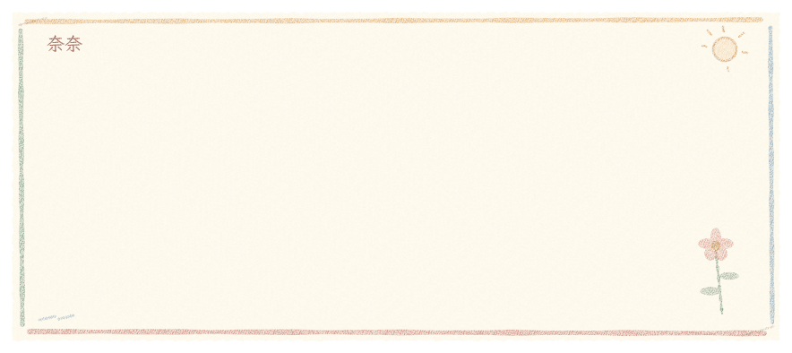

# 皮肤文字过渡与通用呈现遮罩验收

2026-10-18，Windows 实际离屏 GPU 渲染。Linux、macOS 未在本次环境执行。

NanaUI 实现已发布为提交 [`e06201ecd04d44933ca6f390cc45c1110af05580`](https://github.com/sena-nana/NanaUI/commit/e06201ecd04d44933ca6f390cc45c1110af05580)，NanaType 依赖与锁文件固定到该提交。

## 行为与接口

NanaUI 的公共合同为内容无关的 `PresentationMask`：引用现有 `MaterialRef`，提供局部／目标坐标、目标尺寸和有限进度，材质 alpha 作为覆盖率。文字适配层提供逐字时刻及字形坐标；不引入蜡笔专用框架类型或任意子树后处理。未来容器合成结果可以作为单个绘制对象接入相同合同。

蜡笔皮肤逐字斜向擦入 180ms；正文视口整体擦除 320ms；两者分割线均沿左下—右上倾斜 45°，从左上向右下推进，角度使用逻辑像素计算，保留姓名、引用和框体。换句／翻页先擦除旧正文，再启动新正文、音效与标记。输入编辑及退格保持即时，已完成的历史记录不播放退场。



[300px 窄窗动画](crayon-typewriter-narrow.webp)

## 验证证据

固定远端依赖后，NanaType 相关测试共 313 项通过（核心 41、播放 24、主题 50、国际化 3、联机 12、应用 178、集成 5），另有原有 2 项忽略。无本地路径依赖；`cargo metadata` 的来源记录为 `target/transition-dependency-check.json`。

- 播放核心测试覆盖新句事件／音效延迟、清空幂等、连续替换、继续／跳过、分页、过期唤醒、最后一字入场完成以及减少动态效果。退场期间的排队发送不会覆盖已经等待入场的下一句；镜像编辑会取消旧退场并立即删除文字，正文滚动在退场期间保持不变。联机快照另验证年轻接收端时钟下的有限截止时间与已显示范围。
- 蜡笔方向另以真实 WGSL 和生产材质管线检查：160×80 非正方形区域在 1×／2× 下，向下 40px 的分割线交点向左移动 40px，确认左下—右上 45° 倾斜；左上侧先完成、右下侧后完成，进度 0／1 覆盖精确。
- GPU 像素断言覆盖中英文、ruby、描边、彩色 emoji 与行内图片。中性遮罩与原始输出相同；擦除后的左侧覆盖为零，右侧原颜色保持不变，最后无残留。
- 通用材质原有形状／文字、富文本覆盖、纹理替换及无效程序／资源回退测试继续通过。设备重建保留布局与遮罩资源，另检查 2× 绘制。
- 性能测试确认遮罩更新不重新塑形、不栅格化字形、不上传图集、不重建文字实例。有限截止时间结束后停止连续帧。
- 实际动画截图覆盖默认宽度、300px、1×／2×；减少动态效果及关闭高级效果均没有额外退场等待。
- 全部 25 套皮肤重新捕获展示框及历史记录并检查图集；原有 24 套展示框与本次改动前基线逐像素一致。`chat_parity` 检查各皮肤默认／300px 共 50 个布局案例。

构建目录保留本次日志及截图：`target/transition-core-verified.log`、`target/transition-viewport-delivery.log`（NanaUI 仓库）、`target/transition-perf-final.log`（NanaUI 仓库）、`target/transition-device.log`（NanaUI 仓库）、`target/transition-skins`、`target/transition-parity.log`、`target/transition-regression.json`、`target/crayon-transition*`。最终固定依赖测试结果见 `target/transition-final-tests.log`；修正方向后的四种宽度／缩放组合与回退截图见 `target/crayon-transition-final*`，最终交互回归见 `target/transition-final-parity.log`。

## 复现

```powershell
cargo test -p nanatype-core -p nanatype-theme -p nanatype-playback --lib
cargo test -p nanatype --lib --test skin_catalogue --test skin_shaders --test painter_surfaces --test crayon_transition
$env:NANATYPE_TRANSITION_AUDIT='1'
cargo run -p nanatype --example snapshots -- target/crayon-transition nanatype.crayon zh-CN
$env:NANATYPE_TRANSITION_WIDTH='300'
cargo run -p nanatype --example snapshots -- target/crayon-transition-narrow nanatype.crayon zh-CN
$env:NANATYPE_SNAPSHOT_SCALE='2'
cargo run -p nanatype --example snapshots -- target/crayon-transition-narrow2x nanatype.crayon zh-CN
```

`NANATYPE_SNAPSHOT_STATIC=1` 检查减少动态效果，`NANATYPE_SNAPSHOT_MATERIALS_OFF=1` 检查关闭高级效果。完成动画捕获后移除 `NANATYPE_TRANSITION_AUDIT`、宽度和缩放变量，再按[皮肤文档](skins.md)运行全皮肤截图与交互回归。

源资源随皮肤完整导出，旧皮肤无需迁移；用户明确指定的入场预设优先于皮肤自定义入场。已有两仓库无关修改保留。

NanaUI 另通过引擎／包边界检查、打包单元及集成测试（72 项），并使用本机 fixture 完成签名打包、启动自检及六类篡改检查。fixture 使用 debug 构建；原生启动屏幕、安装器与其他平台验收未执行。

## 实现精简复核

2026-10-18：shader 与材质共用片元沙箱校验，展示框与历史文本共用入场配置，退场直接设置剩余时长，材质实例缓存使用二进制 hash。相关 313 项测试再次通过；默认／300px 动画共 44 帧与精简前逐像素一致。提交清单与锁文件另经独立导出树的 `cargo metadata --locked --offline`、格式检查及 `cargo check --locked -p nanatype` 验证，排除原有打包、性能及原生拖动修改。25 套皮肤的默认／300px 共 50 个交互布局案例再次通过。日志：`target/refine-tests.log`、`target/refine-pixel-check.json`、`target/refine-parity.log`。

## 历史记录专项复核

2026-10-18：重新检查蜡笔皮肤的历史实际渲染。气泡使用 `paper.wgsl` 的紧凑参数，保留米白纸面、固定颗粒及四色蜡笔边线，省略展示框的大型花朵与太阳；正文、姓名、引用和注音沿用彩铅材质，显式文字颜色及彩色 emoji 保持原色。

`snapshots` 的 `NANATYPE_TRANSITION_AUDIT=1` 现在同时捕获历史逐字入场，并断言展示框退场的全部关键帧及清空后的历史截图逐像素不变。历史与正文共用 180ms 入场遮罩，分割线沿左下—右上 45°，向右下推进；已完成的历史不播放正文退场。

专项截图覆盖默认宽度及 300px、1×／2×、减少动态效果及关闭高级效果。`chat_parity` 默认／300px 的长姓名、引用、多行和连续记录布局检查通过；入场预设覆盖测试与实际 WGSL 的 1×／2× 方向测试通过。未修改皮肤或生产绘制逻辑。

本地产物：`target/history-crayon-review`、`target/history-crayon-animation*`、`target/history-crayon-parity`；日志分别为同名前缀的 `.log`，测试日志为 `target/history-crayon-tests.log` 和 `target/history-crayon-gpu.log`。沿用上方复现命令即可获得 `history-enter-*`、`history-exit-*` 与 `history-after-clear.png`。

验收实现共用场景初始化、宽度解析及截图读取，直接比较解码后的像素，以清空前的完整历史为基线，同时覆盖清空瞬间、退场过程及清空后的保留行为。截图继续使用框架的颜色转换与 PNG 导出路径。精简后重跑默认／300px、300px 2×、减少动态效果及关闭高级效果共 5 组，225 张关键帧除历史时间标签外与精简前逐像素一致，保留断言全部通过。截图及对比结果位于 `target/history-crayon-refined-final*`，格式及差异检查通过。
